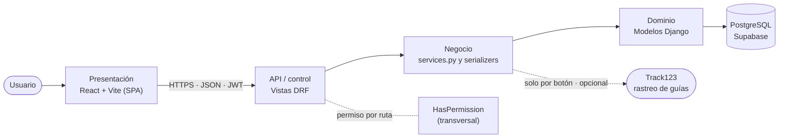
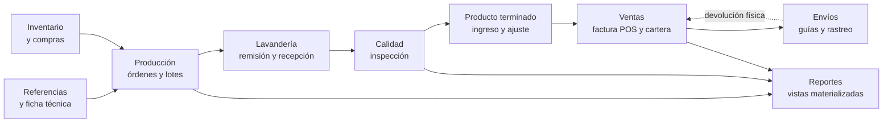
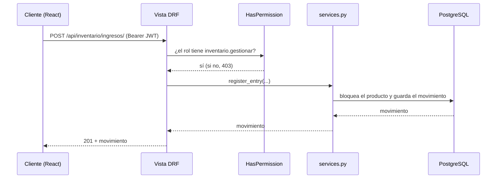

# Arquitectura

TexCore usa una **arquitectura por capas** (cliente-servidor en N capas). El backend sigue el patrón
de Django, MVT, que se parece a MVC; por eso conviene describir el sistema completo como capas.

## Vista general



| Capa | Dónde está | Responsabilidad |
|---|---|---|
| Presentación | Repositorio `TexCoreERP-Frontend` (`src/components`, `src/auth`, `src/api`) | Pantallas y formularios. No decide reglas de negocio. |
| API / control | `apps/*/views.py`, `apps/*/urls.py` | Recibe la petición, comprueba el permiso y delega. |
| Negocio | `apps/*/services.py` (más `costing.py`, `tracking.py`, `monitor.py`, `resources.py`, `remisiones_services.py`, `recepcion_services.py`, `adjustments.py`, `invoicing.py` y `fichas.py` en sus apps), `apps/users/password_reset.py`, serializers | Reglas: stock suficiente, cantidades, NIT, composición textil, delegación de roles, consumo por ficha, estado derivado de lotes, costeo, recepción de mercancía, cotejo de lavandería, facturación y cartera, estados de las guías. |
| Dominio | `apps/*/models.py` | Entidades y restricciones de datos. |
| Persistencia | ORM de Django → PostgreSQL (Supabase) | Almacenamiento. |

### Por qué capas y no MVC "a secas"

- Django es **MVT** (Model, View, Template): su *View* hace de controlador. Aquí la plantilla la sustituye
  una SPA de React que es un proyecto aparte, así que MVC solo describe una parte del sistema.
- Cada capa se cambia y se prueba sin tocar las demás: las pruebas del backend (928) y las funciones puras del frontend no dependen de la interfaz.
- Permite repartir el trabajo (frontend y backend) y cumple el requisito de arquitectura modular (RNF09):
  `users`, `inventory`, `references`, `production`, `purchasing`, `quality`, `finished`, `sales`, `shipping`, `reports` y `core` son módulos independientes y los siguientes se añaden igual.

Correspondencia con el modelo de análisis (interfaz / control / entidad):

| Modelo de análisis | En el código |
|---|---|
| Clase interfaz | Componentes React, por ejemplo `Login.jsx` |
| Clase control | Vista DRF + serializer o servicio |
| Clase entidad | Modelo Django, por ejemplo `CustomUser`, `Producto` |

## Estructura del backend

```
backend/
├── config/        # settings, urls, wsgi/asgi
├── apps/
│   ├── core/       # salud, BaseModel (borrado lógico), permiso HasPermission, comandos generar_erd y seed_demo_completo
│   ├── users/      # usuarios, roles y permisos, recuperación de contraseña
│   ├── inventory/  # proveedores, catálogo, órdenes de salida, kardex, evidencias, alertas, costo promedio
│   ├── purchasing/ # órdenes de compra y recepción de mercancía
│   ├── references/ # referencias de jean (variantes, imágenes) y ficha técnica de consumo
│   ├── production/ # simulación, órdenes y lotes, tiempos, recursos, monitor, costeo y lavandería (remisión de salida y recepción)
│   ├── quality/    # control de calidad: catálogo de defectos, inspecciones y marras
│   ├── finished/   # producto terminado: ingreso de las aptas, existencias por talla y libro de movimientos
│   ├── sales/      # ventas: clientes, precios, factura POS interna (con PDF y anulación), descuento del producto terminado y cartera contraentrega
│   ├── shipping/   # envíos: guías, relaciones de despacho (con PDF), devolución física y rastreo con Track123
│   └── reports/    # reportes gerenciales: dos vistas SQL materializadas de solo lectura (sin tablas propias)
└── docs/          # esta documentación
```

| App | Depende de | Qué aporta |
|---|---|---|
| `core` | — | `BaseModel` (borrado lógico), `HasPermission`, endpoints de salud, RLS de Supabase |
| `users` | `core` | Usuarios, roles y permisos (catálogo y migraciones con la matriz inicial) |
| `inventory` | `core`, `references` | Existencias, kardex, consecutivos (`OP`, `LV`, `TEL`...), costo promedio y foto de costo |
| `references` | `core`, `inventory` | Referencias, variantes, ficha técnica (lee el catálogo de inventario) |
| `production` | `core`, `inventory`, `references` | Órdenes y lotes (descuentan stock vía `inventory.services`), etapas, recursos, monitor, costeo y lavandería: recetas de lavado, remisiones de salida `REM-LAV` y recepciones `REC-LAV` (usan el proveedor y el consecutivo de `inventory`; el lote lleva su `estado_inventario`: planta, en tránsito o retornado) |
| `purchasing` | `core`, `inventory` | Órdenes de compra; recibir mercancía reutiliza `inventory.services.register_entry` |
| `quality` | `core`, `inventory`, `production` | Defectos, inspecciones y marras de los lotes que vuelven de lavandería; lee los lotes y la recepción de lavandería de `production` y reutiliza los consecutivos de `inventory` |
| `finished` | `core`, `inventory`, `references`, `production`, `quality` | Ingreso de las aptas de una inspección al inventario final, existencias por talla y color y libro de movimientos; lee `Inspeccion` de `quality`, `Lote` y `LoteTalla` de `production`, `Variante` de `references` y reutiliza el consecutivo y el estado de la orden de salida de `inventory` |
| `sales` | `core`, `inventory`, `references`, `finished` | Clientes, precios por referencia y factura POS interna (no electrónica) con su PDF (reportlab) y su anulación; al facturar descuenta el stock y escribe en el libro de `finished` (`SALIDA_VENTA` y `DEVOLUCION_VENTA`) reutilizando sus servicios de bloqueo de saldos, y el consecutivo y el formato de error de `inventory` |
| `reports` | `core`, `inventory`, `references`, `sales` | Dos vistas SQL materializadas (`reportes_mv_produccion_ordenes` y `reportes_mv_ventas_referencias`, creadas por su migración `0001`) mapeadas como modelos de solo lectura (`managed = False`), y el servicio que las filtra y agrega: indicadores de producción, calidad y ventas. Lee además el saldo financiero de `sales` y los catálogos de `inventory`, `references` y `sales` para los filtros |
| `shipping` | `core`, `inventory`, `sales` | Guías de envío de las facturas con su semáforo y su historial, relaciones de despacho `RD-0001` con PDF (reportlab), devolución física (reutiliza `reconcile_collection` de `sales`, que reingresa el stock) y rastreo opcional de Interrapidísimo con la API de Track123 (`track123.py` es el cliente HTTP y `tracking.py` aplica la respuesta); reutiliza el consecutivo y el formato de error de `inventory` |

`quality` depende de `production` (lee `Lote` y `RecepcionLote`, y no modifica ninguno); nada de `production` depende de `quality`. `inventory` y `references` se conocen entre sí: la orden de salida apunta a una referencia y la ficha técnica lee el catálogo de productos. `finished` depende de `quality` (lee la inspección y no la modifica) y de `production` (lee el lote y lo planificado por talla), y nada de ellas depende de `finished`. `sales` depende de `finished` (usa su libro y su bloqueo de saldos); la única referencia en sentido contrario es la llave foránea opcional `MovimientoTerminado.factura`, declarada con el nombre `"sales.FacturaVenta"` para no importar el modelo. `production` y `purchasing` solo consumen a `inventory` a través de sus servicios, nunca escriben saldos por su cuenta. `shipping` depende de `sales` (la guía apunta a la factura y la devolución usa su conciliación de cartera) y `sales` llama a `shipping.services` para crear la guía al facturar y para anular la guía al anular la factura; ese sentido contrario se resuelve con un import local dentro de la función, y `sales` solo lee la guía vigente para mostrarla en la factura (campo `guia`). `FacturaVenta.transportadora` y `numero_guia` son el espejo de la guía vigente y solo los escribe el servicio de guías. `reports` solo lee: cruza por SQL las tablas de producción, calidad, referencias y ventas, y ninguna otra app depende de ella. La lavandería vive dentro de `production` (no es una app aparte): `quality` lee sus recepciones para saber qué lotes inspeccionar.

El recorrido de la prenda atraviesa los módulos en este orden (las flechas indican quién entrega a quién):



Cada app separa sus responsabilidades en `models.py`, `serializers.py`, `views.py`, `urls.py` y,
cuando hay reglas de negocio, `services.py`. En `production` el motor de costeo (`costing.py`), el control de tiempos
(`tracking.py`), el tablero (`monitor.py`) y los recursos (`resources.py`) son módulos de funciones sin dependencia de la vista,
para probarlos por separado. Cada app guarda sus constantes en `catalog.py`.

Las tablas llevan el prefijo de su módulo: `seguridad_`, `inventario_`, `referencias_`, `produccion_` (incluye las de lavandería), `compras_`, `calidad_`, `terminado_`, `ventas_` y `envios_`
(ver [convenciones](convenciones-base-de-datos.md)). Son 54 tablas en 9 apps; los reportes agregan dos vistas SQL `reportes_mv_*` que no son tablas de modelo.

## Patrones que se repiten

Estos patrones están en el código y las pruebas los cubren; conviene seguirlos al agregar un módulo.

| Patrón | Dónde se ve | Para qué |
|---|---|---|
| **Capa de servicios**: la vista valida el permiso y el formato, y delega en una función de `services.py` (o de un módulo equivalente) | `inventory.services.register_entry`, `sales.invoicing.issue_invoice`, `production.remisiones_services`, `production.recepcion_services`, `shipping.services` | Las reglas se prueban sin pasar por HTTP y se reutilizan entre módulos (compras recibe con la misma función del ingreso; la devolución de Envíos usa la conciliación de Ventas). |
| **Transacción única por operación** (`transaction.atomic`) | Orden de producción, remisión y recepción de lavandería, factura, ajuste, relación de despacho, recepción de mercancía | Todo se guarda o nada: si falta stock o una línea es inválida no queda un documento a medias ni se gasta el consecutivo. |
| **Bloqueo de filas con `select_for_update`** | Saldos de inventario, saldos de producto terminado (`lock_stock`, en orden de id para evitar bloqueos cruzados), lotes y remisiones de lavandería, factura y saldo financiero al conciliar, consecutivos | Dos usuarios o dos clics simultáneos no pueden dejar un saldo negativo ni usar el mismo número. |
| **Idempotencia por token**: el formulario genera un UUID y la base lo exige único | `token` de la factura (`uq_ventas_factura_token`), del ajuste (`uq_terminado_ajuste_token`) y de la relación de despacho (`uq_envios_relacion_token`) | Un doble clic o un reintento responde `409` con el documento ya creado en vez de duplicarlo. |
| **Consecutivos legibles** (`Consecutivo`, con prefijo y año cuando aplica) | `OP-0001`, `REM-LAV-2026-0001`, `REC-LAV-2026-0001`, `FV-0001`, `RD-0001`, `AJT-0001`... | Identificadores únicos que se generan dentro de la transacción. |
| **Historial y libros de solo inserción** | Kardex, libro de producto terminado, eventos de etapa, historial de guías, movimientos de cartera | Lo pasado no se edita: un error se corrige con un registro nuevo (ajuste, anulación, devolución). |
| **Restricciones en la base, no solo en el código** | Aptas + marras = recibidas, saldo después = saldo antes + cantidad, una guía vigente por factura, las cuentas de la factura cuadran | Aunque una vista falle, la base rechaza el dato incoherente. |
| **Integración externa aislada y opcional** | `shipping/track123.py` (cliente HTTP con el transporte inyectable) y `shipping/tracking.py` (aplica la respuesta) | Una falla del tercero responde `503` y nada más se bloquea; las pruebas reemplazan el transporte y jamás llaman a la API real. |
| **Lectura analítica separada de la transaccional** | `reports`: vistas SQL materializadas | Los cruces pesados de varias tablas no cargan las tablas de negocio; en SQLite (local y pruebas) son vistas normales. |
| **Falla cerrado** | `HasPermission` | Una ruta sin `required_permissions` niega el acceso. |

## Flujo de una petición



Las reglas de negocio fallan con un error 400 `{campo: [mensaje]}` que la interfaz muestra junto al campo.

## Seguridad

- **Autenticación JWT** (simplejwt): `access` de 15 minutos y `refresh` rotativo de 30 minutos, así la sesión vence
  tras 30 minutos sin uso. Cambiar la contraseña invalida las sesiones abiertas.
- **Permiso por ruta** (RNF01): `HasPermission` es el permiso por defecto de toda la API. Cada vista declara
  `required_permissions`; una vista sin declararlo queda **cerrada** (falla cerrado). Las rutas públicas
  (login, registro, recuperación, salud) lo declaran explícitamente.
- **RBAC**: los roles tienen permisos `<modulo>.ver` y `<modulo>.gestionar`; `ADMIN` los tiene todos.
- **Delegación segura**: quien gestiona usuarios sin ser administrador no puede crear administradores
  ni asignar roles con permisos de Seguridad (corrección del BUG-01 de QA).
- **Límites de frecuencia**: login 10/min por IP; registro 20/hora; recuperación 5/hora por IP y 3 correos/hora por usuario.
- **Base de datos**: después de cada migración se activa RLS sin privilegios para los roles de la API de Supabase.

## Decisiones de diseño

| Decisión | Motivo |
|---|---|
| Borrado lógico (`deleted_at`) en todas las tablas de negocio | Conservar el historial y la trazabilidad (ver [convenciones](convenciones-base-de-datos.md)). |
| El stock solo cambia con movimientos (kardex) | Cada cambio queda con saldo antes y después, usuario y fecha. |
| Código consecutivo por categoría (`TEL-0001`, `OP-0002`...) | Identificadores legibles y únicos, generados dentro de una transacción. |
| Imagen de referencia del producto guardada en la base | El disco de Render es efímero; en la base no se pierde. Se sirve con sesión y `ETag`. |
| Tipo de archivo decidido por su contenido (firma binaria) | No confiar en el nombre ni en el tipo que declare el navegador. |
| Metadatos del catálogo servidos por la API (`/api/inventario/metadatos/`, `/api/referencias/metadatos/`, `/api/compras/metadatos/`) | El frontend no duplica categorías, unidades, estados ni reglas. |
| Estado de lotes y órdenes de producción calculado, no guardado | Sale de las etapas y de la anulación; así nunca queda desincronizado (ver [módulos](modulos.md)). |
| Tiempo neto con intervalos (`acumulado_s` + `reanudada_at`) | Las pausas no cuentan y no hace falta recorrer el historial para calcularlo. |
| Historial que solo crece: eventos de etapa, asignaciones y tarifas de mano de obra | Trazabilidad: lo pasado no se edita; un cambio abre un registro nuevo. |
| Foto del costo unitario en cada línea de la orden de salida | La liquidación usa el costo con que salió el material, aunque el promedio cambie después. |
| Costo promedio ponderado móvil por producto | Costear con un solo valor por material sin guardar capas de compras. |
| Orden de producción, lotes y descuento de stock en una sola transacción | Si falta material no queda nada ni se gasta el consecutivo. |
| Recepción de mercancía en una sola transacción, con tolerancia de 5 % | Una fila con error no deja recepciones a medias; el proveedor a veces envía de más. |
| Operarios y máquinas como catálogo simple, sin cuenta de usuario | Los operarios no usan el sistema; «ocupado» se calcula con las etapas en curso. |
| Inspección de calidad inalterable, una por lote, con el nombre y el tipo del defecto copiados en cada línea | La inspección es un registro de auditoría: renombrar o desactivar un defecto después no cambia el historial, y la suma aptas + marras = recibidas la respalda una restricción de la base. |
| Saldo de producto terminado por variante y libro de movimientos de solo inserción (`terminado_`) | Cada cambio del saldo es una fila nueva con saldo antes y después, escrita en la misma transacción que el saldo; una restricción de la base exige `saldo_después = saldo_antes + cantidad`. Así el saldo siempre es la suma del libro y los ajustes manuales (HU 6.3) y las ventas (HU 7.1: `SALIDA_VENTA` y, al anular, `DEVOLUCION_VENTA`) escriben en el mismo libro sin tocar este diseño. |
| Factura POS interna inalterable, que se anula y no se edita (`ventas_`) | Es un comprobante propio, no una factura electrónica (el alcance excluye la DIAN y la contabilidad). Guarda copia del cliente, el precio, el descuento y el IVA del momento, así que cambiar precios o datos después no la toca; anular reingresa las unidades por el libro y no reutiliza el número. |
| Montos de la factura calculados solo en el servidor, en pesos enteros con redondeo de mitad hacia arriba | La factura es la suma de sus líneas y restricciones de la base exigen que las cuentas cuadren; lo que muestra la pantalla es una vista previa. |
| Token único por formulario de venta | Un doble clic o un reintento no factura dos veces: el segundo envío responde `409` con el número ya creado. |
| Descuento del vendedor con tope por tipo de cliente y piso en el costo de fábrica | La empresa deja decidir al vendedor sin vender por debajo del costo; el tope sale del tipo de cliente (Detal 5 %, Mayorista 15 %, Distribuidor 20 %). |
| Guía de envío con máquina de estados, una sola guía vigente por factura e historial de solo inserción (`envios_`) | Las transiciones permitidas están en una tabla (`catalog.TRANSITIONS`) y todo cambio deja un evento con su origen (manual, Track123 o sistema). Reemplazar una guía no borra la anterior: pasa a `ANULADA`. Índices únicos parciales impiden dos guías vigentes por factura o el mismo número en dos facturas. |
| Relación de despacho atómica con token | Todas las guías pasan a `EN_TRANSITO` en una transacción o ninguna, y el consecutivo `RD` no se gasta si algo falla; un doble clic responde `409` con la relación ya creada. |
| Rastreo con Track123 solo por botón, con la cuota cuidada y sin bloquear nada | El plan tiene pocos registros de guías nuevas: registrar gasta cuota, consultar no. Por eso nunca es automático, hay enfriamiento por guía, una reserva de cuota y la última respuesta queda guardada y se reutiliza. Una falla de la API (503) deja la guía como estaba: vender y despachar no dependen de un tercero. La clave sale de variables de entorno, nunca del repositorio. |
| Lote con estado de inventario (`PLANTA`, `EN_TRANSITO`, `RETORNADO`) y remisión que lo saca de la planta | Un lote que ya salió no se puede remitir de nuevo (solo se remiten los que están en la planta); la recepción lo devuelve a la planta con solo las prendas conformes y liquida la pérdida de las mermas y dañadas. |
| Cartera contraentrega conciliada una sola vez, con saldo financiero y libro de movimientos (`ventas_saldo_financiero`, `ventas_movimiento_cartera`) | La transportadora recauda y gira después: conciliar como pagada suma el recaudo a la caja; como devolución reingresa las prendas y no mueve el saldo. Un estado final no se revierte. |
| Reportes sobre vistas SQL materializadas, refrescadas al consultar | El tablero gerencial cruza producción, calidad y ventas sin sobrecargar las tablas de negocio; cada consulta en PostgreSQL refresca las vistas antes de leer, y existe una ruta para forzar el refresco. |
| Siembra de demostración opcional al desplegar (`SEED_DEMO_ON_DEPLOY`) | Deja datos simulados en todos los módulos tras el `migrate`, sin duplicar ni borrar, y un fallo de la siembra no impide el arranque (ver [despliegue](despliegue-render.md)). |
| Ingreso de producto terminado único por inspección, con la suma por talla igual a las aptas | Evita ingresar dos veces las mismas prendas; lo planificado por talla solo se guarda como dato de comparación. |
| Permisos propios para fichas técnicas y compras (`fichas_tecnicas.*`, `compras.aprobar`) | Separar quién diseña, quién aprueba y quién recibe. |

!!! warning "Limitaciones conocidas"
    - Las evidencias (foto o PDF) se guardan en el disco del servicio y se pierden al redesplegar en Render (plan gratuito).
    - El bloqueo de cuenta al tercer intento fallido (RF01) y un registro de auditoría general (RNF02) están pendientes.
    - Desarrollo y producción comparten hoy la misma base de datos.
    - Lavandería: algunos valores salen fijos del código y no de la base (tarifa base de 3.500 por prenda cuando la receta no la trae, costo por prenda de 35.000 en la liquidación de pérdidas si no se envía, y tarifa, tiempo y calificación que muestra el listado de lavanderías). La historia TE-172 del Sprint 4 (lavandería confiable, sin datos simulados) apunta a eliminarlos.
    - Reportes: el tablero filtra por fecha, tipo de jean, referencia y estados, pero no por vendedor ni cliente concreto (RF27, TE-177), y el detalle de ventas se limita a las 250 líneas más recientes.
