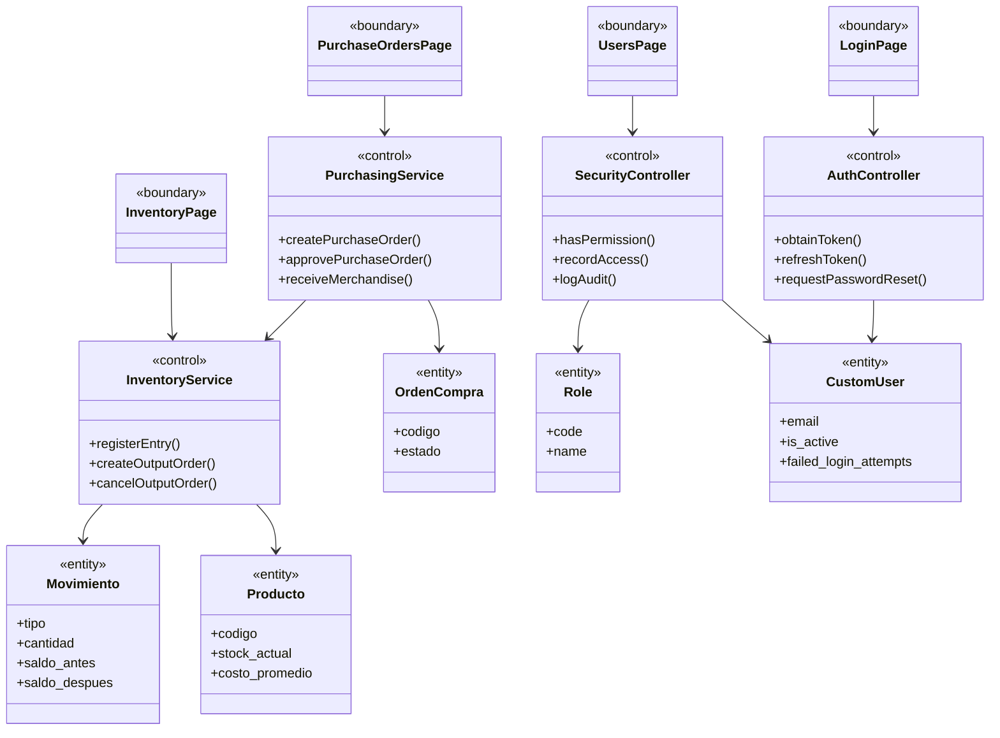
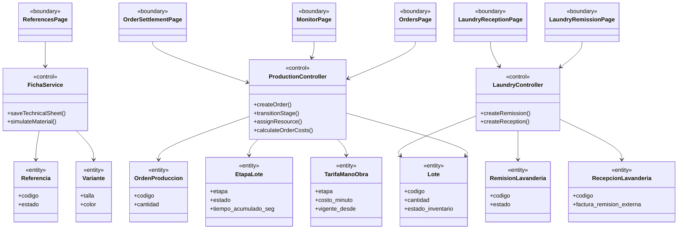
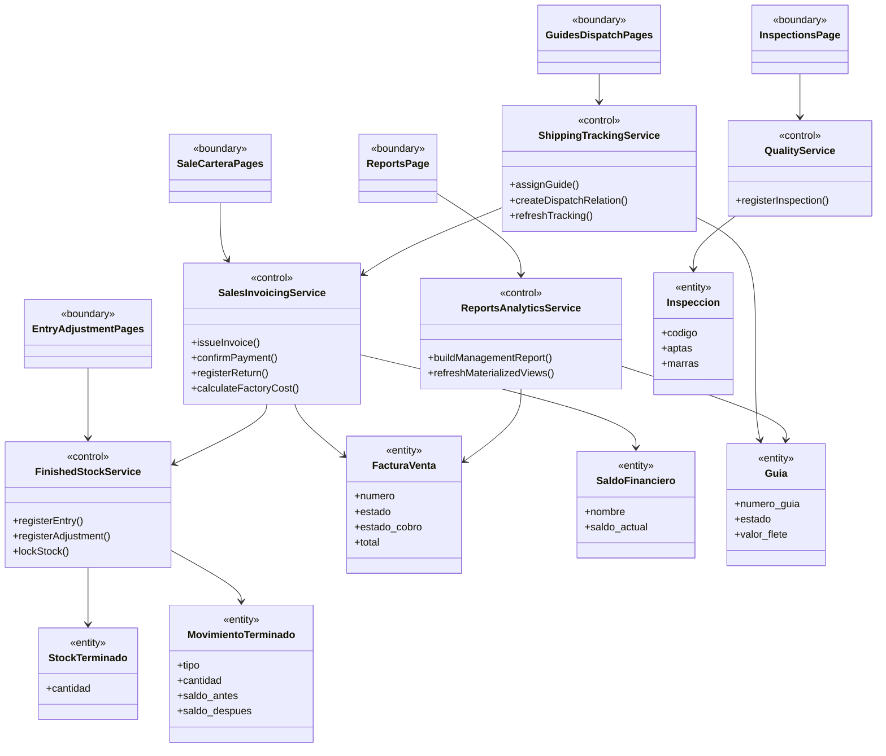

# Diagrama de clases de análisis (H07)

Modelo de análisis **Interfaz (`<<boundary>>`) – Control (`<<control>>`) – Entidad (`<<entity>>`)** para todos los módulos de negocio de TexCore ERP, con su correspondencia verificada frente a las clases reales en React (Frontend) y Django / DRF (Backend).

---

## 1. Seguridad, Inventario y Compras

---

## 2. Referencias, Producción y Lavandería

---

## 3. Calidad, Producto Terminado, Ventas, Envíos y Reportes

---

## 4. Correspondencia exacta con el código del sistema

| Módulo | Clases Interfaz (`frontend/src/components/`) | Clases Control (`backend/apps/*/views.py`, `services.py`) | Clases Entidad (`backend/apps/*/models.py`) |
|---|---|---|---|
| **Seguridad (`users`)** | `Login.jsx`, `UsersPage.jsx`, `RolesPage.jsx`, `AccessLogsPage.jsx`, `AuditLogsPage.jsx` | `CustomTokenObtainPairView`, `UserListCreateView`, `HasPermission`, `password_reset` | `CustomUser`, `Role`, `ModulePermission`, `RolePermission`, `TokenRecuperacion`, `Acceso`, `Auditoria` |
| **Inventario (`inventory`)** | `InventoryPage.jsx`, `CatalogPage.jsx`, `SuppliersPage.jsx` | `IngresoView`, `OrdenSalidaListCreateView`, `inventory.services` | `Proveedor`, `Producto`, `Movimiento`, `OrdenSalida`, `OrdenLinea`, `Evidencia`, `Consecutivo` |
| **Compras (`purchasing`)** | `PurchaseOrdersPage.jsx`, `MerchandiseReceptionPage.jsx` | `OrdenCompraListCreateView`, `OrdenCompraAprobarView`, `purchasing.services` | `OrdenCompra`, `OrdenCompraLinea`, `RecepcionCompra`, `RecepcionCompraLinea` |
| **Referencias (`references`)** | `ReferencesPage.jsx`, `FichaModal.jsx` | `ReferenciaListCreateView`, `FichaTecnicaView`, `fichas.py` | `Referencia`, `Variante`, `ReferenciaImagen`, `FichaTecnica`, `FichaTecnicaLinea` |
| **Producción (`production`)** | `OrdersPage.jsx`, `MonitorPage.jsx`, `ResourcesPage.jsx`, `OrderSettlementPage.jsx` | `OrdenProduccionListCreateView`, `LoteAccionView`, `OrdenProduccionCostosView`, `tracking.py`, `costing.py`, `monitor.py`, `resources.py` | `OrdenProduccion`, `Lote`, `LoteTalla`, `EtapaLote`, `EventoEtapa`, `Operario`, `Maquina`, `AsignacionEtapa`, `TarifaManoObra` |
| **Lavandería (`production`)** | `LaundryRemissionPage.jsx`, `LaundryReceptionPage.jsx` | `RemisionLavanderiaListCreateView`, `RecepcionLavanderiaListCreateView`, `remisiones_services.py`, `recepcion_services.py` | `RecetaLavado`, `RemisionLavanderia`, `RemisionLote`, `RecepcionLavanderia`, `RecepcionLote` |
| **Calidad (`quality`)** | `DefectsPage.jsx`, `InspectionsPage.jsx` | `DefectoListCreateView`, `InspeccionListCreateView`, `quality.services` | `TipoDefecto`, `Inspeccion`, `MarraDetalle` |
| **Producto Terminado (`finished`)** | `EntryPage.jsx`, `StockPage.jsx`, `AdjustmentPage.jsx`, `MovementsPage.jsx` | `IngresoListCreateView`, `AjusteListCreateView`, `finished.services`, `adjustments.py` | `IngresoTerminado`, `IngresoLinea`, `StockTerminado`, `MovimientoTerminado`, `AjusteTerminado`, `AjusteLinea` |
| **Ventas y Cartera (`sales`)** | `SalesPanel.jsx`, `SalePage.jsx`, `InvoicesPage.jsx`, `CarteraPage.jsx`, `PricesPage.jsx`, `ClientsPage.jsx` | `FacturaListCreateView`, `FacturaConciliarView`, `PrecioAplicarCostoView`, `sales.invoicing`, `sales.pricing` | `Cliente`, `PrecioReferencia`, `HistorialPrecioReferencia`, `FacturaVenta`, `DetalleVenta`, `SaldoFinanciero`, `MovimientoCartera` |
| **Envíos (`shipping`)** | `ShippingPanel.jsx`, `GuidesPage.jsx`, `PendingPage.jsx`, `DispatchPage.jsx` | `GuiaRastrearView`, `RelacionListCreateView`, `shipping.services`, `tracking.py`, `track123.py` | `RelacionDespacho`, `Guia`, `EventoGuia` |
| **Reportes (`reports`)** | `ReportsPage.jsx` | `ReporteGerencialView`, `ReporteRefrescarVistasView`, `reports.services` | `VistaProduccionOrden`, `VistaVentasReferencia` *(vistas SQL `managed = False`)* |
