# Modelo de datos

> Generado automáticamente con `python manage.py generar_erd --salida docs/modelo-de-datos.md`.
> No lo edites a mano: vuelve a generarlo cuando cambie un modelo.

El modelo tiene **54 tablas** de negocio en 9 módulos, más dos vistas materializadas de reportes. Todas las tablas de negocio heredan de `BaseModel` y por eso incluyen además `created_at`, `updated_at` y `deleted_at` (borrado lógico; ver [convenciones de base de datos](convenciones-base-de-datos.md)). Esas columnas no se repiten abajo.

## Cómo leer este modelo

El modelo se presenta en tres niveles, de lo general a lo particular:

1. **[Mapa de módulos](#mapa-de-modulos)** y **[mapa general de tablas](#mapa-general-de-tablas)**: primero los módulos y sus dependencias; luego solo las entidades y sus relaciones, agrupadas por módulo. Sirven para ver cómo se conectan las aplicaciones entre sí.
2. **[Diagramas por módulo](#diagramas-por-modulo)**: las tablas de cada módulo con sus columnas, y las tablas de otros módulos con las que se relacionan (mostradas solo con su clave).
3. **[Detalle por tabla](#tablas)**: cada campo con su tipo, restricciones y relación.

Además, la sección [Vistas materializadas de reportes](#vistas-materializadas-de-reportes) describe las vistas analíticas de la aplicación `reports`, que no son modelos de Django.

Cada diagrama se publica como imagen (SVG, ampliable con clic) y también como código Mermaid, que el sitio dibuja en el navegador. Para regenerarlo, desde `backend`:

```bash
python manage.py generar_erd --salida docs/modelo-de-datos.md --mermaid-dir <carpeta temporal>
# imagen de cada diagrama (mermaid-cli):
#   mmdc -i <carpeta>/mapa-modulos.mmd -o docs/img/mapa-modulos.svg
```

## Mapa de módulos

Un nodo por módulo y una flecha por cada par de módulos con dependencia por clave foránea; va del módulo referenciado al que guarda la clave y se rotula con el número de relaciones. Se excluyen las relaciones hacia `CustomUser` (seguridad), que casi todos los módulos usan para registrar responsables; por eso Usuarios y seguridad aparece sin flechas.

[](img/mapa-modulos.svg){ target=_blank }

[Abrir imagen SVG](img/mapa-modulos.svg){ target=_blank } · [Descargar PNG](img/mapa-modulos.png)

??? note "Ver como código Mermaid (se dibuja en el navegador)"

    ```mermaid
    flowchart TB
        m_seguridad["Usuarios y seguridad<br/>(6 tablas)"]
        m_inventario["Inventario<br/>(7 tablas)"]
        m_compras["Compras<br/>(4 tablas)"]
        m_referencias["Referencias<br/>(5 tablas)"]
        m_produccion["Producción y lavandería<br/>(14 tablas)"]
        m_calidad["Calidad<br/>(3 tablas)"]
        m_terminado["Producto terminado<br/>(6 tablas)"]
        m_ventas["Ventas y cartera<br/>(6 tablas)"]
        m_envios["Envíos<br/>(3 tablas)"]
        m_calidad -->|"1 relación"| m_terminado
        m_inventario -->|"5 relaciones"| m_compras
        m_inventario -->|"2 relaciones"| m_produccion
        m_inventario -->|"1 relación"| m_referencias
        m_produccion -->|"2 relaciones"| m_calidad
        m_produccion -->|"2 relaciones"| m_terminado
        m_referencias -->|"1 relación"| m_inventario
        m_referencias -->|"2 relaciones"| m_produccion
        m_referencias -->|"4 relaciones"| m_terminado
        m_referencias -->|"2 relaciones"| m_ventas
        m_ventas -->|"1 relación"| m_envios
        m_ventas -->|"1 relación"| m_terminado
    ```

## Mapa general de tablas

Cada flecha va de la tabla referenciada a la tabla que guarda la clave foránea. Para que sea legible se omiten las relaciones con `CustomUser` (responsable, creador, etc.) que salen de casi todos los módulos; están en el detalle por tabla y en el diagrama completo.

[](img/mapa-general.svg){ target=_blank }

[Abrir imagen SVG](img/mapa-general.svg){ target=_blank } · [Descargar PNG](img/mapa-general.png)

??? note "Ver como código Mermaid (se dibuja en el navegador)"

    ```mermaid
    flowchart TB
        subgraph sg_seguridad["Usuarios y seguridad"]
            ModulePermission
            Role
            RolePermission
            CustomUser
            AccessLog
            PasswordResetToken
        end
        subgraph sg_inventario["Inventario"]
            Consecutivo
            Proveedor
            Producto
            OrdenSalida
            OrdenLinea
            Movimiento
            Evidencia
        end
        subgraph sg_compras["Compras"]
            OrdenCompra
            LineaCompra
            Recepcion
            RecepcionLinea
        end
        subgraph sg_referencias["Referencias"]
            Referencia
            Variante
            ImagenReferencia
            FichaTecnica
            FichaLinea
        end
        subgraph sg_produccion["Producción y lavandería"]
            OrdenProduccion
            Lote
            LoteTalla
            EtapaLote
            EventoEtapa
            TarifaManoObra
            Operario
            Maquina
            AsignacionEtapa
            RecetaLavado
            RemisionLavanderia
            RemisionLote
            RecepcionLavanderia
            RecepcionLote
        end
        subgraph sg_calidad["Calidad"]
            TipoDefecto
            Inspeccion
            MarraDetalle
        end
        subgraph sg_terminado["Producto terminado"]
            StockTerminado
            IngresoTerminado
            IngresoLinea
            AjusteTerminado
            AjusteLinea
            MovimientoTerminado
        end
        subgraph sg_ventas["Ventas y cartera"]
            Cliente
            PrecioReferencia
            FacturaVenta
            DetalleVenta
            SaldoFinanciero
            MovimientoCartera
        end
        subgraph sg_envios["Envíos"]
            RelacionDespacho
            Guia
            EventoGuia
        end
        AjusteTerminado --> AjusteLinea
        AjusteTerminado --> MovimientoTerminado
        Cliente --> FacturaVenta
        CustomUser --> AccessLog
        CustomUser --> PasswordResetToken
        CustomUser --> RolePermission
        EtapaLote --> AsignacionEtapa
        EtapaLote --> EventoEtapa
        FacturaVenta --> DetalleVenta
        FacturaVenta --> Guia
        FacturaVenta --> MovimientoCartera
        FacturaVenta --> MovimientoTerminado
        FichaTecnica --> FichaLinea
        Guia --> EventoGuia
        IngresoTerminado --> IngresoLinea
        IngresoTerminado --> MovimientoTerminado
        Inspeccion --> IngresoTerminado
        Inspeccion --> MarraDetalle
        LineaCompra --> RecepcionLinea
        Lote --> EtapaLote
        Lote --> IngresoTerminado
        Lote --> Inspeccion
        Lote --> LoteTalla
        Lote --> MovimientoTerminado
        Lote --> RecepcionLote
        Lote --> RemisionLote
        Maquina --> AsignacionEtapa
        ModulePermission --> RolePermission
        Movimiento --> Evidencia
        Movimiento --> RecepcionLinea
        Operario --> AsignacionEtapa
        OrdenCompra --> LineaCompra
        OrdenCompra --> Recepcion
        OrdenProduccion --> Lote
        OrdenSalida --> Evidencia
        OrdenSalida --> Movimiento
        OrdenSalida --> OrdenLinea
        OrdenSalida --> OrdenProduccion
        Producto --> FichaLinea
        Producto --> LineaCompra
        Producto --> Movimiento
        Producto --> OrdenLinea
        Producto --> OrdenSalida
        Producto --> RecepcionLinea
        Proveedor --> Movimiento
        Proveedor --> OrdenCompra
        Proveedor --> Recepcion
        Proveedor --> RemisionLavanderia
        Recepcion --> RecepcionLinea
        RecepcionLavanderia --> RecepcionLote
        RecepcionLote --> Inspeccion
        RecetaLavado --> RemisionLote
        Referencia --> FichaTecnica
        Referencia --> ImagenReferencia
        Referencia --> OrdenProduccion
        Referencia --> OrdenSalida
        Referencia --> PrecioReferencia
        Referencia --> Variante
        RelacionDespacho --> Guia
        RemisionLavanderia --> RecepcionLavanderia
        RemisionLavanderia --> RemisionLote
        RemisionLote --> RecepcionLote
        Role --> CustomUser
        Role --> RolePermission
        TipoDefecto --> MarraDetalle
        Variante --> AjusteLinea
        Variante --> DetalleVenta
        Variante --> IngresoLinea
        Variante --> LoteTalla
        Variante --> MovimientoTerminado
        Variante --> StockTerminado
    ```

## Diagramas por módulo

### Usuarios y seguridad

Tablas: `ModulePermission`, `Role`, `RolePermission`, `CustomUser`, `AccessLog`, `PasswordResetToken`.

[](img/modulo-seguridad.svg){ target=_blank }

[Abrir imagen SVG](img/modulo-seguridad.svg){ target=_blank } · [Descargar PNG](img/modulo-seguridad.png)

??? note "Ver como código Mermaid (se dibuja en el navegador)"

    ```mermaid
    erDiagram
        ModulePermission {
            bigint id PK
            varchar_60 code UK
            varchar_120 name
            varchar_40 module
            varchar_255 description
        }
        Role {
            bigint id PK
            varchar_20 code UK
            varchar_60 name
            varchar_255 description
            boolean is_system
        }
        RolePermission {
            bigint id PK
            bigint role FK
            bigint permission FK
            timestamp granted_at
            bigint granted_by FK
        }
        CustomUser {
            bigint id PK
            varchar_128 password
            timestamp last_login
            boolean is_superuser
            varchar_150 username UK
            varchar_150 first_name
            varchar_150 last_name
            varchar_254 email
            boolean is_staff
            boolean is_active
            timestamp date_joined
            varchar_20 role FK
            varchar_20 requested_area FK
            varchar_20 document_id
        }
        AccessLog {
            bigint id PK
            bigint user FK
            varchar_254 email
            varchar_20 event
            inet ip
            varchar_300 forwarded
            varchar_255 user_agent
        }
        PasswordResetToken {
            bigint id PK
            bigint user FK
            varchar_64 token_hash UK
            varchar_10 purpose
            timestamp expires_at
            timestamp used_at
            inet requested_ip
        }
        CustomUser |o--o{ AccessLog : "user"
        CustomUser |o--o{ RolePermission : "granted_by"
        CustomUser ||--o{ PasswordResetToken : "user"
        ModulePermission ||--o{ RolePermission : "permission"
        Role |o--o{ CustomUser : "requested_area"
        Role ||--o{ CustomUser : "role"
        Role ||--o{ RolePermission : "role"
    ```

### Inventario

Tablas: `Consecutivo`, `Proveedor`, `Producto`, `OrdenSalida`, `OrdenLinea`, `Movimiento`, `Evidencia`.

Relaciones con otros módulos (solo clave): `Referencia` (Referencias), `FichaLinea` (Referencias), `OrdenProduccion` (Producción y lavandería), `RemisionLavanderia` (Producción y lavandería), `OrdenCompra` (Compras), `LineaCompra` (Compras), `Recepcion` (Compras), `RecepcionLinea` (Compras).

[](img/modulo-inventario.svg){ target=_blank }

[Abrir imagen SVG](img/modulo-inventario.svg){ target=_blank } · [Descargar PNG](img/modulo-inventario.png)

??? note "Ver como código Mermaid (se dibuja en el navegador)"

    ```mermaid
    erDiagram
        Consecutivo {
            bigint id PK
            varchar_10 clave UK
            int ultimo
        }
        Proveedor {
            bigint id PK
            varchar_10 nit
            varchar_1 nit_dv
            varchar_150 razon_social
            varchar_20 categoria
            varchar_120 contacto
            varchar_20 telefono
            varchar_120 correo
            varchar_80 ciudad
            varchar_200 direccion
        }
        Producto {
            bigint id PK
            varchar_20 codigo
            varchar_150 nombre
            varchar_15 tipo
            varchar_20 categoria
            varchar_10 unidad
            decimal_12_2 stock_actual
            decimal_12_2 stock_minimo
            decimal_14_4 costo_promedio
            varchar_255 descripcion
            decimal_4_2 ancho_util
            varchar_60 color
            varchar_120 composicion
            bytea imagen
            varchar_20 imagen_tipo
            int imagen_version
        }
        OrdenSalida {
            bigint id PK
            varchar_20 codigo
            varchar_12 tipo
            varchar_12 estado
            date fecha_salida
            varchar_120 responsable
            varchar_120 destino
            bigint referencia FK
            varchar_60 ficha_tecnica
            bigint producto_resultado FK
            decimal_12_2 cantidad_prendas
            text observaciones
            bigint registrado_por FK
            timestamp completada_at
            timestamp anulada_at
            varchar_255 motivo_anulacion
        }
        OrdenLinea {
            bigint id PK
            bigint orden FK
            bigint producto FK
            decimal_12_2 cantidad
            decimal_14_4 costo_unitario
        }
        Movimiento {
            bigint id PK
            bigint producto FK
            varchar_8 tipo
            varchar_15 motivo
            decimal_12_2 cantidad
            decimal_14_4 costo_unitario
            decimal_12_2 stock_antes
            decimal_12_2 stock_despues
            date fecha
            bigint proveedor FK
            varchar_150 proveedor_nombre
            varchar_40 orden_compra
            varchar_60 lote
            bigint orden FK
            text observaciones
            bigint registrado_por FK
        }
        Evidencia {
            bigint id PK
            bigint movimiento FK
            bigint orden FK
            varchar archivo
            varchar_120 nombre_original
            varchar_40 content_type
            int tamano
            bigint subido_por FK
        }
        Referencia {
            bigint id PK
        }
        FichaLinea {
            bigint id PK
        }
        OrdenProduccion {
            bigint id PK
        }
        RemisionLavanderia {
            bigint id PK
        }
        OrdenCompra {
            bigint id PK
        }
        LineaCompra {
            bigint id PK
        }
        Recepcion {
            bigint id PK
        }
        RecepcionLinea {
            bigint id PK
        }
        Movimiento |o--o{ Evidencia : "movimiento"
        Movimiento ||--o{ RecepcionLinea : "movimiento"
        OrdenSalida |o--o{ Evidencia : "orden"
        OrdenSalida |o--o{ Movimiento : "orden"
        OrdenSalida ||--o{ OrdenLinea : "orden"
        OrdenSalida ||--o{ OrdenProduccion : "orden_salida"
        Producto ||--o{ FichaLinea : "producto"
        Producto ||--o{ LineaCompra : "producto"
        Producto ||--o{ Movimiento : "producto"
        Producto ||--o{ OrdenLinea : "producto"
        Producto ||--o{ OrdenSalida : "producto_resultado"
        Producto ||--o{ RecepcionLinea : "producto"
        Proveedor |o--o{ Movimiento : "proveedor"
        Proveedor ||--o{ OrdenCompra : "proveedor"
        Proveedor ||--o{ Recepcion : "proveedor"
        Proveedor ||--o{ RemisionLavanderia : "lavanderia"
        Referencia |o--o{ OrdenSalida : "referencia"
    ```

### Compras

Tablas: `OrdenCompra`, `LineaCompra`, `Recepcion`, `RecepcionLinea`.

Relaciones con otros módulos (solo clave): `Proveedor` (Inventario), `Producto` (Inventario), `Movimiento` (Inventario).

[](img/modulo-compras.svg){ target=_blank }

[Abrir imagen SVG](img/modulo-compras.svg){ target=_blank } · [Descargar PNG](img/modulo-compras.png)

??? note "Ver como código Mermaid (se dibuja en el navegador)"

    ```mermaid
    erDiagram
        OrdenCompra {
            bigint id PK
            varchar_20 codigo
            bigint proveedor FK
            date fecha
            date fecha_esperada
            varchar_120 condiciones_pago
            varchar_500 notas
            varchar_16 estado
            bigint creado_por FK
            bigint aprobado_por FK
            timestamp aprobada_at
            varchar_255 motivo_cierre
            timestamp cerrada_at
        }
        LineaCompra {
            bigint id PK
            bigint orden FK
            bigint producto FK
            decimal_12_2 cantidad_pedida
            decimal_14_4 precio_pactado
        }
        Recepcion {
            bigint id PK
            varchar_20 codigo
            bigint orden FK
            bigint proveedor FK
            varchar_40 documento
            date fecha
            varchar_500 observaciones
            bigint recibido_por FK
        }
        RecepcionLinea {
            bigint id PK
            bigint recepcion FK
            bigint linea_compra FK
            bigint producto FK
            bigint movimiento FK, UK
            decimal_12_2 cantidad
            varchar_60 lote
            decimal_14_4 costo_unitario
        }
        Proveedor {
            bigint id PK
        }
        Producto {
            bigint id PK
        }
        Movimiento {
            bigint id PK
        }
        LineaCompra |o--o{ RecepcionLinea : "linea_compra"
        Movimiento ||--o{ RecepcionLinea : "movimiento"
        OrdenCompra |o--o{ Recepcion : "orden"
        OrdenCompra ||--o{ LineaCompra : "orden"
        Producto ||--o{ LineaCompra : "producto"
        Producto ||--o{ RecepcionLinea : "producto"
        Proveedor ||--o{ OrdenCompra : "proveedor"
        Proveedor ||--o{ Recepcion : "proveedor"
        Recepcion ||--o{ RecepcionLinea : "recepcion"
    ```

### Referencias

Tablas: `Referencia`, `Variante`, `ImagenReferencia`, `FichaTecnica`, `FichaLinea`.

Relaciones con otros módulos (solo clave): `OrdenSalida` (Inventario), `Producto` (Inventario), `OrdenProduccion` (Producción y lavandería), `LoteTalla` (Producción y lavandería), `StockTerminado` (Producto terminado), `IngresoLinea` (Producto terminado), `AjusteLinea` (Producto terminado), `MovimientoTerminado` (Producto terminado), `PrecioReferencia` (Ventas y cartera), `DetalleVenta` (Ventas y cartera).

[](img/modulo-referencias.svg){ target=_blank }

[Abrir imagen SVG](img/modulo-referencias.svg){ target=_blank } · [Descargar PNG](img/modulo-referencias.png)

??? note "Ver como código Mermaid (se dibuja en el navegador)"

    ```mermaid
    erDiagram
        Referencia {
            bigint id PK
            varchar_20 codigo
            varchar_150 nombre
            varchar_500 descripcion
            varchar_15 ajuste
            varchar_15 estado
            bigint creado_por FK
        }
        Variante {
            bigint id PK
            bigint referencia FK
            varchar_10 talla
            varchar_60 color
        }
        ImagenReferencia {
            bigint id PK
            bigint referencia FK
            bytea imagen
            varchar_20 tipo
            int version
            boolean principal
        }
        FichaTecnica {
            bigint id PK
            bigint referencia FK
            varchar_15 lavado
            varchar_500 notas
            bigint actualizado_por FK
            bytea documento
            varchar_120 documento_nombre
            int documento_tamano
            int documento_version
        }
        FichaLinea {
            bigint id PK
            bigint ficha FK
            bigint producto FK
            decimal_10_3 cantidad
            decimal_5_2 merma
            varchar_120 observaciones
        }
        OrdenSalida {
            bigint id PK
        }
        Producto {
            bigint id PK
        }
        OrdenProduccion {
            bigint id PK
        }
        LoteTalla {
            bigint id PK
        }
        StockTerminado {
            bigint id PK
        }
        IngresoLinea {
            bigint id PK
        }
        AjusteLinea {
            bigint id PK
        }
        MovimientoTerminado {
            bigint id PK
        }
        PrecioReferencia {
            bigint id PK
        }
        DetalleVenta {
            bigint id PK
        }
        FichaTecnica ||--o{ FichaLinea : "ficha"
        Producto ||--o{ FichaLinea : "producto"
        Referencia |o--o{ OrdenSalida : "referencia"
        Referencia ||--o{ FichaTecnica : "referencia"
        Referencia ||--o{ ImagenReferencia : "referencia"
        Referencia ||--o{ OrdenProduccion : "referencia"
        Referencia ||--o{ PrecioReferencia : "referencia"
        Referencia ||--o{ Variante : "referencia"
        Variante ||--o{ AjusteLinea : "variante"
        Variante ||--o{ DetalleVenta : "variante"
        Variante ||--o{ IngresoLinea : "variante"
        Variante ||--o{ LoteTalla : "variante"
        Variante ||--o{ MovimientoTerminado : "variante"
        Variante ||--o{ StockTerminado : "variante"
    ```

### Producción y lavandería

Tablas: `OrdenProduccion`, `Lote`, `LoteTalla`, `EtapaLote`, `EventoEtapa`, `TarifaManoObra`, `Operario`, `Maquina`, `AsignacionEtapa`, `RecetaLavado`, `RemisionLavanderia`, `RemisionLote`, `RecepcionLavanderia`, `RecepcionLote`.

Relaciones con otros módulos (solo clave): `OrdenSalida` (Inventario), `Referencia` (Referencias), `Variante` (Referencias), `Proveedor` (Inventario), `Inspeccion` (Calidad), `IngresoTerminado` (Producto terminado), `MovimientoTerminado` (Producto terminado).

[](img/modulo-produccion.svg){ target=_blank }

[Abrir imagen SVG](img/modulo-produccion.svg){ target=_blank } · [Descargar PNG](img/modulo-produccion.png)

??? note "Ver como código Mermaid (se dibuja en el navegador)"

    ```mermaid
    erDiagram
        OrdenProduccion {
            bigint id PK
            bigint orden_salida FK, UK
            varchar_20 codigo
            bigint referencia FK
            int cantidad
            bigint creado_por FK
        }
        Lote {
            bigint id PK
            bigint orden FK
            positivesmallinteger numero
            varchar_24 codigo
            int cantidad
            varchar_20 estado_inventario
        }
        LoteTalla {
            bigint id PK
            bigint lote FK
            bigint variante FK
            varchar_10 talla
            varchar_60 color
            int cantidad
        }
        EtapaLote {
            bigint id PK
            bigint lote FK
            varchar_16 etapa
            positivesmallinteger secuencia
            varchar_10 estado
            timestamp inicio_at
            timestamp fin_at
            timestamp reanudada_at
            int acumulado_s
            bigint responsable FK
        }
        EventoEtapa {
            bigint id PK
            bigint etapa_lote FK
            varchar_10 accion
            varchar_10 de_estado
            varchar_10 a_estado
            bigint usuario FK
            timestamp momento
            varchar_255 nota
        }
        TarifaManoObra {
            bigint id PK
            varchar_16 etapa
            decimal_12_4 costo_minuto
            date vigente_desde
            bigint creado_por FK
        }
        Operario {
            bigint id PK
            varchar_20 codigo
            varchar_120 nombres
            varchar_20 documento
            json etapas
            varchar_8 tipo_pago
            boolean activo
            bigint usuario FK
        }
        Maquina {
            bigint id PK
            varchar_20 codigo
            varchar_14 tipo
            varchar_120 marca_modelo
            varchar_60 serial
            varchar_80 ubicacion
            varchar_14 estado
            json etapas
            varchar_255 observaciones
            boolean activo
        }
        AsignacionEtapa {
            bigint id PK
            bigint etapa_lote FK
            bigint operario FK
            bigint maquina FK
            timestamp inicio_at
            timestamp fin_at
            bigint asignada_por FK
        }
        RecetaLavado {
            bigint id PK
            varchar_20 codigo
            varchar_150 nombre
            varchar_100 categoria
            text descripcion
            varchar_40 temperatura_proceso
            int duracion_horas
            decimal_12_2 tarifa_sugerida
        }
        RemisionLavanderia {
            bigint id PK
            varchar_30 codigo
            date fecha_emision
            date fecha_entrega_estimada
            bigint lavanderia FK
            varchar_150 transportador_nombre
            varchar_30 vehiculo_placa
            int tulas_bultos
            decimal_10_2 peso_kg
            decimal_14_2 costo_estimado
            varchar_20 estado
            text observaciones
            bigint responsable FK
            bigint creado_por FK
        }
        RemisionLote {
            bigint id PK
            bigint remision FK
            bigint lote FK
            int cantidad
            bigint receta FK
            varchar_150 receta_nombre
            text instrucciones_especiales
        }
        RecepcionLavanderia {
            bigint id PK
            varchar_30 codigo
            bigint remision FK
            varchar_60 factura_remision_externa
            date fecha_recepcion
            int total_enviado
            int total_recibido_conforme
            int total_merma
            int total_danadas
            decimal_14_2 costo_total_perdida
            decimal_14_2 costo_servicio_lavado
            varchar_20 estado
            text observaciones
            bigint responsable FK
            bigint creado_por FK
        }
        RecepcionLote {
            bigint id PK
            bigint recepcion FK
            bigint remision_lote FK
            bigint lote FK
            int cantidad_enviada
            int cantidad_recibida_conforme
            int cantidad_merma
            int cantidad_danada
            varchar_200 motivo_merma
            varchar_200 tipo_dano
            decimal_12_2 costo_unitario_prenda
            decimal_14_2 costo_perdida
            text observaciones
        }
        OrdenSalida {
            bigint id PK
        }
        Referencia {
            bigint id PK
        }
        Variante {
            bigint id PK
        }
        Proveedor {
            bigint id PK
        }
        Inspeccion {
            bigint id PK
        }
        IngresoTerminado {
            bigint id PK
        }
        MovimientoTerminado {
            bigint id PK
        }
        EtapaLote ||--o{ AsignacionEtapa : "etapa_lote"
        EtapaLote ||--o{ EventoEtapa : "etapa_lote"
        Lote |o--o{ MovimientoTerminado : "lote"
        Lote ||--o{ EtapaLote : "lote"
        Lote ||--o{ IngresoTerminado : "lote"
        Lote ||--o{ Inspeccion : "lote"
        Lote ||--o{ LoteTalla : "lote"
        Lote ||--o{ RecepcionLote : "lote"
        Lote ||--o{ RemisionLote : "lote"
        Maquina |o--o{ AsignacionEtapa : "maquina"
        Operario |o--o{ AsignacionEtapa : "operario"
        OrdenProduccion ||--o{ Lote : "orden"
        OrdenSalida ||--o{ OrdenProduccion : "orden_salida"
        Proveedor ||--o{ RemisionLavanderia : "lavanderia"
        RecepcionLavanderia ||--o{ RecepcionLote : "recepcion"
        RecepcionLote ||--o{ Inspeccion : "recepcion_lote"
        RecetaLavado |o--o{ RemisionLote : "receta"
        Referencia ||--o{ OrdenProduccion : "referencia"
        RemisionLavanderia ||--o{ RecepcionLavanderia : "remision"
        RemisionLavanderia ||--o{ RemisionLote : "remision"
        RemisionLote ||--o{ RecepcionLote : "remision_lote"
        Variante ||--o{ LoteTalla : "variante"
    ```

### Calidad

Tablas: `TipoDefecto`, `Inspeccion`, `MarraDetalle`.

Relaciones con otros módulos (solo clave): `Lote` (Producción y lavandería), `RecepcionLote` (Producción y lavandería), `IngresoTerminado` (Producto terminado).

[](img/modulo-calidad.svg){ target=_blank }

[Abrir imagen SVG](img/modulo-calidad.svg){ target=_blank } · [Descargar PNG](img/modulo-calidad.png)

??? note "Ver como código Mermaid (se dibuja en el navegador)"

    ```mermaid
    erDiagram
        TipoDefecto {
            bigint id PK
            varchar_20 codigo
            varchar_80 nombre
            varchar_255 descripcion
            boolean corregible
            boolean activo
        }
        Inspeccion {
            bigint id PK
            varchar_20 codigo
            bigint lote FK
            bigint recepcion_lote FK
            int cantidad_recibida
            int aptas
            int marras
            varchar_500 observaciones
            bigint inspector FK
            date fecha
        }
        MarraDetalle {
            bigint id PK
            bigint inspeccion FK
            bigint tipo_defecto FK
            varchar_80 defecto_nombre
            boolean corregible
            int cantidad
            varchar_255 nota
        }
        Lote {
            bigint id PK
        }
        RecepcionLote {
            bigint id PK
        }
        IngresoTerminado {
            bigint id PK
        }
        Inspeccion ||--o{ IngresoTerminado : "inspeccion"
        Inspeccion ||--o{ MarraDetalle : "inspeccion"
        Lote ||--o{ Inspeccion : "lote"
        RecepcionLote ||--o{ Inspeccion : "recepcion_lote"
        TipoDefecto ||--o{ MarraDetalle : "tipo_defecto"
    ```

### Producto terminado

Tablas: `StockTerminado`, `IngresoTerminado`, `IngresoLinea`, `AjusteTerminado`, `AjusteLinea`, `MovimientoTerminado`.

Relaciones con otros módulos (solo clave): `Variante` (Referencias), `Inspeccion` (Calidad), `Lote` (Producción y lavandería), `FacturaVenta` (Ventas y cartera).

[](img/modulo-terminado.svg){ target=_blank }

[Abrir imagen SVG](img/modulo-terminado.svg){ target=_blank } · [Descargar PNG](img/modulo-terminado.png)

??? note "Ver como código Mermaid (se dibuja en el navegador)"

    ```mermaid
    erDiagram
        StockTerminado {
            bigint id PK
            bigint variante FK
            int cantidad
        }
        IngresoTerminado {
            bigint id PK
            varchar_20 codigo
            bigint inspeccion FK
            bigint lote FK
            int aptas
            varchar_80 ubicacion
            varchar_500 observaciones
            bigint recibido_por FK
            date fecha
        }
        IngresoLinea {
            bigint id PK
            bigint ingreso FK
            bigint variante FK
            varchar_10 talla
            varchar_60 color
            int cantidad
            int planificada
        }
        AjusteTerminado {
            bigint id PK
            varchar_20 codigo
            varchar_20 motivo
            varchar_500 observacion
            bigint realizado_por FK
            date fecha
            uuid token
            int unidades_faltantes
            int unidades_sobrantes
        }
        AjusteLinea {
            bigint id PK
            bigint ajuste FK
            bigint variante FK
            varchar_10 talla
            varchar_60 color
            int stock_antes
            int stock_contado
            int diferencia
        }
        MovimientoTerminado {
            bigint id PK
            bigint variante FK
            varchar_20 tipo
            int cantidad
            int saldo_antes
            int saldo_despues
            bigint ingreso FK
            bigint ajuste FK
            bigint factura FK
            bigint lote FK
            bigint usuario FK
            varchar_255 motivo
        }
        Variante {
            bigint id PK
        }
        Inspeccion {
            bigint id PK
        }
        Lote {
            bigint id PK
        }
        FacturaVenta {
            bigint id PK
        }
        AjusteTerminado |o--o{ MovimientoTerminado : "ajuste"
        AjusteTerminado ||--o{ AjusteLinea : "ajuste"
        FacturaVenta |o--o{ MovimientoTerminado : "factura"
        IngresoTerminado |o--o{ MovimientoTerminado : "ingreso"
        IngresoTerminado ||--o{ IngresoLinea : "ingreso"
        Inspeccion ||--o{ IngresoTerminado : "inspeccion"
        Lote |o--o{ MovimientoTerminado : "lote"
        Lote ||--o{ IngresoTerminado : "lote"
        Variante ||--o{ AjusteLinea : "variante"
        Variante ||--o{ IngresoLinea : "variante"
        Variante ||--o{ MovimientoTerminado : "variante"
        Variante ||--o{ StockTerminado : "variante"
    ```

### Ventas y cartera

Tablas: `Cliente`, `PrecioReferencia`, `FacturaVenta`, `DetalleVenta`, `SaldoFinanciero`, `MovimientoCartera`.

Relaciones con otros módulos (solo clave): `MovimientoTerminado` (Producto terminado), `Referencia` (Referencias), `Variante` (Referencias), `Guia` (Envíos).

[](img/modulo-ventas.svg){ target=_blank }

[Abrir imagen SVG](img/modulo-ventas.svg){ target=_blank } · [Descargar PNG](img/modulo-ventas.png)

??? note "Ver como código Mermaid (se dibuja en el navegador)"

    ```mermaid
    erDiagram
        Cliente {
            bigint id PK
            varchar_20 codigo
            varchar_3 tipo_documento
            varchar_20 documento
            varchar_1 dv
            varchar_150 nombre
            varchar_12 tipo
            varchar_80 ciudad
            varchar_200 direccion
            varchar_20 telefono
            varchar_120 correo
            boolean activo
        }
        PrecioReferencia {
            bigint id PK
            bigint referencia FK
            positivebiginteger costo_fabrica
            positivebiginteger precio_detal
            positivebiginteger precio_mayorista
            bigint actualizado_por FK
        }
        FacturaVenta {
            bigint id PK
            varchar_20 numero
            bigint cliente FK
            varchar_150 cliente_nombre
            varchar_40 cliente_documento
            varchar_12 cliente_tipo
            varchar_80 cliente_ciudad
            varchar_200 cliente_direccion
            varchar_20 cliente_telefono
            bigint vendedor FK
            date fecha
            varchar_10 estado
            varchar_15 modalidad_pago
            varchar_12 estado_cobro
            varchar_16 transportadora
            varchar_40 numero_guia
            varchar_500 observaciones
            positivebiginteger subtotal
            positivebiginteger descuento_total
            positivebiginteger base_gravable
            positivesmallinteger iva_tarifa
            positivebiginteger iva_total
            positivebiginteger total
            positivebiginteger valor_a_recaudar
            uuid token
            varchar_255 motivo_anulacion
            bigint anulada_por FK
            timestamp anulada_en
            timestamp fecha_cobro
            bigint cobrado_por FK
            varchar_255 motivo_devolucion
        }
        DetalleVenta {
            bigint id PK
            bigint factura FK
            bigint variante FK
            varchar_20 referencia_codigo
            varchar_150 referencia_nombre
            varchar_10 talla
            varchar_60 color
            int cantidad
            positivebiginteger precio_unitario
            positivesmallinteger descuento_pct
            positivebiginteger costo_fabrica
            positivebiginteger subtotal
            positivebiginteger descuento
            positivebiginteger base
            positivebiginteger iva
            positivebiginteger total
        }
        SaldoFinanciero {
            bigint id PK
            varchar_100 nombre
            bigint saldo_actual
        }
        MovimientoCartera {
            bigint id PK
            bigint factura FK
            varchar_20 tipo
            bigint monto
            bigint saldo_antes
            bigint saldo_despues
            bigint usuario FK
            varchar_255 observaciones
        }
        MovimientoTerminado {
            bigint id PK
        }
        Referencia {
            bigint id PK
        }
        Variante {
            bigint id PK
        }
        Guia {
            bigint id PK
        }
        Cliente ||--o{ FacturaVenta : "cliente"
        FacturaVenta |o--o{ MovimientoTerminado : "factura"
        FacturaVenta ||--o{ DetalleVenta : "factura"
        FacturaVenta ||--o{ Guia : "factura"
        FacturaVenta ||--o{ MovimientoCartera : "factura"
        Referencia ||--o{ PrecioReferencia : "referencia"
        Variante ||--o{ DetalleVenta : "variante"
    ```

### Envíos

Tablas: `RelacionDespacho`, `Guia`, `EventoGuia`.

Relaciones con otros módulos (solo clave): `FacturaVenta` (Ventas y cartera).

[](img/modulo-envios.svg){ target=_blank }

[Abrir imagen SVG](img/modulo-envios.svg){ target=_blank } · [Descargar PNG](img/modulo-envios.png)

??? note "Ver como código Mermaid (se dibuja en el navegador)"

    ```mermaid
    erDiagram
        RelacionDespacho {
            bigint id PK
            varchar_20 codigo
            varchar_16 transportadora
            date fecha
            varchar_120 responsable
            varchar_255 observaciones
            uuid token
            bigint creada_por FK
        }
        Guia {
            bigint id PK
            bigint factura FK
            varchar_16 transportadora
            varchar_40 numero_guia
            varchar_14 estado
            boolean vigente
            bigint relacion FK
            varchar_255 novedad
            bigint valor_flete
            bigint flete_vendedor
            timestamp despachada_en
            timestamp entregada_en
            timestamp devuelta_en
            boolean rastreo_registrado
            varchar_20 rastreo_estado
            varchar_30 rastreo_subestado
            timestamp rastreo_consultado_en
            timestamp rastreo_proxima_consulta
            json rastreo_respuesta
            boolean rastreo_sintetico
        }
        EventoGuia {
            bigint id PK
            bigint guia FK
            varchar_14 estado_antes
            varchar_14 estado_despues
            varchar_255 nota
            varchar_10 origen
            bigint usuario FK
        }
        FacturaVenta {
            bigint id PK
        }
        FacturaVenta ||--o{ Guia : "factura"
        Guia ||--o{ EventoGuia : "guia"
        RelacionDespacho |o--o{ Guia : "relacion"
    ```

## Vistas materializadas de reportes

La aplicación `reports` consulta dos vistas SQL creadas por la migración `0001_vistas_materializadas` (en PostgreSQL son `MATERIALIZED VIEW`; en SQLite, vistas estándar). Son de solo lectura y no tienen modelo de negocio. Las columnas se leen del SQL de la migración.

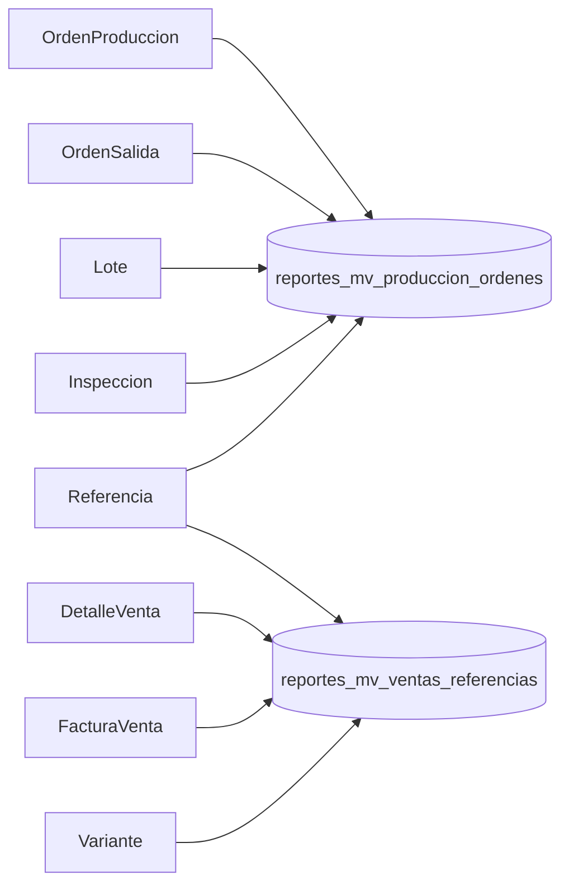

### `reportes_mv_produccion_ordenes`

Fila consolidada de una orden de producción en la vista materializada `reportes_mv_produccion_ordenes`.

Se alimenta de: `produccion_orden` (OrdenProduccion), `inventario_orden` (OrdenSalida), `referencias_referencia` (Referencia), `produccion_lote` (Lote), `calidad_inspeccion` (Inspeccion).

| Columna | Tipo |
|---|---|
| `orden_id` | bigint |
| `codigo` | varchar(20) |
| `fecha_salida` | date |
| `estado_orden` | varchar(12) |
| `responsable` | varchar(120) |
| `referencia_id` | bigint |
| `referencia_codigo` | varchar(20) |
| `referencia_nombre` | varchar(150) |
| `tipo_jean` | varchar(15) |
| `prendas_planificadas` | int |
| `total_lotes` | int |
| `prendas_en_lotes` | int |
| `prendas_aptas` | int |
| `prendas_marras` | int |

### `reportes_mv_ventas_referencias`

Fila pre-agregada de ventas por factura y referencia de jean en la vista materializada `reportes_mv_ventas_referencias`.

Se alimenta de: `ventas_factura_linea` (DetalleVenta), `ventas_factura` (FacturaVenta), `referencias_variante` (Variante), `referencias_referencia` (Referencia).

| Columna | Tipo |
|---|---|
| `linea_id` | bigint |
| `factura_id` | bigint |
| `numero_factura` | varchar(20) |
| `fecha` | date |
| `estado_factura` | varchar(10) |
| `estado_cobro` | varchar(12) |
| `cliente_tipo` | varchar(12) |
| `cliente_nombre` | varchar(150) |
| `transportadora` | varchar(16) |
| `referencia_id` | bigint |
| `referencia_codigo` | varchar(20) |
| `referencia_nombre` | varchar(150) |
| `tipo_jean` | varchar(15) |
| `talla` | varchar(10) |
| `color` | varchar(60) |
| `unidades` | int |
| `subtotal` | bigint |
| `descuento` | bigint |
| `base_gravable` | bigint |
| `iva` | bigint |
| `total` | bigint |
| `costo_estimado` | bigint |

## Diagrama entidad-relación completo

Todas las tablas con todas sus columnas en un solo diagrama.

```mermaid
erDiagram
    ModulePermission {
        bigint id PK
        varchar_60 code UK
        varchar_120 name
        varchar_40 module
        varchar_255 description
    }
    Role {
        bigint id PK
        varchar_20 code UK
        varchar_60 name
        varchar_255 description
        boolean is_system
    }
    RolePermission {
        bigint id PK
        bigint role FK
        bigint permission FK
        timestamp granted_at
        bigint granted_by FK
    }
    CustomUser {
        bigint id PK
        varchar_128 password
        timestamp last_login
        boolean is_superuser
        varchar_150 username UK
        varchar_150 first_name
        varchar_150 last_name
        varchar_254 email
        boolean is_staff
        boolean is_active
        timestamp date_joined
        varchar_20 role FK
        varchar_20 requested_area FK
        varchar_20 document_id
    }
    AccessLog {
        bigint id PK
        bigint user FK
        varchar_254 email
        varchar_20 event
        inet ip
        varchar_300 forwarded
        varchar_255 user_agent
    }
    PasswordResetToken {
        bigint id PK
        bigint user FK
        varchar_64 token_hash UK
        varchar_10 purpose
        timestamp expires_at
        timestamp used_at
        inet requested_ip
    }
    Consecutivo {
        bigint id PK
        varchar_10 clave UK
        int ultimo
    }
    Proveedor {
        bigint id PK
        varchar_10 nit
        varchar_1 nit_dv
        varchar_150 razon_social
        varchar_20 categoria
        varchar_120 contacto
        varchar_20 telefono
        varchar_120 correo
        varchar_80 ciudad
        varchar_200 direccion
    }
    Producto {
        bigint id PK
        varchar_20 codigo
        varchar_150 nombre
        varchar_15 tipo
        varchar_20 categoria
        varchar_10 unidad
        decimal_12_2 stock_actual
        decimal_12_2 stock_minimo
        decimal_14_4 costo_promedio
        varchar_255 descripcion
        decimal_4_2 ancho_util
        varchar_60 color
        varchar_120 composicion
        bytea imagen
        varchar_20 imagen_tipo
        int imagen_version
    }
    OrdenSalida {
        bigint id PK
        varchar_20 codigo
        varchar_12 tipo
        varchar_12 estado
        date fecha_salida
        varchar_120 responsable
        varchar_120 destino
        bigint referencia FK
        varchar_60 ficha_tecnica
        bigint producto_resultado FK
        decimal_12_2 cantidad_prendas
        text observaciones
        bigint registrado_por FK
        timestamp completada_at
        timestamp anulada_at
        varchar_255 motivo_anulacion
    }
    OrdenLinea {
        bigint id PK
        bigint orden FK
        bigint producto FK
        decimal_12_2 cantidad
        decimal_14_4 costo_unitario
    }
    Movimiento {
        bigint id PK
        bigint producto FK
        varchar_8 tipo
        varchar_15 motivo
        decimal_12_2 cantidad
        decimal_14_4 costo_unitario
        decimal_12_2 stock_antes
        decimal_12_2 stock_despues
        date fecha
        bigint proveedor FK
        varchar_150 proveedor_nombre
        varchar_40 orden_compra
        varchar_60 lote
        bigint orden FK
        text observaciones
        bigint registrado_por FK
    }
    Evidencia {
        bigint id PK
        bigint movimiento FK
        bigint orden FK
        varchar archivo
        varchar_120 nombre_original
        varchar_40 content_type
        int tamano
        bigint subido_por FK
    }
    Referencia {
        bigint id PK
        varchar_20 codigo
        varchar_150 nombre
        varchar_500 descripcion
        varchar_15 ajuste
        varchar_15 estado
        bigint creado_por FK
    }
    Variante {
        bigint id PK
        bigint referencia FK
        varchar_10 talla
        varchar_60 color
    }
    ImagenReferencia {
        bigint id PK
        bigint referencia FK
        bytea imagen
        varchar_20 tipo
        int version
        boolean principal
    }
    FichaTecnica {
        bigint id PK
        bigint referencia FK
        varchar_15 lavado
        varchar_500 notas
        bigint actualizado_por FK
        bytea documento
        varchar_120 documento_nombre
        int documento_tamano
        int documento_version
    }
    FichaLinea {
        bigint id PK
        bigint ficha FK
        bigint producto FK
        decimal_10_3 cantidad
        decimal_5_2 merma
        varchar_120 observaciones
    }
    OrdenProduccion {
        bigint id PK
        bigint orden_salida FK, UK
        varchar_20 codigo
        bigint referencia FK
        int cantidad
        bigint creado_por FK
    }
    Lote {
        bigint id PK
        bigint orden FK
        positivesmallinteger numero
        varchar_24 codigo
        int cantidad
        varchar_20 estado_inventario
    }
    LoteTalla {
        bigint id PK
        bigint lote FK
        bigint variante FK
        varchar_10 talla
        varchar_60 color
        int cantidad
    }
    EtapaLote {
        bigint id PK
        bigint lote FK
        varchar_16 etapa
        positivesmallinteger secuencia
        varchar_10 estado
        timestamp inicio_at
        timestamp fin_at
        timestamp reanudada_at
        int acumulado_s
        bigint responsable FK
    }
    EventoEtapa {
        bigint id PK
        bigint etapa_lote FK
        varchar_10 accion
        varchar_10 de_estado
        varchar_10 a_estado
        bigint usuario FK
        timestamp momento
        varchar_255 nota
    }
    TarifaManoObra {
        bigint id PK
        varchar_16 etapa
        decimal_12_4 costo_minuto
        date vigente_desde
        bigint creado_por FK
    }
    Operario {
        bigint id PK
        varchar_20 codigo
        varchar_120 nombres
        varchar_20 documento
        json etapas
        varchar_8 tipo_pago
        boolean activo
        bigint usuario FK
    }
    Maquina {
        bigint id PK
        varchar_20 codigo
        varchar_14 tipo
        varchar_120 marca_modelo
        varchar_60 serial
        varchar_80 ubicacion
        varchar_14 estado
        json etapas
        varchar_255 observaciones
        boolean activo
    }
    AsignacionEtapa {
        bigint id PK
        bigint etapa_lote FK
        bigint operario FK
        bigint maquina FK
        timestamp inicio_at
        timestamp fin_at
        bigint asignada_por FK
    }
    RecetaLavado {
        bigint id PK
        varchar_20 codigo
        varchar_150 nombre
        varchar_100 categoria
        text descripcion
        varchar_40 temperatura_proceso
        int duracion_horas
        decimal_12_2 tarifa_sugerida
    }
    RemisionLavanderia {
        bigint id PK
        varchar_30 codigo
        date fecha_emision
        date fecha_entrega_estimada
        bigint lavanderia FK
        varchar_150 transportador_nombre
        varchar_30 vehiculo_placa
        int tulas_bultos
        decimal_10_2 peso_kg
        decimal_14_2 costo_estimado
        varchar_20 estado
        text observaciones
        bigint responsable FK
        bigint creado_por FK
    }
    RemisionLote {
        bigint id PK
        bigint remision FK
        bigint lote FK
        int cantidad
        bigint receta FK
        varchar_150 receta_nombre
        text instrucciones_especiales
    }
    RecepcionLavanderia {
        bigint id PK
        varchar_30 codigo
        bigint remision FK
        varchar_60 factura_remision_externa
        date fecha_recepcion
        int total_enviado
        int total_recibido_conforme
        int total_merma
        int total_danadas
        decimal_14_2 costo_total_perdida
        decimal_14_2 costo_servicio_lavado
        varchar_20 estado
        text observaciones
        bigint responsable FK
        bigint creado_por FK
    }
    RecepcionLote {
        bigint id PK
        bigint recepcion FK
        bigint remision_lote FK
        bigint lote FK
        int cantidad_enviada
        int cantidad_recibida_conforme
        int cantidad_merma
        int cantidad_danada
        varchar_200 motivo_merma
        varchar_200 tipo_dano
        decimal_12_2 costo_unitario_prenda
        decimal_14_2 costo_perdida
        text observaciones
    }
    OrdenCompra {
        bigint id PK
        varchar_20 codigo
        bigint proveedor FK
        date fecha
        date fecha_esperada
        varchar_120 condiciones_pago
        varchar_500 notas
        varchar_16 estado
        bigint creado_por FK
        bigint aprobado_por FK
        timestamp aprobada_at
        varchar_255 motivo_cierre
        timestamp cerrada_at
    }
    LineaCompra {
        bigint id PK
        bigint orden FK
        bigint producto FK
        decimal_12_2 cantidad_pedida
        decimal_14_4 precio_pactado
    }
    Recepcion {
        bigint id PK
        varchar_20 codigo
        bigint orden FK
        bigint proveedor FK
        varchar_40 documento
        date fecha
        varchar_500 observaciones
        bigint recibido_por FK
    }
    RecepcionLinea {
        bigint id PK
        bigint recepcion FK
        bigint linea_compra FK
        bigint producto FK
        bigint movimiento FK, UK
        decimal_12_2 cantidad
        varchar_60 lote
        decimal_14_4 costo_unitario
    }
    TipoDefecto {
        bigint id PK
        varchar_20 codigo
        varchar_80 nombre
        varchar_255 descripcion
        boolean corregible
        boolean activo
    }
    Inspeccion {
        bigint id PK
        varchar_20 codigo
        bigint lote FK
        bigint recepcion_lote FK
        int cantidad_recibida
        int aptas
        int marras
        varchar_500 observaciones
        bigint inspector FK
        date fecha
    }
    MarraDetalle {
        bigint id PK
        bigint inspeccion FK
        bigint tipo_defecto FK
        varchar_80 defecto_nombre
        boolean corregible
        int cantidad
        varchar_255 nota
    }
    StockTerminado {
        bigint id PK
        bigint variante FK
        int cantidad
    }
    IngresoTerminado {
        bigint id PK
        varchar_20 codigo
        bigint inspeccion FK
        bigint lote FK
        int aptas
        varchar_80 ubicacion
        varchar_500 observaciones
        bigint recibido_por FK
        date fecha
    }
    IngresoLinea {
        bigint id PK
        bigint ingreso FK
        bigint variante FK
        varchar_10 talla
        varchar_60 color
        int cantidad
        int planificada
    }
    AjusteTerminado {
        bigint id PK
        varchar_20 codigo
        varchar_20 motivo
        varchar_500 observacion
        bigint realizado_por FK
        date fecha
        uuid token
        int unidades_faltantes
        int unidades_sobrantes
    }
    AjusteLinea {
        bigint id PK
        bigint ajuste FK
        bigint variante FK
        varchar_10 talla
        varchar_60 color
        int stock_antes
        int stock_contado
        int diferencia
    }
    MovimientoTerminado {
        bigint id PK
        bigint variante FK
        varchar_20 tipo
        int cantidad
        int saldo_antes
        int saldo_despues
        bigint ingreso FK
        bigint ajuste FK
        bigint factura FK
        bigint lote FK
        bigint usuario FK
        varchar_255 motivo
    }
    Cliente {
        bigint id PK
        varchar_20 codigo
        varchar_3 tipo_documento
        varchar_20 documento
        varchar_1 dv
        varchar_150 nombre
        varchar_12 tipo
        varchar_80 ciudad
        varchar_200 direccion
        varchar_20 telefono
        varchar_120 correo
        boolean activo
    }
    PrecioReferencia {
        bigint id PK
        bigint referencia FK
        positivebiginteger costo_fabrica
        positivebiginteger precio_detal
        positivebiginteger precio_mayorista
        bigint actualizado_por FK
    }
    FacturaVenta {
        bigint id PK
        varchar_20 numero
        bigint cliente FK
        varchar_150 cliente_nombre
        varchar_40 cliente_documento
        varchar_12 cliente_tipo
        varchar_80 cliente_ciudad
        varchar_200 cliente_direccion
        varchar_20 cliente_telefono
        bigint vendedor FK
        date fecha
        varchar_10 estado
        varchar_15 modalidad_pago
        varchar_12 estado_cobro
        varchar_16 transportadora
        varchar_40 numero_guia
        varchar_500 observaciones
        positivebiginteger subtotal
        positivebiginteger descuento_total
        positivebiginteger base_gravable
        positivesmallinteger iva_tarifa
        positivebiginteger iva_total
        positivebiginteger total
        positivebiginteger valor_a_recaudar
        uuid token
        varchar_255 motivo_anulacion
        bigint anulada_por FK
        timestamp anulada_en
        timestamp fecha_cobro
        bigint cobrado_por FK
        varchar_255 motivo_devolucion
    }
    DetalleVenta {
        bigint id PK
        bigint factura FK
        bigint variante FK
        varchar_20 referencia_codigo
        varchar_150 referencia_nombre
        varchar_10 talla
        varchar_60 color
        int cantidad
        positivebiginteger precio_unitario
        positivesmallinteger descuento_pct
        positivebiginteger costo_fabrica
        positivebiginteger subtotal
        positivebiginteger descuento
        positivebiginteger base
        positivebiginteger iva
        positivebiginteger total
    }
    SaldoFinanciero {
        bigint id PK
        varchar_100 nombre
        bigint saldo_actual
    }
    MovimientoCartera {
        bigint id PK
        bigint factura FK
        varchar_20 tipo
        bigint monto
        bigint saldo_antes
        bigint saldo_despues
        bigint usuario FK
        varchar_255 observaciones
    }
    RelacionDespacho {
        bigint id PK
        varchar_20 codigo
        varchar_16 transportadora
        date fecha
        varchar_120 responsable
        varchar_255 observaciones
        uuid token
        bigint creada_por FK
    }
    Guia {
        bigint id PK
        bigint factura FK
        varchar_16 transportadora
        varchar_40 numero_guia
        varchar_14 estado
        boolean vigente
        bigint relacion FK
        varchar_255 novedad
        bigint valor_flete
        bigint flete_vendedor
        timestamp despachada_en
        timestamp entregada_en
        timestamp devuelta_en
        boolean rastreo_registrado
        varchar_20 rastreo_estado
        varchar_30 rastreo_subestado
        timestamp rastreo_consultado_en
        timestamp rastreo_proxima_consulta
        json rastreo_respuesta
        boolean rastreo_sintetico
    }
    EventoGuia {
        bigint id PK
        bigint guia FK
        varchar_14 estado_antes
        varchar_14 estado_despues
        varchar_255 nota
        varchar_10 origen
        bigint usuario FK
    }
    AjusteTerminado |o--o{ MovimientoTerminado : "ajuste"
    AjusteTerminado ||--o{ AjusteLinea : "ajuste"
    Cliente ||--o{ FacturaVenta : "cliente"
    CustomUser |o--o{ AccessLog : "user"
    CustomUser |o--o{ AjusteTerminado : "realizado_por"
    CustomUser |o--o{ AsignacionEtapa : "asignada_por"
    CustomUser |o--o{ EtapaLote : "responsable"
    CustomUser |o--o{ EventoEtapa : "usuario"
    CustomUser |o--o{ EventoGuia : "usuario"
    CustomUser |o--o{ Evidencia : "subido_por"
    CustomUser |o--o{ FacturaVenta : "anulada_por"
    CustomUser |o--o{ FacturaVenta : "cobrado_por"
    CustomUser |o--o{ FacturaVenta : "vendedor"
    CustomUser |o--o{ FichaTecnica : "actualizado_por"
    CustomUser |o--o{ IngresoTerminado : "recibido_por"
    CustomUser |o--o{ Inspeccion : "inspector"
    CustomUser |o--o{ Movimiento : "registrado_por"
    CustomUser |o--o{ MovimientoTerminado : "usuario"
    CustomUser |o--o{ Operario : "usuario"
    CustomUser |o--o{ OrdenCompra : "aprobado_por"
    CustomUser |o--o{ OrdenCompra : "creado_por"
    CustomUser |o--o{ OrdenProduccion : "creado_por"
    CustomUser |o--o{ OrdenSalida : "registrado_por"
    CustomUser |o--o{ PrecioReferencia : "actualizado_por"
    CustomUser |o--o{ Recepcion : "recibido_por"
    CustomUser |o--o{ RecepcionLavanderia : "creado_por"
    CustomUser |o--o{ RecepcionLavanderia : "responsable"
    CustomUser |o--o{ Referencia : "creado_por"
    CustomUser |o--o{ RemisionLavanderia : "creado_por"
    CustomUser |o--o{ RemisionLavanderia : "responsable"
    CustomUser |o--o{ RolePermission : "granted_by"
    CustomUser |o--o{ TarifaManoObra : "creado_por"
    CustomUser ||--o{ MovimientoCartera : "usuario"
    CustomUser ||--o{ PasswordResetToken : "user"
    CustomUser ||--o{ RelacionDespacho : "creada_por"
    EtapaLote ||--o{ AsignacionEtapa : "etapa_lote"
    EtapaLote ||--o{ EventoEtapa : "etapa_lote"
    FacturaVenta |o--o{ MovimientoTerminado : "factura"
    FacturaVenta ||--o{ DetalleVenta : "factura"
    FacturaVenta ||--o{ Guia : "factura"
    FacturaVenta ||--o{ MovimientoCartera : "factura"
    FichaTecnica ||--o{ FichaLinea : "ficha"
    Guia ||--o{ EventoGuia : "guia"
    IngresoTerminado |o--o{ MovimientoTerminado : "ingreso"
    IngresoTerminado ||--o{ IngresoLinea : "ingreso"
    Inspeccion ||--o{ IngresoTerminado : "inspeccion"
    Inspeccion ||--o{ MarraDetalle : "inspeccion"
    LineaCompra |o--o{ RecepcionLinea : "linea_compra"
    Lote |o--o{ MovimientoTerminado : "lote"
    Lote ||--o{ EtapaLote : "lote"
    Lote ||--o{ IngresoTerminado : "lote"
    Lote ||--o{ Inspeccion : "lote"
    Lote ||--o{ LoteTalla : "lote"
    Lote ||--o{ RecepcionLote : "lote"
    Lote ||--o{ RemisionLote : "lote"
    Maquina |o--o{ AsignacionEtapa : "maquina"
    ModulePermission ||--o{ RolePermission : "permission"
    Movimiento |o--o{ Evidencia : "movimiento"
    Movimiento ||--o{ RecepcionLinea : "movimiento"
    Operario |o--o{ AsignacionEtapa : "operario"
    OrdenCompra |o--o{ Recepcion : "orden"
    OrdenCompra ||--o{ LineaCompra : "orden"
    OrdenProduccion ||--o{ Lote : "orden"
    OrdenSalida |o--o{ Evidencia : "orden"
    OrdenSalida |o--o{ Movimiento : "orden"
    OrdenSalida ||--o{ OrdenLinea : "orden"
    OrdenSalida ||--o{ OrdenProduccion : "orden_salida"
    Producto ||--o{ FichaLinea : "producto"
    Producto ||--o{ LineaCompra : "producto"
    Producto ||--o{ Movimiento : "producto"
    Producto ||--o{ OrdenLinea : "producto"
    Producto ||--o{ OrdenSalida : "producto_resultado"
    Producto ||--o{ RecepcionLinea : "producto"
    Proveedor |o--o{ Movimiento : "proveedor"
    Proveedor ||--o{ OrdenCompra : "proveedor"
    Proveedor ||--o{ Recepcion : "proveedor"
    Proveedor ||--o{ RemisionLavanderia : "lavanderia"
    Recepcion ||--o{ RecepcionLinea : "recepcion"
    RecepcionLavanderia ||--o{ RecepcionLote : "recepcion"
    RecepcionLote ||--o{ Inspeccion : "recepcion_lote"
    RecetaLavado |o--o{ RemisionLote : "receta"
    Referencia |o--o{ OrdenSalida : "referencia"
    Referencia ||--o{ FichaTecnica : "referencia"
    Referencia ||--o{ ImagenReferencia : "referencia"
    Referencia ||--o{ OrdenProduccion : "referencia"
    Referencia ||--o{ PrecioReferencia : "referencia"
    Referencia ||--o{ Variante : "referencia"
    RelacionDespacho |o--o{ Guia : "relacion"
    RemisionLavanderia ||--o{ RecepcionLavanderia : "remision"
    RemisionLavanderia ||--o{ RemisionLote : "remision"
    RemisionLote ||--o{ RecepcionLote : "remision_lote"
    Role |o--o{ CustomUser : "requested_area"
    Role ||--o{ CustomUser : "role"
    Role ||--o{ RolePermission : "role"
    TipoDefecto ||--o{ MarraDetalle : "tipo_defecto"
    Variante ||--o{ AjusteLinea : "variante"
    Variante ||--o{ DetalleVenta : "variante"
    Variante ||--o{ IngresoLinea : "variante"
    Variante ||--o{ LoteTalla : "variante"
    Variante ||--o{ MovimientoTerminado : "variante"
    Variante ||--o{ StockTerminado : "variante"
```

## Tablas

### ModulePermission (`seguridad_permiso`)

Acción concreta sobre un módulo, p. ej. "inventario.gestionar".

| Campo | Tipo | Restricciones | Relación |
|---|---|---|---|
| `id` | bigint | PK |  |
| `code` | varchar(60) | UK |  |
| `name` | varchar(120) |  |  |
| `module` | varchar(40) |  |  |
| `description` | varchar(255) |  |  |

### Role (`seguridad_rol`)

Perfil de acceso. El código es inmutable: lo usan el JWT y el frontend.

| Campo | Tipo | Restricciones | Relación |
|---|---|---|---|
| `id` | bigint | PK |  |
| `code` | varchar(20) | UK |  |
| `name` | varchar(60) |  |  |
| `description` | varchar(255) |  |  |
| `is_system` | boolean |  |  |

### RolePermission (`seguridad_rol_permiso`)

Asignación de un permiso a un rol (tabla intermedia), con quién y cuándo lo concedió.

| Campo | Tipo | Restricciones | Relación |
|---|---|---|---|
| `id` | bigint | PK |  |
| `role` | bigint | FK | → `Role` |
| `permission` | bigint | FK | → `ModulePermission` |
| `granted_at` | timestamp |  |  |
| `granted_by` | bigint | FK, nulo | → `CustomUser` |

### CustomUser (`users_customuser`)

Usuario del sistema. El correo es también el `username`; el rol decide los permisos (RBAC).

| Campo | Tipo | Restricciones | Relación |
|---|---|---|---|
| `id` | bigint | PK |  |
| `password` | varchar(128) |  |  |
| `last_login` | timestamp | nulo |  |
| `is_superuser` | boolean |  |  |
| `username` | varchar(150) | UK |  |
| `first_name` | varchar(150) |  |  |
| `last_name` | varchar(150) |  |  |
| `email` | varchar(254) |  |  |
| `is_staff` | boolean |  |  |
| `is_active` | boolean |  |  |
| `date_joined` | timestamp |  |  |
| `role` | varchar(20) | FK | → `Role` |
| `requested_area` | varchar(20) | FK, nulo | → `Role` |
| `document_id` | varchar(20) | nulo |  |

### AccessLog (`seguridad_acceso`)

Rastro de registros e inicios de sesión (éxitos y fallos) para revisar accesos sospechosos.

| Campo | Tipo | Restricciones | Relación |
|---|---|---|---|
| `id` | bigint | PK |  |
| `user` | bigint | FK, nulo | → `CustomUser` |
| `email` | varchar(254) |  |  |
| `event` | varchar(20) |  |  |
| `ip` | inet | nulo |  |
| `forwarded` | varchar(300) |  |  |
| `user_agent` | varchar(255) |  |  |

### PasswordResetToken (`seguridad_token_recuperacion`)

Token de un solo uso para restablecer o definir la contraseña (HU 1.3).

| Campo | Tipo | Restricciones | Relación |
|---|---|---|---|
| `id` | bigint | PK |  |
| `user` | bigint | FK | → `CustomUser` |
| `token_hash` | varchar(64) | UK |  |
| `purpose` | varchar(10) |  |  |
| `expires_at` | timestamp |  |  |
| `used_at` | timestamp | nulo |  |
| `requested_ip` | inet | nulo |  |

### Consecutivo (`inventario_consecutivo`)

Último número usado por cada prefijo (OP, LV, MP...). Se bloquea al asignar.

| Campo | Tipo | Restricciones | Relación |
|---|---|---|---|
| `id` | bigint | PK |  |
| `clave` | varchar(10) | UK |  |
| `ultimo` | int |  |  |

### Proveedor (`inventario_proveedor`)

Proveedor de telas e insumos (HU 2.1). El NIT es único entre los proveedores activos.

| Campo | Tipo | Restricciones | Relación |
|---|---|---|---|
| `id` | bigint | PK |  |
| `nit` | varchar(10) |  |  |
| `nit_dv` | varchar(1) |  |  |
| `razon_social` | varchar(150) |  |  |
| `categoria` | varchar(20) |  |  |
| `contacto` | varchar(120) |  |  |
| `telefono` | varchar(20) |  |  |
| `correo` | varchar(120) |  |  |
| `ciudad` | varchar(80) |  |  |
| `direccion` | varchar(200) |  |  |

### Producto (`inventario_producto`)

Producto del catálogo (HU 2.2): materia prima, insumo, pantalón genérico o terminado.

| Campo | Tipo | Restricciones | Relación |
|---|---|---|---|
| `id` | bigint | PK |  |
| `codigo` | varchar(20) |  |  |
| `nombre` | varchar(150) |  |  |
| `tipo` | varchar(15) |  |  |
| `categoria` | varchar(20) |  |  |
| `unidad` | varchar(10) |  |  |
| `stock_actual` | decimal(12,2) |  |  |
| `stock_minimo` | decimal(12,2) |  |  |
| `costo_promedio` | decimal(14,4) |  |  |
| `descripcion` | varchar(255) |  |  |
| `ancho_util` | decimal(4,2) | nulo |  |
| `color` | varchar(60) |  |  |
| `composicion` | varchar(120) |  |  |
| `imagen` | bytea | nulo |  |
| `imagen_tipo` | varchar(20) |  |  |
| `imagen_version` | int |  |  |

### OrdenSalida (`inventario_orden`)

Orden de producción (OP) o de lavandería (LV) que saca materiales del almacén (HU 2.3).

| Campo | Tipo | Restricciones | Relación |
|---|---|---|---|
| `id` | bigint | PK |  |
| `codigo` | varchar(20) |  |  |
| `tipo` | varchar(12) |  |  |
| `estado` | varchar(12) |  |  |
| `fecha_salida` | date |  |  |
| `responsable` | varchar(120) |  |  |
| `destino` | varchar(120) |  |  |
| `referencia` | bigint | FK, nulo | → `Referencia` |
| `ficha_tecnica` | varchar(60) |  |  |
| `producto_resultado` | bigint | FK | → `Producto` |
| `cantidad_prendas` | decimal(12,2) | nulo |  |
| `observaciones` | text |  |  |
| `registrado_por` | bigint | FK, nulo | → `CustomUser` |
| `completada_at` | timestamp | nulo |  |
| `anulada_at` | timestamp | nulo |  |
| `motivo_anulacion` | varchar(255) |  |  |

### OrdenLinea (`inventario_orden_linea`)

Línea de la cesta de una orden: un producto y la cantidad que sale.

| Campo | Tipo | Restricciones | Relación |
|---|---|---|---|
| `id` | bigint | PK |  |
| `orden` | bigint | FK | → `OrdenSalida` |
| `producto` | bigint | FK | → `Producto` |
| `cantidad` | decimal(12,2) |  |  |
| `costo_unitario` | decimal(14,4) | nulo |  |

### Movimiento (`inventario_movimiento`)

Fila del kardex: cada ingreso o salida con el saldo antes y después, el usuario y la fecha.

| Campo | Tipo | Restricciones | Relación |
|---|---|---|---|
| `id` | bigint | PK |  |
| `producto` | bigint | FK | → `Producto` |
| `tipo` | varchar(8) |  |  |
| `motivo` | varchar(15) |  |  |
| `cantidad` | decimal(12,2) |  |  |
| `costo_unitario` | decimal(14,4) | nulo |  |
| `stock_antes` | decimal(12,2) |  |  |
| `stock_despues` | decimal(12,2) |  |  |
| `fecha` | date |  |  |
| `proveedor` | bigint | FK, nulo | → `Proveedor` |
| `proveedor_nombre` | varchar(150) |  |  |
| `orden_compra` | varchar(40) |  |  |
| `lote` | varchar(60) |  |  |
| `orden` | bigint | FK, nulo | → `OrdenSalida` |
| `observaciones` | text |  |  |
| `registrado_por` | bigint | FK, nulo | → `CustomUser` |

### Evidencia (`inventario_evidencia`)

Foto o PDF adjunto a un movimiento o a una orden.

| Campo | Tipo | Restricciones | Relación |
|---|---|---|---|
| `id` | bigint | PK |  |
| `movimiento` | bigint | FK, nulo | → `Movimiento` |
| `orden` | bigint | FK, nulo | → `OrdenSalida` |
| `archivo` | varchar |  |  |
| `nombre_original` | varchar(120) |  |  |
| `content_type` | varchar(40) |  |  |
| `tamano` | int |  |  |
| `subido_por` | bigint | FK, nulo | → `CustomUser` |

### Referencia (`referencias_referencia`)

Un modelo de jean del catálogo de la empresa.

| Campo | Tipo | Restricciones | Relación |
|---|---|---|---|
| `id` | bigint | PK |  |
| `codigo` | varchar(20) |  |  |
| `nombre` | varchar(150) |  |  |
| `descripcion` | varchar(500) |  |  |
| `ajuste` | varchar(15) |  |  |
| `estado` | varchar(15) |  |  |
| `creado_por` | bigint | FK, nulo | → `CustomUser` |

### Variante (`referencias_variante`)

Talla y color en que se fabrica una referencia.

| Campo | Tipo | Restricciones | Relación |
|---|---|---|---|
| `id` | bigint | PK |  |
| `referencia` | bigint | FK | → `Referencia` |
| `talla` | varchar(10) |  |  |
| `color` | varchar(60) |  |  |

### ImagenReferencia (`referencias_imagen`)

Foto del prototipo. Se guarda en la base y se sirve con sesión (como la del catálogo de insumos).

| Campo | Tipo | Restricciones | Relación |
|---|---|---|---|
| `id` | bigint | PK |  |
| `referencia` | bigint | FK | → `Referencia` |
| `imagen` | bytea |  |  |
| `tipo` | varchar(20) |  |  |
| `version` | int |  |  |
| `principal` | boolean |  |  |

### FichaTecnica (`referencias_ficha`)

Ficha técnica de consumo por unidad (HU 3.2): qué materiales y cuánto lleva una prenda de la referencia.

| Campo | Tipo | Restricciones | Relación |
|---|---|---|---|
| `id` | bigint | PK |  |
| `referencia` | bigint | FK | → `Referencia` |
| `lavado` | varchar(15) |  |  |
| `notas` | varchar(500) |  |  |
| `actualizado_por` | bigint | FK, nulo | → `CustomUser` |
| `documento` | bytea | nulo |  |
| `documento_nombre` | varchar(120) |  |  |
| `documento_tamano` | int |  |  |
| `documento_version` | int |  |  |

### FichaLinea (`referencias_ficha_linea`)

Un material de la ficha técnica y cuánto se consume de él por prenda (HU 3.2).

| Campo | Tipo | Restricciones | Relación |
|---|---|---|---|
| `id` | bigint | PK |  |
| `ficha` | bigint | FK | → `FichaTecnica` |
| `producto` | bigint | FK | → `Producto` |
| `cantidad` | decimal(10,3) |  |  |
| `merma` | decimal(5,2) |  |  |
| `observaciones` | varchar(120) |  |  |

### OrdenProduccion (`produccion_orden`)

Orden para fabricar una cantidad de prendas de una referencia (RF11). Su código es el de la orden de salida.

| Campo | Tipo | Restricciones | Relación |
|---|---|---|---|
| `id` | bigint | PK |  |
| `orden_salida` | bigint | FK, UK | → `OrdenSalida` |
| `codigo` | varchar(20) |  |  |
| `referencia` | bigint | FK | → `Referencia` |
| `cantidad` | int |  |  |
| `creado_por` | bigint | FK, nulo | → `CustomUser` |

### Lote (`produccion_lote`)

Parte de una orden de producción con identificador único (RF12).

| Campo | Tipo | Restricciones | Relación |
|---|---|---|---|
| `id` | bigint | PK |  |
| `orden` | bigint | FK | → `OrdenProduccion` |
| `numero` | positivesmallinteger |  |  |
| `codigo` | varchar(24) |  |  |
| `cantidad` | int |  |  |
| `estado_inventario` | varchar(20) |  |  |

### LoteTalla (`produccion_lote_talla`)

Prendas de una talla y color dentro de un lote (HU 4.2).

| Campo | Tipo | Restricciones | Relación |
|---|---|---|---|
| `id` | bigint | PK |  |
| `lote` | bigint | FK | → `Lote` |
| `variante` | bigint | FK | → `Variante` |
| `talla` | varchar(10) |  |  |
| `color` | varchar(60) |  |  |
| `cantidad` | int |  |  |

### EtapaLote (`produccion_etapa_lote`)

Una etapa productiva de un lote (corte, confección, terminación...) con su tiempo (HU 4.3 / RF13).

| Campo | Tipo | Restricciones | Relación |
|---|---|---|---|
| `id` | bigint | PK |  |
| `lote` | bigint | FK | → `Lote` |
| `etapa` | varchar(16) |  |  |
| `secuencia` | positivesmallinteger |  |  |
| `estado` | varchar(10) |  |  |
| `inicio_at` | timestamp | nulo |  |
| `fin_at` | timestamp | nulo |  |
| `reanudada_at` | timestamp | nulo |  |
| `acumulado_s` | int |  |  |
| `responsable` | bigint | FK, nulo | → `CustomUser` |

### EventoEtapa (`produccion_evento_etapa`)

Historial de una etapa: quién la inició, pausó, reanudó o terminó, y cuándo. Solo se agregan filas, nunca se editan.

| Campo | Tipo | Restricciones | Relación |
|---|---|---|---|
| `id` | bigint | PK |  |
| `etapa_lote` | bigint | FK | → `EtapaLote` |
| `accion` | varchar(10) |  |  |
| `de_estado` | varchar(10) |  |  |
| `a_estado` | varchar(10) |  |  |
| `usuario` | bigint | FK, nulo | → `CustomUser` |
| `momento` | timestamp |  |  |
| `nota` | varchar(255) |  |  |

### TarifaManoObra (`produccion_tarifa_mano_obra`)

Tarifa de mano de obra por minuto para una etapa productiva (HU 4.6 / RF16, TE-129).

| Campo | Tipo | Restricciones | Relación |
|---|---|---|---|
| `id` | bigint | PK |  |
| `etapa` | varchar(16) |  |  |
| `costo_minuto` | decimal(12,4) |  |  |
| `vigente_desde` | date |  |  |
| `creado_por` | bigint | FK, nulo | → `CustomUser` |

### Operario (`produccion_operario`)

Persona que trabaja en el taller (HU 4.4 / RF14); catálogo simple que no exige un usuario del sistema.

| Campo | Tipo | Restricciones | Relación |
|---|---|---|---|
| `id` | bigint | PK |  |
| `codigo` | varchar(20) |  |  |
| `nombres` | varchar(120) |  |  |
| `documento` | varchar(20) |  |  |
| `etapas` | json |  |  |
| `tipo_pago` | varchar(8) |  |  |
| `activo` | boolean |  |  |
| `usuario` | bigint | FK, nulo | → `CustomUser` |

### Maquina (`produccion_maquina`)

Máquina del taller (HU 4.4 / RF14) con su estado físico: disponible, en mantenimiento o fuera de servicio.

| Campo | Tipo | Restricciones | Relación |
|---|---|---|---|
| `id` | bigint | PK |  |
| `codigo` | varchar(20) |  |  |
| `tipo` | varchar(14) |  |  |
| `marca_modelo` | varchar(120) |  |  |
| `serial` | varchar(60) |  |  |
| `ubicacion` | varchar(80) |  |  |
| `estado` | varchar(14) |  |  |
| `etapas` | json |  |  |
| `observaciones` | varchar(255) |  |  |
| `activo` | boolean |  |  |

### AsignacionEtapa (`produccion_asignacion_etapa`)

Quién trabajó una etapa de un lote y con qué máquina, y entre cuándo (HU 4.4 / RF14).

| Campo | Tipo | Restricciones | Relación |
|---|---|---|---|
| `id` | bigint | PK |  |
| `etapa_lote` | bigint | FK | → `EtapaLote` |
| `operario` | bigint | FK, nulo | → `Operario` |
| `maquina` | bigint | FK, nulo | → `Maquina` |
| `inicio_at` | timestamp |  |  |
| `fin_at` | timestamp | nulo |  |
| `asignada_por` | bigint | FK, nulo | → `CustomUser` |

### RecetaLavado (`produccion_receta_lavado`)

Receta y especificación técnica de lavado industrial.

| Campo | Tipo | Restricciones | Relación |
|---|---|---|---|
| `id` | bigint | PK |  |
| `codigo` | varchar(20) |  |  |
| `nombre` | varchar(150) |  |  |
| `categoria` | varchar(100) |  |  |
| `descripcion` | text |  |  |
| `temperatura_proceso` | varchar(40) |  |  |
| `duracion_horas` | int |  |  |
| `tarifa_sugerida` | decimal(12,2) |  |  |

### RemisionLavanderia (`produccion_remision_lavanderia`)

Guía de remisión y salida de lotes ensamblados a procesos externos (lavandería).

| Campo | Tipo | Restricciones | Relación |
|---|---|---|---|
| `id` | bigint | PK |  |
| `codigo` | varchar(30) |  |  |
| `fecha_emision` | date |  |  |
| `fecha_entrega_estimada` | date | nulo |  |
| `lavanderia` | bigint | FK | → `Proveedor` |
| `transportador_nombre` | varchar(150) |  |  |
| `vehiculo_placa` | varchar(30) |  |  |
| `tulas_bultos` | int |  |  |
| `peso_kg` | decimal(10,2) |  |  |
| `costo_estimado` | decimal(14,2) |  |  |
| `estado` | varchar(20) |  |  |
| `observaciones` | text |  |  |
| `responsable` | bigint | FK, nulo | → `CustomUser` |
| `creado_por` | bigint | FK, nulo | → `CustomUser` |

### RemisionLote (`produccion_remision_lote`)

Detalle de un lote remitido a lavandería.

| Campo | Tipo | Restricciones | Relación |
|---|---|---|---|
| `id` | bigint | PK |  |
| `remision` | bigint | FK | → `RemisionLavanderia` |
| `lote` | bigint | FK | → `Lote` |
| `cantidad` | int |  |  |
| `receta` | bigint | FK, nulo | → `RecetaLavado` |
| `receta_nombre` | varchar(150) |  |  |
| `instrucciones_especiales` | text |  |  |

### RecepcionLavanderia (`produccion_recepcion_lavanderia`)

Acta de reingreso y cotejo de prendas retornadas de lavandería externa (TE-58).

| Campo | Tipo | Restricciones | Relación |
|---|---|---|---|
| `id` | bigint | PK |  |
| `codigo` | varchar(30) |  |  |
| `remision` | bigint | FK | → `RemisionLavanderia` |
| `factura_remision_externa` | varchar(60) |  |  |
| `fecha_recepcion` | date |  |  |
| `total_enviado` | int |  |  |
| `total_recibido_conforme` | int |  |  |
| `total_merma` | int |  |  |
| `total_danadas` | int |  |  |
| `costo_total_perdida` | decimal(14,2) |  |  |
| `costo_servicio_lavado` | decimal(14,2) |  |  |
| `estado` | varchar(20) |  |  |
| `observaciones` | text |  |  |
| `responsable` | bigint | FK, nulo | → `CustomUser` |
| `creado_por` | bigint | FK, nulo | → `CustomUser` |

### RecepcionLote (`produccion_recepcion_lote`)

Cotejo detallado de cada lote recibido de lavandería externa (TE-58).

| Campo | Tipo | Restricciones | Relación |
|---|---|---|---|
| `id` | bigint | PK |  |
| `recepcion` | bigint | FK | → `RecepcionLavanderia` |
| `remision_lote` | bigint | FK | → `RemisionLote` |
| `lote` | bigint | FK | → `Lote` |
| `cantidad_enviada` | int |  |  |
| `cantidad_recibida_conforme` | int |  |  |
| `cantidad_merma` | int |  |  |
| `cantidad_danada` | int |  |  |
| `motivo_merma` | varchar(200) |  |  |
| `tipo_dano` | varchar(200) |  |  |
| `costo_unitario_prenda` | decimal(12,2) |  |  |
| `costo_perdida` | decimal(14,2) |  |  |
| `observaciones` | text |  |  |

### OrdenCompra (`compras_orden`)

Pedido de materiales a un proveedor. No es factura ni remisión: confirma lo pedido.

| Campo | Tipo | Restricciones | Relación |
|---|---|---|---|
| `id` | bigint | PK |  |
| `codigo` | varchar(20) |  |  |
| `proveedor` | bigint | FK | → `Proveedor` |
| `fecha` | date |  |  |
| `fecha_esperada` | date | nulo |  |
| `condiciones_pago` | varchar(120) |  |  |
| `notas` | varchar(500) |  |  |
| `estado` | varchar(16) |  |  |
| `creado_por` | bigint | FK, nulo | → `CustomUser` |
| `aprobado_por` | bigint | FK, nulo | → `CustomUser` |
| `aprobada_at` | timestamp | nulo |  |
| `motivo_cierre` | varchar(255) |  |  |
| `cerrada_at` | timestamp | nulo |  |

### LineaCompra (`compras_linea`)

Un material pedido en la orden. La cantidad recibida no se guarda aquí: se suma de las recepciones.

| Campo | Tipo | Restricciones | Relación |
|---|---|---|---|
| `id` | bigint | PK |  |
| `orden` | bigint | FK | → `OrdenCompra` |
| `producto` | bigint | FK | → `Producto` |
| `cantidad_pedida` | decimal(12,2) |  |  |
| `precio_pactado` | decimal(14,4) | nulo |  |

### Recepcion (`compras_recepcion`)

Entrega de mercancía recibida en el almacén: con una orden de compra o suelta (varios productos de un proveedor).

| Campo | Tipo | Restricciones | Relación |
|---|---|---|---|
| `id` | bigint | PK |  |
| `codigo` | varchar(20) |  |  |
| `orden` | bigint | FK, nulo | → `OrdenCompra` |
| `proveedor` | bigint | FK | → `Proveedor` |
| `documento` | varchar(40) |  |  |
| `fecha` | date |  |  |
| `observaciones` | varchar(500) |  |  |
| `recibido_por` | bigint | FK, nulo | → `CustomUser` |

### RecepcionLinea (`compras_recepcion_linea`)

Un producto recibido en una recepción, con su lote y su costo real, enlazado al movimiento del kardex.

| Campo | Tipo | Restricciones | Relación |
|---|---|---|---|
| `id` | bigint | PK |  |
| `recepcion` | bigint | FK | → `Recepcion` |
| `linea_compra` | bigint | FK, nulo | → `LineaCompra` |
| `producto` | bigint | FK | → `Producto` |
| `movimiento` | bigint | FK, UK | → `Movimiento` |
| `cantidad` | decimal(12,2) |  |  |
| `lote` | varchar(60) |  |  |
| `costo_unitario` | decimal(14,4) | nulo |  |

### TipoDefecto (`calidad_defecto`)

Un defecto que se puede encontrar en una prenda (costura, tono, mancha, medida...).

| Campo | Tipo | Restricciones | Relación |
|---|---|---|---|
| `id` | bigint | PK |  |
| `codigo` | varchar(20) |  |  |
| `nombre` | varchar(80) |  |  |
| `descripcion` | varchar(255) |  |  |
| `corregible` | boolean |  |  |
| `activo` | boolean |  |  |

### Inspeccion (`calidad_inspeccion`)

Revisión final de un lote que volvió de lavandería: cuántas prendas son aptas y cuántas marras.

| Campo | Tipo | Restricciones | Relación |
|---|---|---|---|
| `id` | bigint | PK |  |
| `codigo` | varchar(20) |  |  |
| `lote` | bigint | FK | → `Lote` |
| `recepcion_lote` | bigint | FK | → `RecepcionLote` |
| `cantidad_recibida` | int |  |  |
| `aptas` | int |  |  |
| `marras` | int |  |  |
| `observaciones` | varchar(500) |  |  |
| `inspector` | bigint | FK, nulo | → `CustomUser` |
| `fecha` | date |  |  |

### MarraDetalle (`calidad_marra_detalle`)

Cuántas marras de un defecto hubo en una inspección. Guarda el nombre y el tipo del defecto tal como estaban.

| Campo | Tipo | Restricciones | Relación |
|---|---|---|---|
| `id` | bigint | PK |  |
| `inspeccion` | bigint | FK | → `Inspeccion` |
| `tipo_defecto` | bigint | FK | → `TipoDefecto` |
| `defecto_nombre` | varchar(80) |  |  |
| `corregible` | boolean |  |  |
| `cantidad` | int |  |  |
| `nota` | varchar(255) |  |  |

### StockTerminado (`terminado_stock`)

Prendas de primera calidad disponibles de una variante.

| Campo | Tipo | Restricciones | Relación |
|---|---|---|---|
| `id` | bigint | PK |  |
| `variante` | bigint | FK | → `Variante` |
| `cantidad` | int |  |  |

### IngresoTerminado (`terminado_ingreso`)

Ingreso de las aptas de un lote inspeccionado al inventario final, repartidas por talla.

| Campo | Tipo | Restricciones | Relación |
|---|---|---|---|
| `id` | bigint | PK |  |
| `codigo` | varchar(20) |  |  |
| `inspeccion` | bigint | FK | → `Inspeccion` |
| `lote` | bigint | FK | → `Lote` |
| `aptas` | int |  |  |
| `ubicacion` | varchar(80) |  |  |
| `observaciones` | varchar(500) |  |  |
| `recibido_por` | bigint | FK, nulo | → `CustomUser` |
| `fecha` | date |  |  |

### IngresoLinea (`terminado_ingreso_linea`)

Cuántas prendas de una variante entraron en un ingreso. Guarda talla y color tal como estaban.

| Campo | Tipo | Restricciones | Relación |
|---|---|---|---|
| `id` | bigint | PK |  |
| `ingreso` | bigint | FK | → `IngresoTerminado` |
| `variante` | bigint | FK | → `Variante` |
| `talla` | varchar(10) |  |  |
| `color` | varchar(60) |  |  |
| `cantidad` | int |  |  |
| `planificada` | int | nulo |  |

### AjusteTerminado (`terminado_ajuste`)

Comprobante de un ajuste manual: quién corrigió qué contra el conteo físico, cuándo y por qué. No se edita ni se borra.

| Campo | Tipo | Restricciones | Relación |
|---|---|---|---|
| `id` | bigint | PK |  |
| `codigo` | varchar(20) |  |  |
| `motivo` | varchar(20) |  |  |
| `observacion` | varchar(500) |  |  |
| `realizado_por` | bigint | FK, nulo | → `CustomUser` |
| `fecha` | date |  |  |
| `token` | uuid |  |  |
| `unidades_faltantes` | int |  |  |
| `unidades_sobrantes` | int |  |  |

### AjusteLinea (`terminado_ajuste_linea`)

Una variante corregida: lo que decía el sistema, lo que se contó y la diferencia. Guarda talla y color tal como estaban.

| Campo | Tipo | Restricciones | Relación |
|---|---|---|---|
| `id` | bigint | PK |  |
| `ajuste` | bigint | FK | → `AjusteTerminado` |
| `variante` | bigint | FK | → `Variante` |
| `talla` | varchar(10) |  |  |
| `color` | varchar(60) |  |  |
| `stock_antes` | int |  |  |
| `stock_contado` | int |  |  |
| `diferencia` | int |  |  |

### MovimientoTerminado (`terminado_movimiento`)

Una fila del libro del stock: de cuánto a cuánto pasó el saldo de una variante y por qué.

| Campo | Tipo | Restricciones | Relación |
|---|---|---|---|
| `id` | bigint | PK |  |
| `variante` | bigint | FK | → `Variante` |
| `tipo` | varchar(20) |  |  |
| `cantidad` | int |  |  |
| `saldo_antes` | int |  |  |
| `saldo_despues` | int |  |  |
| `ingreso` | bigint | FK, nulo | → `IngresoTerminado` |
| `ajuste` | bigint | FK, nulo | → `AjusteTerminado` |
| `factura` | bigint | FK, nulo | → `FacturaVenta` |
| `lote` | bigint | FK, nulo | → `Lote` |
| `usuario` | bigint | FK, nulo | → `CustomUser` |
| `motivo` | varchar(255) |  |  |

### Cliente (`ventas_cliente`)

Persona o empresa a la que se le vende.

| Campo | Tipo | Restricciones | Relación |
|---|---|---|---|
| `id` | bigint | PK |  |
| `codigo` | varchar(20) |  |  |
| `tipo_documento` | varchar(3) |  |  |
| `documento` | varchar(20) |  |  |
| `dv` | varchar(1) |  |  |
| `nombre` | varchar(150) |  |  |
| `tipo` | varchar(12) |  |  |
| `ciudad` | varchar(80) |  |  |
| `direccion` | varchar(200) |  |  |
| `telefono` | varchar(20) |  |  |
| `correo` | varchar(120) |  |  |
| `activo` | boolean |  |  |

### PrecioReferencia (`ventas_precio_referencia`)

Costo de fábrica y precios de venta de una referencia (pesos enteros, antes de IVA).

| Campo | Tipo | Restricciones | Relación |
|---|---|---|---|
| `id` | bigint | PK |  |
| `referencia` | bigint | FK | → `Referencia` |
| `costo_fabrica` | positivebiginteger |  |  |
| `precio_detal` | positivebiginteger |  |  |
| `precio_mayorista` | positivebiginteger |  |  |
| `actualizado_por` | bigint | FK, nulo | → `CustomUser` |

### FacturaVenta (`ventas_factura`)

Factura POS interna (no es factura electrónica). Inalterable: se anula, no se edita ni se borra.

| Campo | Tipo | Restricciones | Relación |
|---|---|---|---|
| `id` | bigint | PK |  |
| `numero` | varchar(20) |  |  |
| `cliente` | bigint | FK | → `Cliente` |
| `cliente_nombre` | varchar(150) |  |  |
| `cliente_documento` | varchar(40) |  |  |
| `cliente_tipo` | varchar(12) |  |  |
| `cliente_ciudad` | varchar(80) |  |  |
| `cliente_direccion` | varchar(200) |  |  |
| `cliente_telefono` | varchar(20) |  |  |
| `vendedor` | bigint | FK, nulo | → `CustomUser` |
| `fecha` | date |  |  |
| `estado` | varchar(10) |  |  |
| `modalidad_pago` | varchar(15) |  |  |
| `estado_cobro` | varchar(12) |  |  |
| `transportadora` | varchar(16) |  |  |
| `numero_guia` | varchar(40) |  |  |
| `observaciones` | varchar(500) |  |  |
| `subtotal` | positivebiginteger |  |  |
| `descuento_total` | positivebiginteger |  |  |
| `base_gravable` | positivebiginteger |  |  |
| `iva_tarifa` | positivesmallinteger |  |  |
| `iva_total` | positivebiginteger |  |  |
| `total` | positivebiginteger |  |  |
| `valor_a_recaudar` | positivebiginteger |  |  |
| `token` | uuid |  |  |
| `motivo_anulacion` | varchar(255) |  |  |
| `anulada_por` | bigint | FK, nulo | → `CustomUser` |
| `anulada_en` | timestamp | nulo |  |
| `fecha_cobro` | timestamp | nulo |  |
| `cobrado_por` | bigint | FK, nulo | → `CustomUser` |
| `motivo_devolucion` | varchar(255) |  |  |

### DetalleVenta (`ventas_factura_linea`)

Una variante vendida: cantidad, precio, descuento e IVA del momento. Guarda referencia, talla y color tal como estaban.

| Campo | Tipo | Restricciones | Relación |
|---|---|---|---|
| `id` | bigint | PK |  |
| `factura` | bigint | FK | → `FacturaVenta` |
| `variante` | bigint | FK | → `Variante` |
| `referencia_codigo` | varchar(20) |  |  |
| `referencia_nombre` | varchar(150) |  |  |
| `talla` | varchar(10) |  |  |
| `color` | varchar(60) |  |  |
| `cantidad` | int |  |  |
| `precio_unitario` | positivebiginteger |  |  |
| `descuento_pct` | positivesmallinteger |  |  |
| `costo_fabrica` | positivebiginteger |  |  |
| `subtotal` | positivebiginteger |  |  |
| `descuento` | positivebiginteger |  |  |
| `base` | positivebiginteger |  |  |
| `iva` | positivebiginteger |  |  |
| `total` | positivebiginteger |  |  |

### SaldoFinanciero (`ventas_saldo_financiero`)

Saldo financiero general de la empresa (pesos colombianos enteros).

| Campo | Tipo | Restricciones | Relación |
|---|---|---|---|
| `id` | bigint | PK |  |
| `nombre` | varchar(100) |  |  |
| `saldo_actual` | bigint |  |  |

### MovimientoCartera (`ventas_movimiento_cartera`)

Libro de movimientos del saldo financiero por conciliación de cartera (HU 7.3).

| Campo | Tipo | Restricciones | Relación |
|---|---|---|---|
| `id` | bigint | PK |  |
| `factura` | bigint | FK | → `FacturaVenta` |
| `tipo` | varchar(20) |  |  |
| `monto` | bigint |  |  |
| `saldo_antes` | bigint |  |  |
| `saldo_despues` | bigint |  |  |
| `usuario` | bigint | FK | → `CustomUser` |
| `observaciones` | varchar(255) |  |  |

### RelacionDespacho (`envios_relacion`)

Paquetes que una transportadora recoge juntos. Al crearla, todas sus guías pasan a EN_TRANSITO.

| Campo | Tipo | Restricciones | Relación |
|---|---|---|---|
| `id` | bigint | PK |  |
| `codigo` | varchar(20) |  |  |
| `transportadora` | varchar(16) |  |  |
| `fecha` | date |  |  |
| `responsable` | varchar(120) |  |  |
| `observaciones` | varchar(255) |  |  |
| `token` | uuid |  |  |
| `creada_por` | bigint | FK | → `CustomUser` |

### Guia (`envios_guia`)

Guía de envío de una factura.

| Campo | Tipo | Restricciones | Relación |
|---|---|---|---|
| `id` | bigint | PK |  |
| `factura` | bigint | FK | → `FacturaVenta` |
| `transportadora` | varchar(16) |  |  |
| `numero_guia` | varchar(40) |  |  |
| `estado` | varchar(14) |  |  |
| `vigente` | boolean |  |  |
| `relacion` | bigint | FK, nulo | → `RelacionDespacho` |
| `novedad` | varchar(255) |  |  |
| `valor_flete` | bigint | nulo |  |
| `flete_vendedor` | bigint |  |  |
| `despachada_en` | timestamp | nulo |  |
| `entregada_en` | timestamp | nulo |  |
| `devuelta_en` | timestamp | nulo |  |
| `rastreo_registrado` | boolean |  |  |
| `rastreo_estado` | varchar(20) |  |  |
| `rastreo_subestado` | varchar(30) |  |  |
| `rastreo_consultado_en` | timestamp | nulo |  |
| `rastreo_proxima_consulta` | timestamp | nulo |  |
| `rastreo_respuesta` | json | nulo |  |
| `rastreo_sintetico` | boolean |  |  |

### EventoGuia (`envios_evento`)

Historial de una guía. Solo inserción.

| Campo | Tipo | Restricciones | Relación |
|---|---|---|---|
| `id` | bigint | PK |  |
| `guia` | bigint | FK | → `Guia` |
| `estado_antes` | varchar(14) |  |  |
| `estado_despues` | varchar(14) |  |  |
| `nota` | varchar(255) |  |  |
| `origen` | varchar(10) |  |  |
| `usuario` | bigint | FK, nulo | → `CustomUser` |
