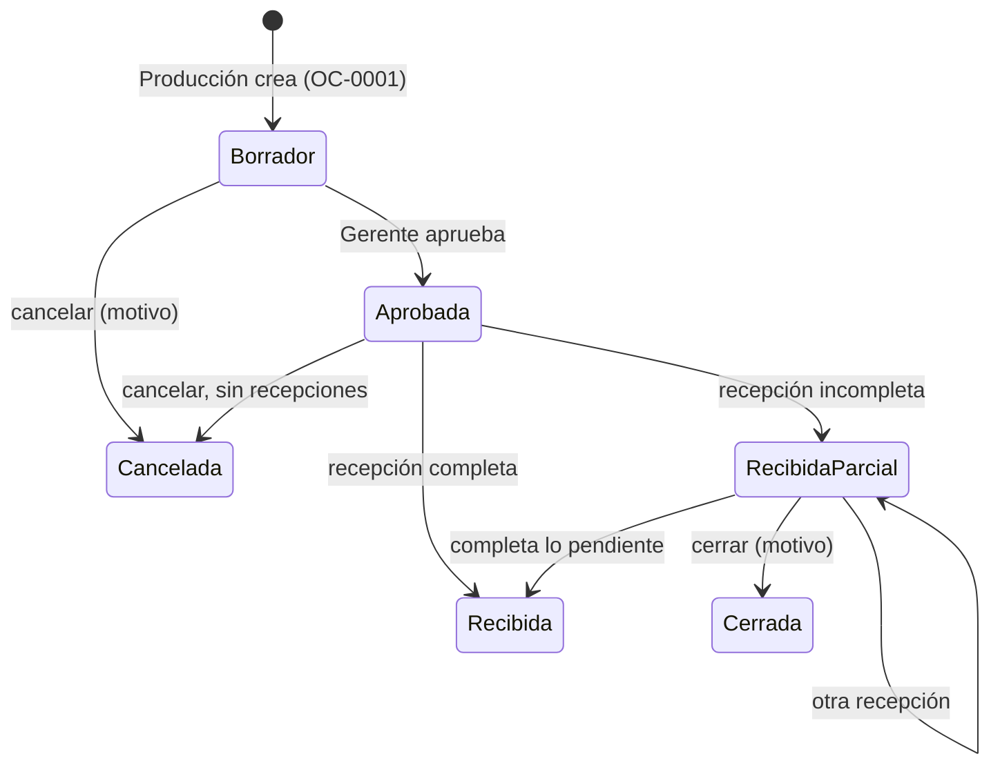
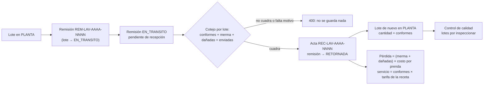
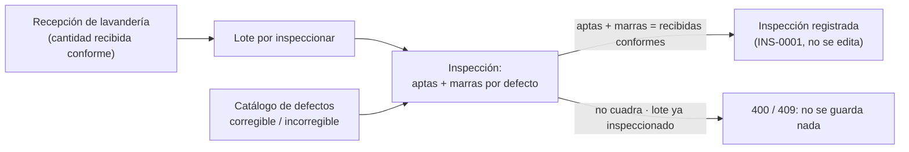
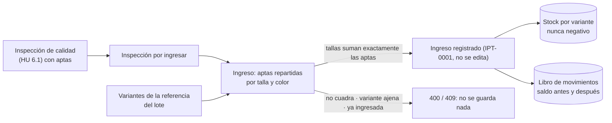
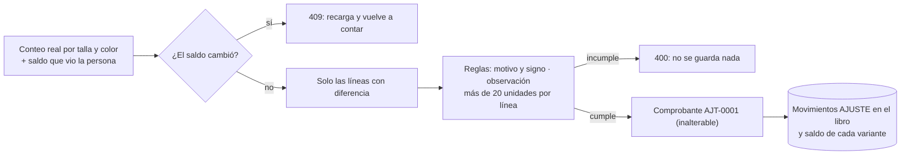
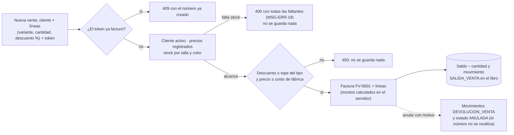
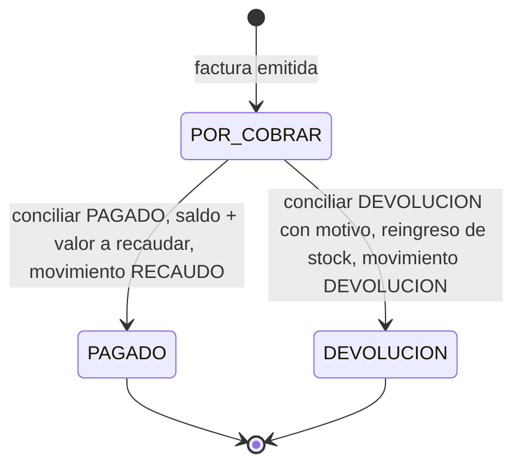
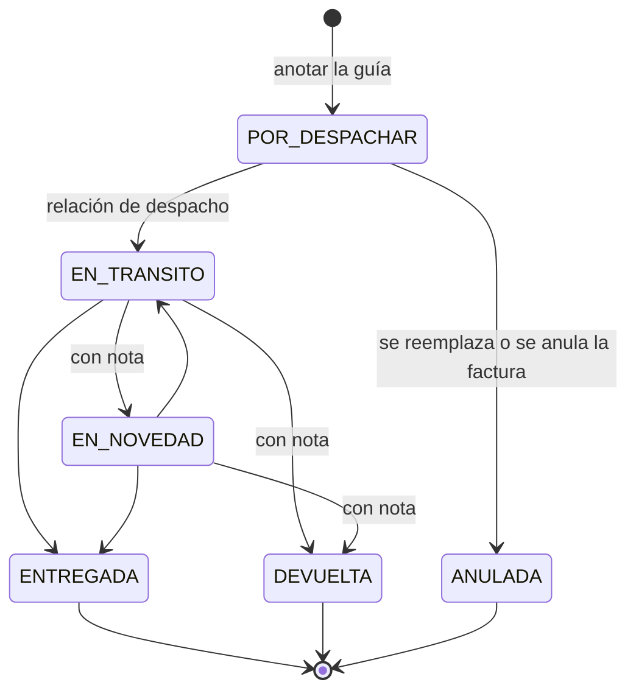

# Módulos y reglas de negocio

Resumen técnico de lo construido hasta ahora: por cada historia de usuario, qué hace, dónde vive en el
código, qué ruta la expone, qué permiso exige y qué reglas aplica. Los detalles de cada endpoint (parámetros,
cuerpos y respuestas) están en Swagger (`/api/docs/`); cómo se usa cada pantalla está en el
[manual de usuario](manual-de-usuario.md); los permisos por rol, en [roles y permisos](roles-y-permisos.md).

| Historia | Tema | App | Pantalla |
|---|---|---|---|
| HU 1.x | Seguridad, usuarios, roles y permisos | `users` | Seguridad y Usuarios |
| HU 2.1 a 2.4 | Inventario: proveedores, catálogo, movimientos, alertas | `inventory` | Inventario de Materias Primas |
| Compras | Órdenes de compra y recepción de mercancía | `purchasing` | Compras |
| HU 3.1 (TE-49) | Referencias de jean | `references` | Referencias de Jean |
| HU 3.2 (TE-50) | Ficha técnica de consumo por unidad | `references` | Botón *Ficha técnica* del catálogo de jeans |
| HU 4.1 (TE-51) | Validación de material y planificación | `production` | Órdenes de producción |
| HU 4.2 (TE-52) | Órdenes de producción y lotes | `production` | Órdenes de producción |
| HU 4.3 (TE-53) | Control de tiempos por etapa | `production` | Órdenes de producción → Seguimiento |
| HU 4.4 (TE-54) | Asignación de recursos | `production` | Recursos y Seguimiento |
| HU 4.5 (TE-55) | Monitor de estado | `production` | Monitor de estado |
| HU 4.6 (TE-56) | Costeo y liquidación de órdenes | `production`, `inventory` | Liquidación de Órdenes |
| HU 5.1 (TE-57) | Remisión de salida a lavandería | `production` | Lavandería → Remisión a Lavado |
| HU 5.2 (TE-58) | Recepción de lavandería con cotejo y pérdidas | `production` | Lavandería → Recepción de Lavandería |
| HU 6.1 (TE-59) | Registro de marras y calidad | `quality` | Control de Calidad → Inspecciones y Defectos |
| HU 6.2 (TE-60) | Ingreso a inventario final (producto terminado) | `finished` | Producto Terminado → Ingreso, Existencias y Movimientos |
| HU 6.3 (TE-61) | Ajuste manual de inventario de producto terminado | `finished` | Producto Terminado → Ajuste manual |
| HU 7.1 (TE-62) | Facturación y descuento de inventario (factura POS interna) | `sales` | Ventas y Despachos → Panel de ventas, Nueva venta, Facturas, Clientes y Precios |
| HU 7.2 (TE-63) | Gestión de guías de envío | `shipping` | Envíos → Guías, Por despachar / sin guía, Relaciones de despacho y Resumen |
| HU 7.3 (TE-64) | Cartera y pagos contraentrega | `sales` | Ventas y Despachos → Gestión de cartera |
| HU 7.4 (TE-65) | Reportes gerenciales | `reports` | Reportes → Tablero gerencial |

Cómo se conectan entre sí:

```mermaid
flowchart LR
    COMP["Compras<br/>orden → aprobación → recepción"] -- "ingreso con costo" --> INV[("Inventario<br/>stock · kardex · costo promedio")]
    REF["Referencias<br/>+ ficha técnica"] -- "consumo por prenda" --> PLAN["Simulación de material"]
    INV -- "stock disponible" --> PLAN
    PLAN --> ORD["Orden de producción<br/>y lotes"]
    ORD -- "descuenta el material<br/>(foto del costo)" --> INV
    ORD --> TIEMPOS["Etapas: corte → confección → terminación<br/>tiempos y asignación de recursos"]
    TIEMPOS --> MON["Monitor de estado"]
    TIEMPOS -- "minutos netos × tarifa" --> COSTEO["Liquidación y costo por prenda"]
    INV -- "costo unitario del material" --> COSTEO
    TIEMPOS -- "lote en PLANTA" --> REMI["Lavandería: remisión de salida<br/>REM-LAV · lote EN_TRANSITO (HU 5.1)"]
    REMI --> RECE["Recepción con cotejo<br/>REC-LAV · pérdidas por terceros (HU 5.2)"]
    RECE -- "conformes: el lote vuelve a PLANTA" --> CAL["Control de calidad<br/>inspección del lote"]
    CAL -- "aptas · marras por defecto" --> RES["Resultado de la inspección<br/>(solo se agrega)"]
    RES -- "solo las aptas, repartidas<br/>por talla y color" --> TER[("Producto terminado<br/>stock por variante · libro de movimientos")]
    CONTEO["Conteo físico de la bodega"] -- "ajuste manual (HU 6.3)<br/>movimientos AJUSTE" --> TER
    TER -- "stock por talla y color" --> VEN["Ventas: factura POS interna<br/>(HU 7.1)"]
    VEN -- "SALIDA_VENTA al facturar<br/>DEVOLUCION_VENTA al anular" --> TER
    VEN -- "guía anotada al facturar<br/>(o después, si falta)" --> ENV["Envíos: guía y semáforo<br/>relación de despacho (HU 7.2)"]
    ENV -. "estado real de Interrapidísimo<br/>solo con el botón Consultar estado" .-> T123["Track123"]
    ENV -- "paquete devuelto: reingreso<br/>de las prendas, una sola vez" --> TER
    VEN -- "factura POR_COBRAR" --> COBRO["Cartera (HU 7.3)<br/>conciliar: PAGADO o DEVOLUCION"]
    ENV -. "entregada: ya se puede cobrar<br/>(aún solo avisa)" .-> COBRO
    COBRO -- "PAGADO: suma al saldo financiero" --> CAJA[("Saldo financiero<br/>movimientos de cartera")]
    COBRO -- "DEVOLUCION: reingreso<br/>(DEVOLUCION_VENTA)" --> TER
    ORD -- "órdenes, lotes y marras" --> REP["Reportes gerenciales (HU 7.4)<br/>vistas materializadas"]
    CAL -- "aptas y marras" --> REP
    VEN -- "ventas por referencia" --> REP
    CAJA -- "saldo de la empresa" --> REP
```

## Seguridad y usuarios (HU 1.x)

- **Autenticación:** JWT (`/api/token/`); `access` de 15 min y `refresh` rotativo de 30 min.
- **Cuentas:** el registro público crea un usuario en rol `PENDING` con el área que pidió; un administrador lo aprueba
  asignándole rol. Las cuentas creadas por un administrador reciben una invitación (48 h) para definir su contraseña.
- **Recuperación de contraseña:** enlace de un solo uso que vence a los 15 minutos; solo se guarda su SHA-256.
- **Roles y permisos:** ver [roles y permisos](roles-y-permisos.md). Rutas en `apps/users/urls.py`.

## Inventario (HU 2.1 a 2.4)

App `apps/inventory`. Toda la lógica de stock está en `services.py` y todas las rutas cuelgan de `/api/inventario/`.

- **Catálogo:** nueve categorías que fijan tipo, unidades y datos obligatorios (ancho útil y composición para telas e hilos).
  Código automático por categoría (`TEL-0001`).
- **Kardex:** el stock solo cambia con movimientos (`Movimiento`), cada uno con saldo antes y después, usuario y fecha.
  Los saldos se bloquean por fila al escribir, así dos salidas simultáneas no dejan el stock en negativo.
- **Órdenes de salida:** `OP-0001` (producción) y `LV-0001` (lavandería), con varias líneas. Una salida con stock
  insuficiente se rechaza completa y devuelve `faltantes`. Anular una orden en proceso devuelve las cantidades.
- **Costo promedio ponderado:** cada compra puede traer `costo_unitario`; el costo del producto se recalcula como
  `(existencias × promedio + compra × costo) / (existencias + compra)`. Si lo que había no tenía costo, manda el de la
  compra; una compra sin costo no cambia el promedio. Al salir material por una orden, la línea guarda una **foto del
  costo** vigente (`OrdenLinea.costo_unitario`), que es la que usa el costeo.
- **Evidencias:** foto o PDF (5 MB, hasta 10 por movimiento u orden), validadas por su contenido.

## Compras: órdenes de compra y recepción de mercancía

App `apps/purchasing`, rutas bajo `/api/compras/`, tablas `compras_*`.

| Regla | Detalle |
|---|---|
| Quién hace qué | Producción crea, edita (solo en borrador), cancela y cierra (`compras.gestionar`); el Gerente aprueba (`compras.aprobar`); el Almacenista recibe (`inventario.gestionar`). |
| Contenido de la orden | Solo materia prima e insumos, sin repetir producto, hasta 100 líneas. El precio pactado por unidad es opcional. |
| Recepción | Varias filas en una sola transacción: si una falla, no se guarda ninguna. Cada fila lleva cantidad, lote y costo real (opcional). Código `RC-0001`. |
| Tolerancia | Se puede recibir hasta un **5 %** más de lo pendiente de cada línea (`OVERAGE_TOLERANCE`, fijo en el código). |
| Estados | Se guardan: borrador, aprobada, recibida parcial, recibida, cerrada y cancelada. La cantidad recibida de cada línea **no** se guarda: se suma de las recepciones. |
| Separación de funciones | Quien creó la orden no puede registrar su recepción. |
| Entrega sin orden | La recepción sin `orden` registra varios productos de un proveedor (remisión o factura, lote y costo). |
| Efecto en el inventario | Cada fila se registra con la misma regla del ingreso: suma al stock, recalcula el costo promedio y deja su fila en el kardex con el código de la orden y de la recepción. |

## Referencias de jean (HU 3.1, TE-49)

App `apps/references`, rutas bajo `/api/referencias/`, tablas `referencias_*`.

- Una **referencia** (`REF-0001`) tiene nombre, ajuste (skinny, slim, recto, bootcut, mom, wide leg, jogger u otro),
  descripción, **variantes** (talla × color, hasta 60) y hasta cinco imágenes del prototipo (2 MB cada una, una principal).
- **Estados:** `BORRADOR → ACTIVA → DESCONTINUADA` (y de vuelta a activa). Para activarla hacen falta al menos una variante
  y una imagen. Solo se archiva una referencia que no esté activa.
- Las imágenes se guardan en la base y se sirven con sesión y `ETag`.

## Ficha técnica de consumo por unidad (HU 3.2, TE-50)

- Una ficha por referencia: lista de materiales (materia prima o insumo del inventario, sin repetir, hasta 50) con
  **cantidad por prenda** (hasta 3 decimales; entera para botones, cierres y remaches) y **merma %** (0 a 50). Opcionalmente
  el tipo de lavado (`STONE_WASH`, `ENZIMATICO`, `LEJIA`, `OZONO`, `LASER` u `OTRO`) y notas.
- Guardar la ficha **reemplaza** la lista anterior. No se puede quitar mientras la referencia tenga órdenes en proceso.
- **Consumo contra el stock** (`/api/inventario/fichas-tecnicas/<id>/consumo/?cantidad=N`): la merma se aplica una sola vez
  y el resultado se redondea hacia arriba. Es una simulación; no reserva stock.
- **PDF de la ficha extensa** (geometral, secuencia de confección, tabla de medidas): hasta 5 MB, detectado por su contenido
  y guardado en la base. Se descarga con `ETag`.
- Permisos propios: `fichas_tecnicas.ver` y `fichas_tecnicas.gestionar`.

## Validación de material y planificación (HU 4.1, TE-51 / TE-110)

`POST /api/produccion/simulacion/` recibe referencia, cantidad y, opcionalmente, la lista de lotes. Devuelve:

- `viable`, y por material lo **requerido**, lo **disponible** y lo que **falta**;
- el **máximo producible** con el stock actual y su **cuello de botella** (el material que limita);
- si hay lotes, la **cobertura acumulada**: los lotes comparten el mismo stock, así que un lote se cubre si alcanza para
  él y los anteriores juntos.

Es de solo lectura (basta `produccion.ver`): la orden vuelve a verificar el stock bajo bloqueo al crearse. La pantalla
la llama sola, con una pequeña espera mientras se escribe.

## Órdenes de producción y lotes (HU 4.2, TE-52)

`POST /api/produccion/ordenes/` crea, en **una sola transacción**: la salida de inventario (que descuenta el material de
la ficha, con su merma), la orden de producción (`OP-0001`, el mismo código de la salida), sus lotes (`OP-0001-L01`…, hasta 50,
que deben sumar exactamente el total) y, opcionalmente, las tallas de cada lote. Si falta material no queda nada ni se gasta
el consecutivo. Anular la orden (`/anular/`, con motivo) devuelve el material y deja los lotes como historial.

## Control de tiempos por etapa (HU 4.3, TE-53)

- Cada lote recorre **Corte → Confección → Terminación**, en ese orden; una etapa empieza cuando la anterior terminó y un
  lote tiene una sola etapa en curso. La lavandería, la calidad y el empaque no son etapas de este seguimiento.
- Acciones: `iniciar`, `pausar`, `reanudar`, `completar` (`POST /api/produccion/lotes/<id>/<accion>/`). Cada una queda en el
  historial de la etapa (`EventoEtapa`), que solo recibe filas nuevas.
- **Tiempo neto** = suma de los intervalos en que la etapa estuvo corriendo; el tiempo en pausa no cuenta.
- El **estado** del lote y de la orden (*Planeada, En proceso, En pausa, Terminada, Cancelada*) **no se guarda**: se calcula
  desde sus etapas y desde la anulación. El bloqueo del lote evita que dos personas se pisen.

## Asignación de recursos (HU 4.4, TE-54)

- **Catálogo:** `Operario` (`OPE-0001`; etapas en que puede trabajar y forma de pago, solo informativa) y `Maquina`
  (`MAQ-0001`; tipo, serial, ubicación, etapas y estado físico: disponible, en mantenimiento o fuera de servicio).
  Un operario no necesita usuario del sistema. Nada se borra: se desactiva.
- **Asignación por etapa** (`AsignacionEtapa`): `asignar/` asigna, reasigna o quita; `desvincular/` quita el operario, la
  máquina o ambos; `asignaciones/` muestra el historial. Cada cambio cierra la asignación abierta y abre otra.
- **Se rechaza:** recurso inactivo o no habilitado para la etapa, máquina en mantenimiento o fuera de servicio, etapa terminada,
  orden anulada. **Solo se avisa** (campo `advertencias`): que el operario o la máquina ya estén en otra etapa en curso.
- Terminar la etapa o anular la orden libera los recursos. «Ocupado» se calcula con las asignaciones abiertas; no se guarda.

## Monitor de estado (HU 4.5, TE-55)

`GET /api/produccion/monitor/` devuelve los lotes en cuatro columnas (Planeada, En proceso, En pausa, Terminada) con su total.

| Parámetro | Efecto |
|---|---|
| `limite` | Tarjetas por columna (50 por defecto, máximo 200). Los totales siempre cuentan todo. |
| `orden`, `referencia` | Filtran por id; los totales respetan el filtro. |
| `terminadas_dias` | Ventana de la columna Terminada (7 por defecto, máximo 90). |
| `canceladas=1` | Agrega una columna Cancelada, de solo consulta. |

Cada tarjeta trae su `alerta` por tiempo detenido: `ATENCION` desde 2 horas y `CRITICA` desde 8 horas, para lotes en pausa o
entre una etapa y la siguiente. La respuesta resume las alertas de todos los lotes activos. Dentro de cada columna va primero lo
que más tiempo lleva esperando (en Terminada, lo más reciente). La pantalla se actualiza sola cada 20 s y permite mover un lote
arrastrando su tarjeta, lo que aplica la acción de la etapa en curso si es válida.

## Costeo y liquidación (HU 4.6, TE-56 / TE-129 / TE-130)

`GET /api/produccion/ordenes/<id>/costos/` calcula la liquidación de una orden (motor puro en `apps/production/costing.py`):

- **Materiales** = cantidad × costo unitario de la foto guardada en cada línea de la salida. Como el material se descuenta por
  orden completa, a cada lote se le asigna `total_materiales × prendas_del_lote / prendas_de_la_orden`.
- **Mano de obra** por lote y etapa = `(segundos netos / 60) × tarifa por minuto`, con la tarifa vigente a la fecha en que terminó
  la etapa (o a hoy si sigue en curso; entonces el costo es *provisional*).
- **Tarifas** (`/api/produccion/tarifas/`): historial por etapa; nunca se editan ni se borran. Para cambiar un precio se
  registra una nueva vigencia (`vigente_desde`).
- Se redondea a centavos solo al final (mitad hacia arriba). La respuesta incluye totales, **costo por prenda**, distribución
  porcentual y `completo: false` con `advertencias` si falta una tarifa o el costo de un material (*Sin tarifa*, *Sin costo*).
- Una orden anulada devuelve todos los costos en cero, porque el material regresó al almacén.

## Lavandería: remisión de salida y recepción con cotejo (HU 5.1 y 5.2, TE-57 y TE-58)

Procesos externos del lote ensamblado: se **remite** a una lavandería (HU 5.1, TE-57) y se **recibe** con cotejo de lo devuelto (HU 5.2, TE-58). No hay
una app propia: el código vive en `apps/production/`. La salida está en `remisiones_services.py` y `remisiones_views.py`; la recepción, en
`recepcion_services.py` y `recepcion_views.py`; las constantes (permisos, estados, motivos), en `catalog.py`; las rutas, en `urls.py` bajo `/api/lavanderia/`.
Todas las respuestas de error usan el formato `{campo: [mensaje]}` con `400`.

!!! info "No es la «Salida a lavandería» de Inventario"
    Esta es la remisión de **lotes ensamblados** de producción. Es distinta de la orden de salida provisional `LV-0001` del módulo de Inventario
    (ver [Inventario](#inventario-hu-21-a-24)), que se retirará con la HU 5.3 (TE-171).

### Modelos

Tablas del módulo de producción (borrado lógico como el resto; el detalle de campos está en [modelo de datos](modelo-de-datos.md)):

| Tabla | Qué guarda |
|---|---|
| `produccion_receta_lavado` | Catálogo de recetas de lavado: `codigo` (único entre los activos), nombre, categoría, descripción, temperatura del proceso, duración en horas y `tarifa_sugerida` por prenda. |
| `produccion_remision_lavanderia` | La remisión de salida: código `REM-LAV-AAAA-NNNN` (único), fechas de emisión y de entrega estimada, la lavandería (un `Proveedor`), transportador, placa, tulas o bultos, peso en kg, `costo_estimado`, `estado`, observaciones, responsable y quién la creó. |
| `produccion_remision_lote` | Una línea por lote remitido: la remisión, el lote, la `cantidad` enviada (mínimo 1), la receta (opcional), el nombre de la receta y las instrucciones especiales. Un lote no se repite dentro de la misma remisión. |
| `produccion_recepcion_lavanderia` | El acta de recepción: código `REC-LAV-AAAA-NNNN` (único), la remisión, el número de factura o remisión física de la lavandería (`factura_remision_externa`), la fecha, los totales (enviado, conforme, merma, dañadas), `costo_total_perdida`, `costo_servicio_lavado`, `estado`, observaciones y responsable. |
| `produccion_recepcion_lote` | El cotejo de cada lote: la línea de remisión, el lote, cantidades enviada, conforme, merma y dañada, `motivo_merma`, `tipo_dano`, `costo_unitario_prenda` y `costo_perdida`. |

Además `Lote` ganó el campo `estado_inventario`, que dice dónde está el lote.

| Estado | Dónde se usa | Significa |
|---|---|---|
| Lote `PLANTA` | `Lote.estado_inventario` (valor por defecto) | El lote está en la planta interna; es el único estado que se puede remitir a lavandería. |
| Lote `EN_TRANSITO` | `Lote.estado_inventario` | El lote salió con una remisión y está fuera de la planta; no aparece en los lotes disponibles. |
| Lote `RETORNADO` | Definido en `catalog.py` | Existe como opción, pero **ningún servicio lo asigna**: al recibir, el lote vuelve a `PLANTA`. |
| Remisión `EN_TRANSITO` | `RemisionLavanderia.estado` | Estado con el que se crea la remisión; espera su recepción. |
| Remisión `EN_LAVANDERIA` | `RemisionLavanderia.estado` | Se acepta como «pendiente de recibir», pero ningún flujo actual la asigna. |
| Remisión `RETORNADA` | `RemisionLavanderia.estado` | La recepción ya se asentó; no admite otra. |
| Remisión `ANULADA` | `RemisionLavanderia.estado` | Existe en el catálogo y la recepción la rechaza, pero no hay ruta para anular una remisión. |
| Recepción `COMPLETADA` | `RecepcionLavanderia.estado` | Valor con el que se guarda toda recepción. `PARCIAL` existe en el catálogo, pero no se asigna. |

### Salida: remisión a lavandería (HU 5.1, TE-57)

`create_laundry_remission` es una sola transacción: si algo falla, no queda nada, ni siquiera el consecutivo. Reglas en el orden en que se aplican:

| Regla | Detalle |
|---|---|
| Al menos un lote | Sin lotes responde `400` («Debes seleccionar al menos un lote para generar la remisión.»). El cuerpo también exige `lavanderia_id` y `fecha_emision`. |
| Lavandería válida | El proveedor debe existir y no estar eliminado. El servicio **no exige** que su categoría sea lavandería. |
| Sin lotes repetidos | Un lote no puede ir dos veces en la misma remisión. |
| Lotes bloqueados | Se bloquean por fila en orden de id, así que dos remisiones simultáneas del mismo lote no pasan las dos: la segunda ve el lote `EN_TRANSITO` y se rechaza. Un id inexistente se rechaza. |
| Lote en planta | Solo se remite un lote con `estado_inventario = PLANTA`; si no, `400` indicando el estado actual. |
| Cantidad | Entera, mayor que cero y **no mayor que las unidades del lote** (`lote.cantidad`). |
| Consecutivo | `REM-LAV-AAAA-NNNN`: el año es el de hoy y el número sale del contador `REM-LAV` (`Consecutivo`), que **no se reinicia cada año**. |
| Costo estimado | Suma de `cantidad × tarifa_sugerida` de la receta elegida; si no hay receta, usa **3.500** por prenda. |
| Descuento de la planta | Cada lote remitido pasa a `EN_TRANSITO` y la remisión nace `EN_TRANSITO`, con el usuario como responsable y creador. |
| Respuesta | `201` con la remisión lista para el ticket de impresión: código, lavandería, lotes con su receta, `total_prendas`, costo estimado, transportador, placa, tulas, peso y estado. |

Campos opcionales del cuerpo: `fecha_entrega_estimada`, `transportador_nombre` (150 caracteres), `vehiculo_placa` (30), `tulas_bultos` (entero ≥ 1, por defecto 1),
`peso_kg` (por defecto 0), `observaciones` (1000), y por lote `receta_id` (el código de la receta), `receta_nombre` e `instrucciones_especiales` (500).
Un `receta_id` que no existe no da error: la línea se guarda sin receta.

`GET /api/lavanderia/lotes-disponibles/` lista los lotes en `PLANTA` de órdenes vigentes (código del lote, orden, referencia, tallas, unidades y receta sugerida);
`GET /api/lavanderia/proveedores/` lista las lavanderías (proveedores de categoría lavandería, o todos los activos si todavía no hay ninguna);
`GET /api/lavanderia/recetas/` lista las recetas.

### Entrada: recepción con cotejo (HU 5.2, TE-58)

`create_laundry_reception` también es una sola transacción. Bloquea la remisión, sus líneas y sus lotes, y aplica:

| Regla | Detalle |
|---|---|
| Remisión pendiente | Debe existir; una remisión `RETORNADA` responde «ya fue retornada y recibida previamente» y una `ANULADA`, «está anulada y no puede recibir prendas». |
| Todos los lotes, una vez | El cotejo debe traer **todos** los lotes de la remisión, cada uno una sola vez (por `remision_lote_id` o por `lote_id`); uno ajeno o repetido, o uno que falte, responde `400`. |
| Cotejo exacto | Por lote, `conformes + merma + dañadas` debe ser **igual a lo enviado** en la remisión (no a las unidades actuales del lote). El mensaje dice cuánto suma y cuánto debería sumar. Ninguna cantidad puede ser negativa. |
| Justificar las pérdidas | Si `cantidad_merma > 0`, `motivo_merma` es obligatorio; si `cantidad_danada > 0`, `tipo_dano` lo es. Son texto libre de hasta 200 caracteres; `catalog.py` trae listas sugeridas de motivos de merma y tipos de daño, pero el servicio no obliga a escoger de ellas. |
| Liquidación de pérdidas por terceros | `costo_perdida = (merma + dañadas) × costo_unitario_prenda`, por lote y sumado en `costo_total_perdida`. El costo unitario viene en el cuerpo y, si falta, vale **35.000** (`DEFAULT_GARMENT_COST`). |
| Costo del servicio | `costo_servicio_lavado` suma `conformes × tarifa_sugerida` de la receta de cada línea (3.500 si no tiene receta): solo se cobra lo procesado conforme. |
| Consecutivo | `REC-LAV-AAAA-NNNN`, con el contador `REC-LAV` (tampoco se reinicia por año). |
| Reingreso a planta | Cada lote vuelve a `PLANTA` y su `cantidad` pasa a ser **solo las prendas conformes**. La merma y las dañadas salen de la cantidad del lote; quedan escritas únicamente en el acta. |
| Cierre | La remisión queda `RETORNADA` y el acta, `COMPLETADA`. No hay recepción parcial: o se cotejan todos los lotes o no se guarda nada. |

`GET /api/lavanderia/remisiones-pendientes/` entrega las remisiones `EN_TRANSITO` o `EN_LAVANDERIA` con sus lotes, días en proceso y, por lote, la tarifa y el costo
unitario estimado (35.000) que la pantalla propone en el cotejo.

**Qué alimenta a Control de calidad:** la inspección de [Control de calidad](#control-de-calidad-marras-y-defectos-hu-61-te-59) toma como base
`RecepcionLote.cantidad_recibida_conforme` de la recepción **más reciente** del lote. Un lote es «por inspeccionar» si está en `PLANTA`, tiene recepción con conformes
mayores que cero, no tiene inspección y su orden no está anulada; la merma y los daños de lavandería ya quedaron liquidados aquí y no se vuelven a clasificar.

### Rutas y permisos

Referencia exacta en Swagger, etiqueta `lavanderia`:

| Ruta | Operaciones | Permiso |
|---|---|---|
| `/api/lavanderia/lotes-disponibles/` | `GET`: lotes en planta disponibles para remitir | `lavanderia.ver` |
| `/api/lavanderia/proveedores/` | `GET`: lavanderías | `lavanderia.ver` |
| `/api/lavanderia/recetas/` | `GET`: recetas de lavado | `lavanderia.ver` |
| `/api/lavanderia/remisiones/` | `GET` (historial, de la más reciente a la más antigua) / `POST` (crea y despacha) | `lavanderia.ver` / `lavanderia.gestionar` |
| `/api/lavanderia/remisiones-pendientes/` | `GET`: remisiones por recibir, con sus lotes | `lavanderia.ver` |
| `/api/lavanderia/recepciones/` | `GET` (historial) / `POST` (asienta el cotejo) | `lavanderia.ver` / `lavanderia.gestionar` |
| `/api/lavanderia/recepciones/<id>/` | `GET`: acta completa | `lavanderia.ver` |

**Permisos:** `lavanderia.ver` y `lavanderia.gestionar` los crea la migración `users/0003_roles_y_permisos`. El **Jefe de Producción** tiene los dos; el **Gerente**,
solo `lavanderia.ver`; el Administrador los tiene de forma implícita. Ninguna migración posterior los cambia. Ver [roles y permisos](roles-y-permisos.md).

**Errores `400` más comunes:** sin lotes, lote repetido, lote que ya no está en la planta, cantidad mayor que las unidades del lote, cotejo que no suma lo enviado,
falta de `motivo_merma` o `tipo_dano`, lotes de la recepción que no son de la remisión o que faltan, y remisión ya retornada o anulada. Un id de remisión
inexistente responde `400` en el campo `remision_id`; el acta inexistente (`GET …/recepciones/<id>/`) responde `400` en el campo `id`.

**Pantallas** (menú *Lavandería*): *Remisión a Lavado* (`/lavanderia/remisiones`) y *Recepción de Lavandería* (`/lavanderia/recepcion`), ambas con `lavanderia.ver`;
generan el ticket de remisión y el comprobante de recepción para imprimir. Los componentes están en `frontend/src/components/Laundry/`.

**Datos de demostración:** `python manage.py seed_demo_lavanderia` (idempotente) deja proveedores de lavandería y cuatro recetas de lavado con tarifas de
2.800 a 4.500, y cuenta los lotes que están en planta; no crea remisiones. `seed_demo_calidad` sí deja dos lotes ya devueltos de lavandería con su remisión y su recepción.

**Pruebas:** `apps/production/test_remisiones.py` cubre los lotes disponibles, los proveedores, las recetas, que la remisión genere el consecutivo `REM-LAV-AAAA-`,
pase el lote a `EN_TRANSITO` y lo saque de la lista, y que un lote que ya no está en planta no se pueda remitir otra vez.
`apps/production/test_recepcion_lavanderia.py` cubre las remisiones pendientes, una recepción completa (60 enviadas = 55 conformes + 3 de merma + 2 dañadas: pérdida,
servicio, remisión `RETORNADA`, lote de vuelta en planta con 55 unidades, historial y detalle), el cotejo que no cuadra, la merma sin motivo, los daños sin tipo y la
remisión ya retornada. Para correrlas: `python manage.py test apps.production.test_remisiones apps.production.test_recepcion_lavanderia --noinput`.

!!! warning "Alcance y límites actuales"
    La auditoría de deuda técnica del Sprint 4 (`Deuda-Tecnica-Sprint-4.md`) agrupó lo siguiente en la **HU 5.4 «Lavandería confiable» (TE-172)**:

    - **Remisión parcial que pierde prendas:** se valida `cantidad ≤ lote.cantidad`, pero el lote **entero** pasa a `EN_TRANSITO`; al recibir, la cantidad del lote se sobrescribe con los conformes. Hoy solo es seguro remitir el lote completo (TE-172).
    - **Recepción sin prendas conformes:** un lote con `0` conformes (todo merma o daño) no está bien resuelto: sobrescribe `Lote.cantidad` y puede fallar con un error `500`. Además, la cantidad original del lote no se conserva y alimenta mal la columna `prendas_en_lotes` de [reportes](#reportes-gerenciales-vistas-materializadas-y-exportacion-hu-74-te-65) (TE-172).
    - **Valores por defecto de costo:** el costo por prenda (35.000) y la tarifa (3.500) cuando falta la receta están escritos en el código, y el servicio de proveedores devuelve datos de relleno (tarifa 3.500, calificación, tiempo promedio). No salen de la liquidación de la orden de producción (TE-172; el costo real de fábrica llega con la HU 4.7, TE-174).
    - **Datos de relleno en el frontend:** las dos pantallas pueden mostrar datos simulados si la API falla y proponen valores inventados (un número de factura aleatorio, la receta `REC-SW-01`, el costo 35.000) que se envían al servidor (TE-172).
    - **Estados sin flujo:** no se puede anular una remisión; `EN_LAVANDERIA`, `ANULADA`, `PARCIAL` y `RETORNADO` existen en el catálogo pero ningún servicio los asigna.
    - **Pérdidas solo en el acta:** la liquidación de las pérdidas se guarda en la recepción, pero aún no se carga al costo de la orden ni a Control de calidad; la valoración de marras es la HU 6.4 (TE-169).
    - **Botones y remaches, y reglas de la lavandería:** si los insumos van antes o después del lavado y si la lavandería responde por las marras son decisiones pendientes del PM; el backend no las endurece.

## Control de calidad: marras y defectos (HU 6.1, TE-59)

App `apps/quality`, rutas bajo `/api/calidad/`, tablas `calidad_defecto`, `calidad_inspeccion` y `calidad_marra_detalle`.
Cubre RF19 (criterios de calidad) y RF20 (registro de marras). La lógica está en `services.py`; las constantes (permisos,
prefijos `DEF` e `INS`, máximo de defectos por inspección) en `catalog.py`.

| Regla | Detalle |
|---|---|
| Catálogo de defectos (RF19) | Cada `TipoDefecto` (`DEF-0001`) tiene nombre (3 a 80 caracteres), descripción y tipo: **corregible** (se podría reprocesar) o **incorregible** (marra definitiva). El nombre no se repite, sin importar mayúsculas ni espacios de más, ni siquiera frente a uno desactivado. Nunca se borra: se **desactiva** (`PATCH` con `activo`), y un defecto inactivo no se puede elegir en una inspección nueva. |
| Qué se inspecciona | La base es lo **recibido conforme** (`RecepcionLote.cantidad_recibida_conforme`) en la recepción de lavandería más reciente del lote (HU 5.2, TE-58). Los faltantes y daños de lavandería ya los liquida esa recepción; aquí solo se clasifican las prendas que sí llegaron. No se modifica el modelo `Lote`. |
| Lote «por inspeccionar» | Está en planta, tiene una recepción con prendas conformes, su orden **no está anulada** y todavía **no tiene inspección**. Lo lista `GET /api/calidad/pendientes/`. |
| La suma debe cuadrar | `aptas + marras = cantidad recibida conforme`. Las marras son la suma de su desglose por defecto (hasta 30 defectos distintos, sin repetir, con cantidades enteras mayores que cero). Si no cuadra responde `400` indicando cuántas prendas faltan o sobran. Una restricción de la base (`ck_calidad_inspeccion_suma`) lo respalda. |
| Una inspección por lote | Si el lote ya fue inspeccionado responde `409` (también si otra persona la registró un instante antes: el lote se bloquea durante la transacción). Una restricción única lo respalda. |
| Solo se agrega | La inspección no tiene `PUT`, `PATCH` ni `DELETE`. Cada línea del desglose (`MarraDetalle`) guarda el **nombre y el tipo del defecto tal como estaban**, así que renombrar o desactivar un defecto después no cambia el historial. |
| Todo o nada | Se registra en una sola transacción: si algo falla no queda nada ni se gasta el consecutivo `INS-0001`. Se guardan el inspector (el usuario de la sesión), la fecha (hoy si no se envía) y observaciones de hasta 500 caracteres. |
| Se rechaza con `400` | Lote inexistente o sin recepción de lavandería lista, orden anulada, suma que no cuadra, defecto inactivo, inexistente o repetido, cantidades que no son enteras. |

Rutas y permisos (la referencia exacta está en Swagger, etiqueta `calidad`):

| Ruta | Operaciones | Permiso |
|---|---|---|
| `/api/calidad/defectos/` | `GET` (filtros `activo`, `q`, `limit`), `POST` | `calidad.ver` / `calidad.gestionar` |
| `/api/calidad/defectos/<id>/` | `GET`, `PATCH` | `calidad.ver` / `calidad.gestionar` |
| `/api/calidad/pendientes/` | `GET` | `calidad.ver` |
| `/api/calidad/inspecciones/` | `GET` (filtros `lote`, `orden`, `desde`, `hasta`, `q`, `limit`), `POST` | `calidad.ver` / `calidad.gestionar` |
| `/api/calidad/inspecciones/<id>/` | `GET` | `calidad.ver` |

Quién puede qué: el Personal de Terminación y el Jefe de Producción **gestionan** (definen defectos e inspeccionan; este último
por la migración `users/0010_permisos_calidad_produccion`), el Gerente solo **consulta** y el Administrador tiene todo. Ver
[roles y permisos](roles-y-permisos.md).

!!! warning "Limitaciones conocidas de la HU 6.1"
    - **Sin reproceso:** el tipo corregible/incorregible solo se registra; no hay flujo para reparar y volver a inspeccionar.
    - **Sin valoración de las marras:** no se calcula su costo ni su pérdida, y las aptas pasan al inventario de producto terminado
      (HU 6.2), pero las marras no tienen inventario.
    - **Sin muestreo AQL:** se clasifica el lote completo, no una muestra.
    - **Una inspección por lote y sin corrección:** si se digita mal una inspección no hay forma de corregirla desde el sistema
      (queda como pregunta pendiente para el responsable del producto).

## Producto terminado: ingreso al inventario final (HU 6.2, TE-60)

App `apps/finished`, rutas bajo `/api/terminado/`, tablas `terminado_stock`, `terminado_ingreso`, `terminado_ingreso_linea` y
`terminado_movimiento`. Cubre RF21 (ingreso de producto terminado). La lógica está en `services.py`; las constantes (permisos,
prefijo `IPT`, tipos de movimiento, máximo de líneas por ingreso) en `catalog.py`.

| Regla | Detalle |
|---|---|
| Qué se ingresa | Solo las **aptas** de una inspección de calidad (HU 6.1). Las **marras no entran** a este saldo: siguen sin inventario hasta la HU 6.4 (TE-169). |
| Inspección «por ingresar» | Tiene al menos una prenda apta, su orden **no está anulada** y todavía **no tiene ingreso**. La lista `GET /api/terminado/pendientes/` trae además las variantes (talla y color) de la referencia del lote y lo planificado por talla. |
| La suma debe cuadrar | Las líneas por talla y color deben sumar **exactamente** las aptas de la inspección. Si no cuadra responde `400` indicando cuántas prendas faltan o sobran. Hasta 100 variantes por ingreso, sin repetir, con cantidades enteras mayores que cero. |
| Variantes de la referencia | Cada talla y color debe ser una variante de la **referencia del lote**; una ajena se rechaza con `400`. |
| Lo planificado es un dato | Lo que el lote tenía planificado por talla (`LoteTalla`) se copia a cada línea (`planificada`, con su `diferencia`) para comparar; **no es una regla**: se puede ingresar distinto de lo planificado mientras la suma cuadre. |
| Un ingreso por inspección | Si la inspección ya fue ingresada responde `409` (también si otra persona la ingresó un instante antes). Una restricción única de la base lo respalda. |
| Todo o nada | Una sola transacción con la inspección bloqueada: el ingreso (`IPT-0001`), el saldo de cada variante y su movimiento en el libro. Los saldos se bloquean por fila en orden de id para que dos ingresos simultáneos no se bloqueen entre sí. Si algo falla no queda nada ni se gasta el consecutivo. |
| Saldo y libro | El saldo (`StockTerminado`) nunca es negativo y solo cambia con un movimiento. Cada movimiento (`MovimientoTerminado`) guarda cantidad con signo, saldo antes y saldo después, y una restricción de la base exige `saldo_después = saldo_antes + cantidad`. Tipos: `ENTRADA_PRODUCCION` (HU 6.2), `AJUSTE` (HU 6.3), `SALIDA_VENTA` y `DEVOLUCION_VENTA` (HU 7.1, sección «Ventas» más abajo). |
| Solo se agrega | No hay `PUT`, `PATCH` ni `DELETE`. Cada línea guarda la talla y el color tal como estaban al ingresar. |
| Ubicación en bodega | Solo un texto libre opcional por ingreso (hasta 80 caracteres), sin controles. |
| Código `IPT-0001` | No se usa `PT`, porque ese prefijo ya es el de los productos de la categoría Producto terminado del inventario de materias primas. |

Rutas y permisos (la referencia exacta está en Swagger, etiqueta `producto-terminado`):

| Ruta | Operaciones | Permiso |
|---|---|---|
| `/api/terminado/pendientes/` | `GET` | `producto_terminado.ver` |
| `/api/terminado/ingresos/` | `GET` (filtros `referencia`, `lote`, `desde`, `hasta`, `q`, `limit`), `POST` | `producto_terminado.ver` / `producto_terminado.gestionar` |
| `/api/terminado/ingresos/<id>/` | `GET` | `producto_terminado.ver` |
| `/api/terminado/existencias/` | `GET` (filtro `referencia`): matriz referencia × color × talla, con las celdas en cero | `producto_terminado.ver` |
| `/api/terminado/movimientos/` | `GET` (filtros `referencia`, `variante`, `tipo`, `desde`, `hasta`, `limit`) | `producto_terminado.ver` |

Quién puede qué: la Secretaria y el Administrador **gestionan** (ingresan); el Vendedor y el Gerente solo **consultan**. Los permisos
`producto_terminado.ver` y `producto_terminado.gestionar` ya existían desde la matriz inicial, así que **no hay migración de permisos
nueva**. Ver [roles y permisos](roles-y-permisos.md).

!!! warning "Limitaciones conocidas de la HU 6.2"
    - **Sin reversa de ingresos:** un ingreso equivocado no se anula; se corrige con un ajuste manual (HU 6.3, sección siguiente).
    - **Sin ubicaciones controladas:** la ubicación es solo texto libre; el aviso MSG-WRN-05 queda pendiente.
    - **Sin reservas ni valorización de costos:** el saldo es de cantidades; no se reserva para pedidos ni se calcula su valor.
    - **Sin recepción parcial:** se ingresan todas las aptas de la inspección de una vez.
    - **Sin notificación por correo** del nuevo stock (el aviso es una tarjeta en el inicio).
    - **Las marras siguen sin inventario** (HU 6.4, TE-169).

## Producto terminado: ajuste manual (HU 6.3, TE-61)

Misma app `apps/finished`. Cubre RF22 (ajuste manual del inventario). La lógica está en `adjustments.py`; las constantes (permiso,
prefijo `AJT`, motivos y signos, umbrales) en `catalog.py`. Tablas nuevas: `terminado_ajuste` (el comprobante: código, motivo,
observación, fecha, quién lo hizo, `token`, `unidades_faltantes` y `unidades_sobrantes`) y `terminado_ajuste_linea` (por variante: talla
y color tal como estaban, `stock_antes`, `stock_contado` y `diferencia`). Además `terminado_movimiento` gana la llave foránea
opcional `ajuste`, igual que ya tenía `ingreso`. El diagrama entidad-relación está en [modelo de datos](modelo-de-datos.md).

El ajuste **no cambia el saldo a mano**: escribe movimientos `AJUSTE` en el libro, uno por variante con diferencia, con el mismo saldo
antes y después de siempre. Por eso el saldo sigue siendo la suma del libro y la restricción `saldo_después = saldo_antes + cantidad`
sigue valiendo. El motivo del movimiento queda como `Ajuste AJT-0001: <motivo>`.

Reglas, en el orden en que el servicio las aplica (todo en una sola transacción: si algo falla no queda nada ni se gasta el consecutivo):

| Regla | Detalle |
|---|---|
| Datos básicos | El motivo debe ser uno del catálogo; la observación se recorta y debe tener entre **10** y 500 caracteres; llegan de 1 a **200** líneas, sin repetir variante, con `esperado` y `contado` enteros desde cero y variantes que existen. Un `token` que no es UUID responde `400`. |
| Conteo real y saldo esperado | Cada línea trae el saldo que vio la persona (`esperado`) y lo que contó (`contado`). Con los saldos ya **bloqueados por fila**, si alguno no coincide con el real (por ejemplo, entró un ingreso mientras contaba) responde `409` con la lista de variantes y no guarda nada. |
| Solo líneas con diferencia | Las líneas donde lo contado es igual al saldo se descartan. Si no queda ninguna responde `400` («No hay diferencias que ajustar»). |
| Faltantes y sobrantes por separado | El comprobante suma `unidades_faltantes` y `unidades_sobrantes` sin netearlos: faltar 5 en una talla y sobrar 5 en otra son 5 y 5, no cero. |
| Motivos cerrados con signo | `ERROR_CONTEO` (Error de conteo) admite ambos signos; `MUESTRA_COMERCIAL`, `PERDIDA` (Pérdida) y `PRENDA_DANADA` (Prenda dañada) solo restan; `SOBRANTE` (Sobrante o hallazgo) solo suma; `OTRO` (Otro) admite ambos. Un motivo que solo resta rechaza con `400` cualquier línea con sobrante, y al revés. |
| Más de 20 unidades por línea | Se mira **cada línea**, no el total del ajuste: si alguna cambia **más de 20** unidades (exactamente 20 no cuenta), el motivo «Otro» no se acepta y la observación debe tener al menos **30** caracteres. |
| Token contra el doble clic | El formulario genera un UUID (`token`) que la base exige único. Si ya existe un comprobante con ese token, el segundo envío responde `409` con el comprobante ya creado (`ajuste` y `codigo`); lo mismo si dos envíos con el mismo token compiten. |
| Inmutable | No hay `PUT`, `PATCH` ni `DELETE`. Restricciones de la base respaldan la observación obligatoria, que la diferencia no sea cero y que `diferencia = contado − stock_antes`. |
| Código `AJT-0001` | Consecutivo automático. |

Rutas y permisos (la referencia exacta está en Swagger, etiqueta `producto-terminado`):

| Ruta | Operaciones | Permiso |
|---|---|---|
| `/api/terminado/ajustes/` | `GET` (filtros `referencia`, `motivo`, `desde`, `hasta`, `q`, `limit`), `POST` | `producto_terminado.ver` / `producto_terminado.ajustar` |
| `/api/terminado/ajustes/<id>/` | `GET` | `producto_terminado.ver` |
| `/api/terminado/metadatos/` | `GET`: motivos con su signo, umbral de unidades y mínimos de la observación | `producto_terminado.ver` |

**Permiso nuevo:** `producto_terminado.ajustar`, creado por la migración `users/0011_permiso_ajustar_producto_terminado`. Se otorga a la
Secretaria y, de forma implícita, al Administrador; el Gerente y el Vendedor solo consultan (`producto_terminado.ver`). Como es un
permiso propio, se puede dar o quitar desde *Roles y permisos* sin tocar el de ingresar. Ver [roles y permisos](roles-y-permisos.md).

**Pantalla:** *Producto Terminado → Ajuste manual* (`/producto-terminado/ajuste`). Quien solo tiene `ver` puede entrar al historial
de ajustes pero no hace el conteo. En *Existencias*, cada referencia muestra el enlace **Ajustar** (solo con el permiso), que abre esta
pantalla con la referencia ya elegida.

**Pruebas:** `apps/finished/test_ajustes.py` cubre el cálculo de la diferencia desde el conteo, un movimiento `AJUSTE` por línea, que el
saldo siga siendo la suma del libro, el `409` por saldo cambiado, el ajuste sin diferencias, las reglas de signo por motivo, la
observación obligatoria, el umbral de 20 unidades (con «Otro» y la observación de 30), el token único, la inmutabilidad, los permisos
por rol, los filtros y que las consultas no crezcan con las filas.

!!! warning "Limitaciones conocidas de la HU 6.3"
    - **Sin aprobación de un segundo rol:** quien tiene `producto_terminado.ajustar` ajusta directamente; un ajuste grande solo
      exige más justificación, no otra firma.
    - **Sin conteo ciego ni cíclico:** la pantalla muestra el saldo del sistema junto a cada celda; no hay programación de conteos.
    - **Sin fotos ni evidencias** adjuntas al comprobante.
    - **Sin valorización:** el ajuste cuenta prendas, no calcula su valor.
    - **Un motivo por ajuste:** si hay faltantes y sobrantes de causas distintas hay que registrar un ajuste por cada motivo.
    - **Sin anular ni editar:** un ajuste equivocado se corrige con otro ajuste.

## Ventas: factura POS interna y descuento de inventario (HU 7.1, TE-62)

App nueva `apps/sales`, rutas bajo `/api/ventas/`. Cubre RF23 (facturación y descuento de inventario). La lógica está en `invoicing.py`
(emitir y anular), el PDF en `pdf.py` (con **reportlab**, dependencia nueva en `requirements.txt`) y las constantes (permisos, prefijos,
IVA, topes de descuento, transportadoras, leyenda) en `catalog.py`.

!!! warning "No es factura electrónica"
    El documento que emite TexCore es una **factura POS interna**: un comprobante propio de la empresa, **no una factura electrónica ante
    la DIAN**. La leyenda *«Factura POS interna. No es factura electrónica.»* aparece en pantalla (Panel de ventas, Facturas y su
    detalle), en el PDF y en el campo `aviso` de la API. El alcance del proyecto excluye la facturación electrónica, la contabilidad,
    la nómina, el comercio electrónico y la gestión tributaria.

Tablas nuevas (prefijo `ventas_`, borrado lógico como el resto):

| Tabla | Qué guarda |
|---|---|
| `ventas_cliente` | A quién se le vende: código `CLI-0001`, tipo y número de documento (único entre los activos), dígito de verificación (solo NIT), nombre, **tipo** (`DETAL`, `MAYORISTA` o `DISTRIBUIDOR`), ciudad, dirección, teléfono, correo opcional y `activo`. |
| `ventas_precio_referencia` | Costo de fábrica, precio mayorista y precio de detal de **una referencia** (uno por referencia), en pesos enteros y antes de IVA, y quién lo actualizó. |
| `ventas_factura` | La factura: número `FV-0001` (único), cliente y **copia** de su nombre, documento, tipo, ciudad, dirección y teléfono, vendedor, fecha, `estado` (`EMITIDA` o `ANULADA`), `modalidad_pago` (`CONTRAENTREGA`), `estado_cobro` (`POR_COBRAR`), `transportadora` y `numero_guia` (opcionales), observaciones, montos (`subtotal`, `descuento_total`, `base_gravable`, `iva_tarifa`, `iva_total`, `total`, `valor_a_recaudar`), el `token` único del formulario y los datos de la anulación (`motivo_anulacion`, `anulada_por`, `anulada_en`). |
| `ventas_factura_linea` | Una variante (talla y color) vendida: referencia, talla y color tal como estaban, cantidad, precio unitario, `descuento_pct`, copia del costo de fábrica y los montos de la línea (`subtotal`, `descuento`, `base`, `iva`, `total`). |

Además `terminado_movimiento` gana la llave foránea opcional `factura` (igual que ya tenía `ingreso` y `ajuste`) y un tipo nuevo,
`DEVOLUCION_VENTA` («Reingreso por anulación de venta»), junto al `SALIDA_VENTA` que el libro ya tenía reservado (migración
`finished/0003_ventas_facturacion`). Restricciones de la base respaldan las cuentas: `base = subtotal − descuento`, `total = base + IVA`
y `valor_a_recaudar = total` en la factura; `subtotal = precio × cantidad` en la línea; y costo ≤ mayorista ≤ detal en los precios. El
diagrama entidad-relación está en [modelo de datos](modelo-de-datos.md).

Reglas, en el orden en que el servicio las aplica (la emisión es una sola transacción: si algo falla no queda nada, ni siquiera el consecutivo):

| Regla | Detalle |
|---|---|
| Token contra el doble clic | El formulario genera un UUID (`token`) que la base exige único. Un `token` que no es UUID responde `400`. Si ya existe una factura con ese token, el segundo envío responde `409` con la factura ya creada (`factura` y `numero`); lo mismo si dos envíos con el mismo token compiten. |
| Cliente y despacho | El cliente debe existir y estar **activo**. La transportadora, si viene, es una de la lista (`INTERRAPIDISIMO`, `ENVIA` u `OTRA`); el número de guía (hasta 40 caracteres) es opcional y la factura solo lo guarda: lo consulta la HU 7.2. Las observaciones admiten hasta 500 caracteres. |
| Líneas | De 1 a **100** variantes distintas, cada una con cantidad entera mayor que cero, `descuento_pct` entero de 0 a 100 (por defecto 0) y una variante que exista. Una talla y color no puede repetirse. |
| Precio registrado | Toda referencia vendida debe tener su fila en `ventas_precio_referencia`; si falta, `400` con los códigos que no tienen precio. |
| Stock suficiente | Se bloquean los saldos por fila, en orden de id, y se compara cada línea con lo disponible. Si **alguna** talla y color no alcanza, responde `400` (MSG-ERR-19) con **todas** las faltantes en `faltantes` (variante, nombre, disponible y pedido) y **no guarda nada**. Si dos vendedores piden las últimas unidades, gana el primero y el otro recibe ese `400`. |
| Precio de lista por tipo de cliente | `DETAL` paga el precio de detal; `MAYORISTA` y `DISTRIBUIDOR` pagan el mayorista. Todo antes de IVA. |
| Descuento decidido por el vendedor, con tope | Lo digita el vendedor por línea; el máximo depende del tipo de cliente: **Detal 5 %, Mayorista 15 %, Distribuidor 20 %**. Pasarse responde `400` con el tope. |
| Nunca por debajo del costo de fábrica | Aun dentro del tope, si el precio con descuento queda por debajo del costo de fábrica de la referencia, `400` indicando el costo (el costo exacto sí se permite). Los problemas de descuento de todas las líneas se devuelven juntos. |
| Montos en pesos enteros | Los calcula siempre el servidor, con una sola regla de redondeo (**mitad hacia arriba**): cada línea redondea su descuento y su IVA, y la factura es la **suma de sus líneas**. Lo que muestra la pantalla es solo una vista previa. |
| IVA | General del **19 %**, guardado en cada factura (`iva_tarifa`): cambiarlo después no toca las ya emitidas. |
| Numeración sin huecos | `FV-0001`, `FV-0002`… dentro de la transacción: si algo falla antes no se gasta el número. |
| Descuento del inventario | Por cada línea, el saldo baja y se escribe un movimiento `SALIDA_VENTA` en el libro (cantidad negativa, saldo antes y después, la factura y el usuario), así que el saldo sigue siendo la suma del libro. |
| Contraentrega | Toda venta es `CONTRAENTREGA`: el `valor_a_recaudar` es el total y el `estado_cobro` queda en `POR_COBRAR` hasta que la HU 7.3 lo cobre. |
| Copia de lo vendido | La factura guarda el cliente, el precio, el descuento, el costo de fábrica y el IVA del momento; cambiar después los datos del cliente o los precios no la toca. |
| Sin edición ni borrado | No hay `PUT`, `PATCH` ni `DELETE` sobre facturas: se **anulan**. |
| Anulación con motivo | Exige un motivo de **10 a 255 caracteres** (sin contar espacios de los extremos). Reingresa cada línea con un movimiento `DEVOLUCION_VENTA` (motivo `Anulación de FV-0001: …`), marca la factura `ANULADA` con quién y cuándo, y **no reutiliza el número**. Una factura ya anulada responde `409`. Anular exige un permiso propio. |

Rutas y permisos (la referencia exacta está en Swagger, etiqueta `ventas`):

| Ruta | Operaciones | Permiso |
|---|---|---|
| `/api/ventas/metadatos/` | `GET`: tipos de cliente con su lista de precios y descuento máximo, tipos de documento, transportadoras, IVA, la leyenda y el mínimo del motivo | `ventas.ver` |
| `/api/ventas/clientes/` | `GET` (filtros `tipo`, `activo`, `q`, `limit`), `POST` | `ventas.ver` / `ventas.gestionar` |
| `/api/ventas/clientes/<id>/` | `GET`, `PATCH` (un cliente no se borra: se desactiva con `activo`) | `ventas.ver` / `ventas.gestionar` |
| `/api/ventas/precios/` | `GET` (filtro `q`): las referencias activas con su costo y precios (vacíos si todavía no se registran) | `ventas.ver` |
| `/api/ventas/precios/<referencia>/` | `PUT`: registra o actualiza el costo de fábrica y los precios de una referencia | `ventas.precios` |
| `/api/ventas/facturas/` | `GET` (filtros `cliente`, `estado`, `desde`, `hasta`, `q`, `limit`), `POST` (emite y descuenta) | `ventas.ver` / `ventas.gestionar` |
| `/api/ventas/facturas/<id>/` | `GET` con sus líneas | `ventas.ver` |
| `/api/ventas/facturas/<id>/pdf/` | `GET`: descarga `FV-0001.pdf` | `ventas.ver` |
| `/api/ventas/facturas/<id>/anular/` | `POST` con `motivo` | `ventas.anular` |
| `/api/ventas/facturas/<id>/conciliar/` | `POST` con `estado_cobro` (`PAGADO` o `DEVOLUCION`), `motivo` u `observaciones` (HU 7.3; ver [Cartera](#cartera-y-pagos-contraentrega-hu-73-te-64)) | `ventas.gestionar` |
| `/api/ventas/cartera/resumen/` | `GET`: totales de cartera y saldo financiero de la empresa (HU 7.3) | `ventas.ver` |

Validaciones de clientes y precios: el documento son de 5 a 15 dígitos, sin puntos ni guiones, y no puede repetirse entre clientes activos
del mismo tipo de documento; el dígito de verificación (un solo número) solo aplica al NIT; el nombre pide al menos 3 caracteres y el
teléfono 7 a 20 caracteres válidos. Los precios son enteros de 1 a 100.000.000 con **costo de fábrica ≤ mayorista ≤ detal**.

**Permisos:** `ventas.ver` y `ventas.gestionar` ya existían desde la matriz inicial (migración `users/0003`). La migración
`users/0012_permisos_ventas_precios_anular` crea `ventas.precios` (administrar precios y costo de fábrica) y `ventas.anular` (anular
facturas) y los otorga al **Gerente**; el Administrador los tiene de forma implícita. El Vendedor queda con `ventas.ver` y
`ventas.gestionar` (registra clientes y factura); el Gerente consulta, administra los precios y anula, pero no factura. Ver
[roles y permisos](roles-y-permisos.md).

**Pantallas** (menú *Ventas y Despachos*):

- *Panel de ventas* (`/ventas/panel`): la leyenda de que la factura es interna, el resumen del día y las últimas facturas.
- *Nueva venta* (`/ventas/nueva`, exige `ventas.gestionar`): elegir o crear el cliente, una **matriz de color × talla** con la disponibilidad de
  cada celda, el descuento por línea con su tope, los **totales en vivo** (subtotal, descuento, base gravable, IVA y total), el despacho
  (transportadora y guía) y el botón **Facturar**, que envía el `token` del formulario. Al terminar ofrece **Descargar PDF**.
- *Gestión de cartera* (`/ventas/cartera`, HU 7.3): tablero de cartera con saldo financiero de la empresa, total pendiente de recaudo,
  recaudado y devoluciones. Filtros por pestañas de estado (destacando pedidos pendientes de cobro), transportadora y búsqueda.
  Incluye **acciones rápidas** para marcar pedidos como `Pagado` (sumando el recaudo al saldo financiero) o registrar `Devolución`
  (reingresando las prendas a producto terminado).
- *Facturas* (`/ventas/facturas`): lista con búsqueda por número, cliente o documento y filtros básicos de estado, recaudo y fechas; el detalle muestra
  las líneas con el precio, descuento e IVA del momento, el PDF y, con `ventas.anular`, la anulación con motivo.
- *Clientes* (`/ventas/clientes`) y *Precios* (`/ventas/precios`): mantenimiento de clientes (con permiso de gestionar) y del costo de
  fábrica y los precios por referencia (con `ventas.precios`).

**Datos de demostración:** `python manage.py seed_demo_ventas` (solo con `DJANGO_DEBUG=true`, idempotente) crea **4 clientes** (un
distribuidor, dos mayoristas y uno de detal) y los precios de demostración de cinco referencias (mayorista ≈ costo × 1,45 y detal ≈ costo × 1,90).
No crea facturas, para hacerlas en vivo, y no toca una referencia que ya tenga precio. Necesita antes `seed_demo_referencias`
(o `seed_demo_inventario`) y, para tener stock que vender, `seed_demo_terminado`.

**Pruebas:** `apps/sales/test_ventas.py` cubre el redondeo y los montos de una línea, la emisión con descuento del stock y un movimiento por
variante, el precio de detal y mayorista, que la factura sea la suma de sus líneas y el saldo la suma del libro, el `400` con todas las faltantes sin
guardar nada, las últimas unidades para el primero, la numeración sin huecos, el tope de descuento por tipo de cliente, el piso del costo
de fábrica (el costo exacto pasa y un peso menos no), el token único (y que la base impida repetirlo o totales que no cuadran), la anulación
(devuelve las unidades, conserva la factura, no se repite y exige motivo y permiso), que las facturas no se editen ni se borren, los permisos por
rol, los filtros, que las consultas no crezcan con las filas, el PDF, los metadatos, los clientes y los precios. Los permisos por rol de la
migración se prueban en `apps/users/tests.py`.

!!! warning "Limitaciones conocidas de la HU 7.1"
    - **Sin factura electrónica:** es un comprobante interno; no hay numeración autorizada, CUFE ni envío a la DIAN, ni contabilidad.
    - **Solo contraentrega:** no hay venta de contado, a crédito ni abonos (deuda técnica). La factura queda `POR_COBRAR` y la HU 7.3 la cobra.
    - **Sin pedidos ni reservas:** se factura contra el stock disponible en ese instante; no se reserva producto para un pedido.
    - **Sin devolución parcial:** solo se anula la factura completa. En una devolución el flete se descuenta al vendedor (política de
      la empresa): la HU 7.2 lo registra y lo reporta por vendedor, pero no lo descuenta (no hay nómina).
    - **Precios y costo a mano:** el Gerente fija el costo de fábrica y los precios; a futuro el costo saldrá de la liquidación de la orden
      (deuda técnica, ítem 19).
    - **Despacho y cobro:** la transportadora y la guía de la factura son el espejo de la guía vigente que administra el módulo de envíos
      (HU 7.2, más abajo); el cobro es de la cartera (HU 7.3, ver [Cartera y pagos contraentrega](#cartera-y-pagos-contraentrega-hu-73-te-64)).
    - **Filtros avanzados e impresión directa:** quedan fuera; la lista tiene búsqueda, estado y fechas (Sprint 4) y el comprobante se entrega solo en PDF.
    - **Un solo IVA:** tarifa general del 19 %, sin productos exentos ni retenciones.

## Cartera y pagos contraentrega (HU 7.3, TE-64)

Cierra el ciclo de la venta contraentrega de la [factura POS interna](#ventas-factura-pos-interna-y-descuento-de-inventario-hu-71-te-62): la transportadora recauda el
dinero y la empresa **concilia** cada factura como cobrada o devuelta. Vive en `apps/sales/` (no hay una app aparte): la lógica está en `invoicing.py`
(`reconcile_collection` y `get_cartera_summary`), los modelos en `models.py`, los permisos y estados en `catalog.py`, y las rutas se declaran junto a las de ventas.
Cubre la parte de cobro de RF25.

Tablas nuevas (migración `sales/0002_cartera_conciliacion`, que además añade campos a `ventas_factura`):

| Tabla o campos | Qué guarda |
|---|---|
| `ventas_saldo_financiero` (`SaldoFinanciero`) | El saldo financiero de la empresa: `nombre` (por defecto «Caja General») y `saldo_actual` en pesos enteros. Solo crece con los recaudos confirmados. El servicio usa la fila de nombre «Caja General» y la crea si no existe. |
| `ventas_movimiento_cartera` (`MovimientoCartera`) | El libro de cartera: la factura, el `tipo` (`RECAUDO` o `DEVOLUCION`), el `monto`, el saldo antes y después, el usuario y una observación de hasta 255 caracteres. Se escribe una fila por conciliación. |
| `ventas_factura`: `fecha_cobro`, `cobrado_por`, `motivo_devolucion` | Cuándo y quién confirmó el recaudo o la devolución, y el motivo de la devolución. `estado_cobro` pasa a admitir `PAGADO` y `DEVOLUCION`, además de `POR_COBRAR`. |

### Estados de cobro

| `estado_cobro` | Nombre | Significa |
|---|---|---|
| `POR_COBRAR` | Por cobrar | Estado inicial de toda factura emitida: la transportadora todavía no ha girado el dinero. |
| `PAGADO` | Pagado | Se confirmó el recaudo: el `valor_a_recaudar` entró al saldo financiero. |
| `DEVOLUCION` | Devolución | El pedido no se entregó: las prendas volvieron al inventario de producto terminado y no entró dinero. |

`PAGADO` y `DEVOLUCION` son finales: no hay ruta para revertirlos. Una factura anulada tampoco se concilia, y una factura ya cobrada o devuelta no se puede anular
(ver [Ventas](#ventas-factura-pos-interna-y-descuento-de-inventario-hu-71-te-62)).

### Reglas de la conciliación

`POST /api/ventas/facturas/<id>/conciliar/` ejecuta `reconcile_collection` en una sola transacción, con la factura y la caja bloqueadas por fila:

| Regla | Detalle |
|---|---|
| Solo `PAGADO` o `DEVOLUCION` | El cuerpo lleva `estado_cobro` con uno de esos dos valores; cualquier otro responde `400`. |
| Solo facturas emitidas y por cobrar | Una factura anulada responde `400` («No se puede conciliar una factura anulada.»), y una ya conciliada, «La factura ya fue gestionada como Pagado» (o «Devolución»). Una factura inexistente responde `404`. |
| Recaudo (`PAGADO`) | Suma el `valor_a_recaudar` al saldo financiero, marca la factura `PAGADO` con `fecha_cobro` y `cobrado_por`, y escribe un movimiento `RECAUDO` con el saldo antes y después. Las `observaciones` (hasta 500) son opcionales; si no vienen, el movimiento dice «Recaudo de FV-0001 confirmado». |
| Devolución (`DEVOLUCION`) | Exige `motivo` de **5 a 255 caracteres** (sin contar espacios de los extremos). Reingresa **todas las líneas** de la factura con un movimiento `DEVOLUCION_VENTA` en el libro de [producto terminado](#producto-terminado-ajuste-manual-hu-63-te-61) (motivo «Devolución contraentrega de FV-0001: …»), marca la factura `DEVOLUCION` y guarda el motivo. El saldo financiero no cambia: el movimiento de cartera `DEVOLUCION` queda con monto cero. |
| Devolución completa | Se devuelve la factura entera; no hay devoluciones parciales. |
| Sin doble efecto | Como la factura sale de `POR_COBRAR` una sola vez, un segundo envío (doble clic, reintento) responde `400` y no suma dos veces ni reingresa dos veces el stock. |
| Otro camino a la devolución | `POST /api/envios/guias/<id>/devolucion/` (módulo de [Envíos](#envios-guias-de-envio-y-relaciones-de-despacho-hu-72-te-63)) llama a la misma función con el motivo de la guía devuelta, y exige que la factura siga por cobrar. |

`GET /api/ventas/cartera/resumen/` calcula, **solo sobre facturas emitidas**: `saldo_financiero` (el de la caja), `total_por_cobrar` y `conteo_por_cobrar`,
`total_recaudado` y `conteo_pagadas`, y `total_devoluciones` y `conteo_devoluciones` (suma del valor de la mercancía devuelta, no dinero). El listado de facturas
(`GET /api/ventas/facturas/`) acepta el filtro `estado_cobro` (`POR_COBRAR`, `PAGADO` o `DEVOLUCION`) y la factura trae `estado_cobro_nombre`, `fecha_cobro`,
`cobrado_por_nombre` y `motivo_devolucion`.

### Rutas y permisos

| Ruta | Operaciones | Permiso |
|---|---|---|
| `/api/ventas/facturas/<id>/conciliar/` | `POST` con `estado_cobro`, `motivo` (devolución) y `observaciones` (recaudo): responde la factura actualizada | `ventas.gestionar` |
| `/api/ventas/cartera/resumen/` | `GET`: totales de cartera y saldo financiero | `ventas.ver` |
| `/api/ventas/facturas/` | `GET` con el filtro `estado_cobro` | `ventas.ver` |

**Permisos:** no hay un permiso propio de cartera. Conciliar usa `ventas.gestionar`, que tienen el **Vendedor** y el Administrador; el resumen usa `ventas.ver` (Vendedor,
Gerente y Administrador). Una cuenta sin `ventas.gestionar` (la Secretaria, por ejemplo) recibe `403`. Ver [roles y permisos](roles-y-permisos.md).

**Errores `400` más comunes:** `estado_cobro` distinto de `PAGADO` o `DEVOLUCION`, factura anulada, factura ya gestionada, devolución sin motivo o con un motivo de
menos de 5 caracteres, y `motivo` de más de 255 u `observaciones` de más de 500 caracteres.

**Pantalla** (*Ventas y Despachos → Gestión de cartera*, `/ventas/cartera`, con `ventas.ver`): tarjetas con el saldo financiero, lo pendiente de recaudo, lo recaudado y las
devoluciones; pestañas *Pendientes de recaudo* (la de entrada), *Todas las facturas*, *Pagadas* y *Devoluciones*; búsqueda y filtro de transportadora; y, con `ventas.gestionar`, las acciones
**Confirmar recaudo** y **Registrar devolución** (con su motivo). Muestra el estado de la guía de cada factura, pero solo como información.

**Pruebas:** `apps/sales/test_ventas.py`, clase de cartera, cubre que el recaudo actualice el saldo y escriba el movimiento con el saldo antes y después, que la devolución
reingrese el stock sin tocar el saldo, que no se pueda conciliar dos veces ni una factura anulada, que una factura recaudada no se pueda anular, el resumen con el filtro `estado_cobro`
y los permisos (la Secretaria recibe `403` y el Administrador puede). Para correrlas: `python manage.py test apps.sales.test_ventas --noinput`.

!!! warning "Alcance y límites actuales"
    La auditoría de deuda técnica del Sprint 4 (`Deuda-Tecnica-Sprint-4.md`) los agrupa en la **HU 7.5 «Coherencia entre cartera y guías de envío» (TE-173)**
    y en la tarea de seguridad **TE-179** (subtarea de TE-184):

    - **La conciliación no mira la guía de envío:** se puede cobrar con la guía devuelta, o reingresar el stock con la guía en tránsito. Solo la ruta de Envíos (`…/guias/<id>/devolucion/`) lo protege. Una guía `ENTREGADA` solo avisa en el resumen de Envíos; no obliga a recaudar (TE-173).
    - **Permiso del Vendedor:** quien factura puede dar por pagadas sus propias facturas, porque `conciliar` usa `ventas.gestionar`. Se prevé un permiso propio `ventas.conciliar` (TE-173).
    - **Nota del cobro dentro de la factura:** el recaudo concatena las observaciones en `observaciones` de la factura, que debería ser inalterable, y el resultado puede superar los 500 caracteres en PostgreSQL. Se propone guardarla solo en el movimiento de cartera (TE-173).
    - **Caja sin restricción de unicidad:** `SaldoFinanciero.nombre` no es único, así que una carrera podría duplicar la «Caja General» (TE-173).
    - **Resumen visible para el Vendedor:** el saldo de la empresa lo ve cualquiera con `ventas.ver`; decidir quién debe verlo es parte de TE-179.
    - **Indicadores del Panel de ventas:** se calculan en el cliente con las últimas 200 facturas, y la pantalla de cartera también pide 200; con más facturas, «Por cobrar» y «Vendido hoy» pueden salir mal. Se pasarán al servidor, como ya hace `cartera/resumen` (TE-173).
    - **Sin contado, crédito ni abonos:** toda la venta es contraentrega y el cobro es de una sola vez. Es una decisión del PM y no está en el Sprint 4.
    - **Sin comisión ni plazo de la transportadora:** el recaudo entra completo, sin descontar la comisión ni modelar cuándo gira la transportadora; el flete de una devolución se reporta en Envíos, no se descuenta aquí.
    - **Sin contabilidad:** el «saldo financiero» es un acumulado de recaudos, no una caja contable; el alcance del proyecto excluye la contabilidad.

## Envíos: guías de envío y relaciones de despacho (HU 7.2, TE-63)

App nueva `apps/shipping`, rutas bajo `/api/envios/`, tablas `envios_*`. La lógica está en `services.py` (anotar la guía, cambiar estados,
relación de despacho, flete y devolución), el rastreo en `tracking.py` (aplica la respuesta) y `track123.py` (cliente HTTP con la biblioteca estándar), el PDF
de la relación en `pdf.py` (reportlab) y las constantes (permisos, estados, transiciones, plazos y mapeo de Track123) en `catalog.py`.

**Cómo trabaja la empresa:** el vendedor genera la guía en el portal de la transportadora **antes de facturar** y la anota en *Nueva venta*. Anotarla es
opcional, pero debe hacerse **lo antes posible**: una factura emitida sin guía pide *atención* desde **4 horas** y queda *vencida* desde **24 horas**
(`/api/envios/pendientes/` trae `horas_sin_guia` y `urgencia`). Mientras falta, la factura aparece en **Por despachar / sin guía**. Cuando los paquetes
salen de la bodega se agrupan en una **relación de despacho** (`RD-0001`), que pasa todas sus guías a *En tránsito*.

Tablas nuevas (prefijo `envios_`, borrado lógico como el resto; el detalle de campos está en [modelo de datos](modelo-de-datos.md)):

| Tabla | Qué guarda |
|---|---|
| `envios_guia` | La guía de una factura: transportadora y `numero_guia`, `estado`, `vigente`, la relación a la que pertenece, la `novedad` abierta, `valor_flete` y `flete_vendedor` (pesos enteros), las fechas de despacho, entrega y devolución, y los campos del rastreo (`rastreo_registrado`, `rastreo_estado`, `rastreo_subestado`, `rastreo_consultado_en`, `rastreo_proxima_consulta`, la última respuesta de Track123 en `rastreo_respuesta` y `rastreo_sintetico` para los datos de demostración). |
| `envios_evento` | El historial de cada guía: estado antes y después, nota, origen del cambio (`MANUAL`, `TRACK123` o `SISTEMA`) y usuario. **Solo inserción**: el modelo rechaza editar un evento. |
| `envios_relacion` | La relación de despacho: código `RD-0001` (único), transportadora, fecha, responsable, observaciones, quién la creó y el `token` único del formulario. |

Restricciones de la base: una sola guía **vigente** por factura, el mismo número de una transportadora no puede estar en dos guías vigentes,
fletes no negativos y número de guía no vacío (ver [convenciones](convenciones-base-de-datos.md#restricciones-de-los-envios)). `FacturaVenta.transportadora`
y `numero_guia` se conservan como **espejo de la guía vigente** y solo los escribe el servicio de guías (un único camino de escritura), por lo que el PDF de la factura, la
cartera y la búsqueda siguen funcionando.

### Estados y semáforo

| Estado | Color | Significa |
|---|---|---|
| `POR_DESPACHAR` | gris | Tiene guía, pero el paquete sigue en la bodega. |
| `EN_TRANSITO` | azul | Ya salió con la transportadora (por una relación de despacho o por el rastreo). |
| `EN_NOVEDAD` | amarillo | Hay un problema con la entrega; guarda qué pasó en `novedad`. |
| `ENTREGADA` | verde | El cliente recibió el paquete. |
| `DEVUELTA` | rojo | El paquete regresa a la empresa; guarda el motivo. |
| `ANULADA` | gris | Reemplazada por otra guía o anulada con su factura (no cuenta en el semáforo del resumen). |

Reglas del servicio (cada cambio de estado deja un evento; cada operación es una sola transacción):

| Regla | Detalle |
|---|---|
| Transiciones | Solo las del diagrama; cualquier otra responde `400`. Los estados finales (`ENTREGADA`, `DEVUELTA`, `ANULADA`) no se mueven, ni a mano ni por el rastreo. |
| Nota obligatoria | **Novedad** y **devolución** exigen una nota de al menos **5 caracteres** (máximo 255). |
| Una guía vigente por factura | Anotar un número distinto sobre una factura con guía **por despachar** anula la anterior (evento «Reemplazada por…») y crea la nueva. Si la guía ya salió, no se puede reemplazar. Repetir el mismo número y transportadora no hace nada. |
| Número único | El mismo número de una transportadora no puede estar en dos facturas (`400` con la factura que ya lo tiene). Los espacios se quitan; máximo 40 caracteres. Una guía de Interrapidísimo que no tenga 12 dígitos se acepta, pero trae `aviso_formato` (advierte, no bloquea). |
| Guía al facturar | `POST /api/ventas/facturas/` con `numero_guia` crea la guía en la misma transacción de la factura (la transportadora es obligatoria si hay número). Sin número, la factura queda sin guía. |
| Factura anulada | Anular una factura con guía **despachada** (en tránsito, con novedad, entregada o devuelta) se rechaza con `400`; con la guía **por despachar**, la guía se anula también. No se anota guía a una factura anulada ni a una ya gestionada como devolución. |
| Relación de despacho | Atómica: todas las guías (hasta 100) deben estar por despachar, ser de **la misma transportadora** y tener la factura emitida; si una falla no cambia ninguna ni se gasta el consecutivo `RD`. Cada guía pasa a `EN_TRANSITO` y queda enlazada a la relación. El `token` del formulario evita el doble clic: una relación ya creada con ese `token` responde **`409`** con su código. El PDF (`RD-0001.pdf`, con reportlab) lista guías, facturas, clientes, el total a recaudar y los espacios para firmar la entrega. |
| Flete | Entero en pesos de 0 a 10.000.000, en cualquier guía no anulada. En una guía devuelta se copia a `flete_vendedor`. |
| Devolución física | `POST /api/envios/guias/<id>/devolucion/` solo para una guía devuelta cuya factura siga por cobrar. Reutiliza `reconcile_collection` de la HU 7.3: las prendas vuelven al inventario **una sola vez** y la factura queda en devolución. |
| Flete de la devolución | Queda como `flete_vendedor` de la guía y el resumen lo suma por vendedor. **Solo se registra y se reporta**: descontarlo del vendedor queda fuera de alcance (no hay nómina). |

### Rastreo con Track123

Consulta el estado real de las guías de **Interrapidísimo** (código de transportadora de Track123 `inter-rapidisimo-inter-rapidsimo`, enviado siempre de forma
explícita porque la autodetección falló en 2 de 3 guías reales). Envía y Otra no se consultan: sus estados son manuales. Rutas vigentes `/tk/v2.1/`.

| Regla | Detalle |
|---|---|
| Nunca automático | Solo ocurre cuando alguien con `envios.gestionar` pulsa **Consultar estado** (`POST /api/envios/guias/<id>/rastrear/`). Ninguna tarea ni la lectura de una pantalla llama a Track123. |
| Cuota | Registrar una guía nueva gasta **1 de la cuota del plan (50 registros)**; **consultar no gasta**. Se registra una sola vez por guía. Antes de registrar se lee la cuota y, si queda la **reserva (10)** o menos, no se inscriben más guías (`400` con un mensaje claro). `GET /api/envios/rastreo/estado/` muestra la cuota sin gastarla. |
| Enfriamiento | Una guía no se vuelve a consultar antes de **10 minutos** (`429` con los `segundos` que faltan); `forzar` lo salta. Una guía entregada o devuelta con su respuesta ya guardada tampoco se consulta. |
| Respuesta guardada | La última respuesta (estado, sub-estado y línea de tiempo de eventos) queda en la guía y se muestra sin volver a llamar a la API. |
| No bloquea | Si Track123 está apagado, sin clave, con la clave inválida o no responde, la consulta responde `503` y la guía conserva su estado; vender y despachar nunca dependen de Track123. La clave sale de `TRACK123_API_KEY` (ver [despliegue](despliegue-render.md#rastreo-de-guias-con-track123)). |
| Solo propone | El estado de la transportadora pasa por la misma tabla de transiciones. Lo que no encaja (por ejemplo, intentar mover una guía final) se ignora y se avisa en `aviso`. Si la guía seguía «por despachar» pero la transportadora ya la reporta, avanza por los estados intermedios, cada uno con su evento. |

Hechos verificados con la API real que el cliente respeta: una **clave inválida responde HTTP 200 con el código `B0001`** (no un error HTTP); una guía no registrada
llega en `rejected` con «trackNo not registered»; y en Track123 **no existe un estado «devuelto»**: la devolución viene dentro de `ABNORMAL` (sub-estados
`ABNORMAL_05`, `06` y `07`) y la novedad en `DELIVERY_FAILED_*` o `ABNORMAL_*`. Mapeo al estado de TexCore:

| Track123 (`transitStatus` / sub-estado) | Estado de la guía |
|---|---|
| `DELIVERED` | `ENTREGADA` |
| `ABNORMAL_05`, `ABNORMAL_06`, `ABNORMAL_07` (el destinatario rechaza, lo recibió el remitente, va de regreso) | `DEVUELTA` |
| `DELIVERY_FAILED*`, `ABNORMAL` (otros sub-estados), `WAITING_DELIVERY_03` | `EN_NOVEDAD` |
| `IN_TRANSIT`, `INFO_RECEIVED`, `WAITING_DELIVERY` | `EN_TRANSITO` |
| `INIT`, `NO_RECORD`, `EXPIRED` o sin dato | Sin cambio (se avisa «sin información todavía») |

Las pruebas **jamás llaman a la API real**: con `manage.py test` el rastreo queda apagado y el transporte HTTP se sustituye por respuestas guardadas
(`apps/shipping/fixtures/track123_entregadas.json` trae las respuestas reales de tres guías entregadas, sin la clave).

Rutas y permisos (la referencia exacta está en Swagger, etiqueta `envios`):

| Ruta | Operaciones | Permiso |
|---|---|---|
| `/api/envios/metadatos/` | `GET`: estados con color, transiciones, transportadoras (y cuál se rastrea), plazos de atención y si el rastreo está habilitado | `envios.ver` |
| `/api/envios/resumen/` | `GET`: conteo por estado, facturas sin guía (total, con atención, vencidas), últimas novedades, devoluciones por vendedor con su flete y entregadas por cobrar | `envios.ver` |
| `/api/envios/pendientes/` | `GET`: facturas emitidas sin guía, de la más antigua a la más reciente | `envios.ver` |
| `/api/envios/guias/` | `GET` (filtros `estado`, `transportadora`, `factura`, `desde`, `hasta`, `q`, `todas`, `limit`; por defecto solo las vigentes) | `envios.ver` |
| `/api/envios/guias/<id>/` | `GET`: detalle con historial y línea de tiempo de la transportadora | `envios.ver` |
| `/api/envios/facturas/<id>/guia/` | `POST`: anotar o reemplazar la guía de una factura | `envios.anotar` |
| `/api/envios/guias/<id>/estado/` | `POST` con `estado` y `nota` | `envios.gestionar` |
| `/api/envios/guias/<id>/flete/` | `PATCH` con `valor_flete` | `envios.gestionar` |
| `/api/envios/guias/<id>/rastrear/` | `POST` (opcional `forzar`): consulta Track123 y aplica el estado | `envios.gestionar` |
| `/api/envios/rastreo/estado/` | `GET`: rastreo habilitado y cuota restante | `envios.gestionar` |
| `/api/envios/guias/<id>/devolucion/` | `POST`: devolución física en cartera | `envios.devolucion` |
| `/api/envios/relaciones/` | `GET` (filtro `transportadora`, `limit`) / `POST` (crea y despacha) | `envios.ver` / `envios.gestionar` |
| `/api/envios/relaciones/<id>/` y `…/pdf/` | `GET`: detalle y PDF | `envios.ver` |

**Permisos:** la migración `users/0013_permisos_envios` crea `envios.ver`, `envios.anotar`, `envios.gestionar` y `envios.devolucion`. Ver (Vendedor, Almacenista,
Secretaria y Gerente), anotar (Vendedor, Almacenista y Secretaria), gestionar (Almacenista y Secretaria) y devolución (Almacenista y Gerente); el Administrador los
tiene todos de forma implícita. Ver [roles y permisos](roles-y-permisos.md).

**Datos existentes:** la migración `shipping/0002_importar_guias_de_facturas` convierte en guías las que las facturas ya traían como texto, de forma idempotente.

**Pantallas** (módulo *Envíos*): *Guías* (tabla con semáforo, filtros y detalle con la línea de tiempo y el botón **Consultar estado**), *Por despachar / sin guía*
(facturas sin guía con su urgencia y un formulario rápido para anotarla), *Relaciones de despacho* (armar la relación con las guías por despachar de una transportadora,
despachar y descargar el PDF) y *Resumen* (semáforo, novedades y devoluciones por vendedor). Además *Nueva venta* pide la guía antes de facturar y *Facturas* muestra su estado.

**Datos de demostración:** `python manage.py seed_demo_envios` (solo con `DJANGO_DEBUG=true`, idempotente, **no llama a Track123 ni gasta cuota**). Deja las **tres guías reales de
Interrapidísimo** del PO `ENTREGADAS` con la respuesta real guardada (si las facturas demo traen guías ficticias, las reemplaza) y **guías sintéticas** (marcadas con
`rastreo_sintetico`) para ver el semáforo completo: una por despachar, dos en tránsito dentro de una relación, una con novedad, una devuelta con su flete y una factura sin guía.
Necesita antes `seed_demo_ventas` y stock de producto terminado. Orden: ver [manual del sistema](manual-del-sistema.md#datos-de-demostracion).

!!! warning "Limitaciones conocidas de la HU 7.2"
    - **Rastreo solo de Interrapidísimo y solo por botón:** Envía y Otra se manejan a mano; no hay consulta automática ni webhooks. La cuota del plan es corta.
    - **El flete de una devolución no se descuenta:** se registra a nombre del vendedor y se reporta; no hay nómina ni contabilidad.
    - **Devolución completa:** se devuelve la factura entera; no hay devoluciones parciales.
    - **Una guía despachada no se reemplaza:** el servicio lo rechaza.
    - **Datos simulados:** las facturas, clientes y guías del sistema son de demostración; las tres guías reales de Interrapidísimo sirven de referencia.

## Reportes gerenciales: vistas materializadas y exportación (HU 7.4, TE-65)

App nueva `apps/reports`, rutas bajo `/api/reportes/`. Es un tablero **de solo lectura** para el Gerente que cruza producción, calidad, ventas y cartera sin consultar
las tablas transaccionales con cruces pesados. La app no tiene tablas propias: sus dos modelos (`models.py`) son `managed = False` y leen vistas SQL creadas por la
migración `reports/0001_vistas_materializadas`. La consulta y el cálculo de indicadores están en `services.py`, los permisos y nombres de las vistas en `catalog.py`,
y los endpoints en `views.py`. Los campos están en [modelo de datos](modelo-de-datos.md).

### Vistas materializadas

En **PostgreSQL** se crean como `MATERIALIZED VIEW` con índice único (necesario para el refresco concurrente) e índices de filtro; en **SQLite** (pruebas y desarrollo sin servidor)
son `VIEW` comunes con el mismo esquema, que siempre están al día. La migración depende de las migraciones de inventario, referencias, producción, calidad y ventas
(`sales/0002`), y excluye las filas con borrado lógico.

| Vista | Una fila por | Columnas |
|---|---|---|
| `reportes_mv_produccion_ordenes` (`VistaProduccionOrden`) | Orden de producción | `orden_id`, `codigo`, `fecha_salida`, `estado_orden`, `responsable` (de la orden de salida de inventario); `referencia_id`, `referencia_codigo`, `referencia_nombre`, `tipo_jean` (el ajuste de la referencia); `prendas_planificadas`; y, sumados de sus lotes e inspecciones, `total_lotes`, `prendas_en_lotes`, `prendas_aptas` y `prendas_marras`. |
| `reportes_mv_ventas_referencias` (`VistaVentasReferencia`) | Línea de factura | `linea_id`, `factura_id`, `numero_factura`, `fecha`, `estado_factura`, `estado_cobro`, `cliente_tipo`, `cliente_nombre`, `transportadora`; `referencia_id`, `referencia_codigo`, `referencia_nombre`, `tipo_jean`, `talla`, `color`; `unidades`, `subtotal`, `descuento`, `base_gravable`, `iva`, `total` y `costo_estimado` (el costo de fábrica copiado en la línea × la cantidad). |

**Refresco:** `refresh_materialized_views()` ejecuta `REFRESH MATERIALIZED VIEW CONCURRENTLY` sobre las dos vistas, solo si el motor es PostgreSQL; en SQLite no hace
nada y devuelve `false`. Se dispara de dos formas: **cada vez que se consulta** `GET /api/reportes/gerencial/` en PostgreSQL (así el tablero nunca muestra datos viejos) y
con el botón **Actualizar datos**, que llama a `POST /api/reportes/refrescar/`.

!!! info "Aviso para quien cambie el modelo de datos"
    El SQL de las vistas está **congelado dentro de la migración**. Si una migración futura cambia una columna que usan, hay que volver a crear las vistas en esa migración;
    en PostgreSQL el `DROP … CASCADE` y el refresco fallarían, mientras que SQLite no lo muestra.

### Qué calcula el tablero

`GET /api/reportes/gerencial/` filtra las dos vistas con los mismos criterios, pero cada filtro solo aplica a la vista que lo tiene:

| Filtro | Aplica a | Detalle |
|---|---|---|
| `desde`, `hasta` (AAAA-MM-DD) | Producción y ventas | A la fecha de salida de la orden y a la fecha de la factura. |
| `tipo_jean` | Producción y ventas | Código del ajuste de la referencia (`SKINNY`, `SLIM`, `RECTO`, `BOOTCUT`, `MOM`, `WIDE_LEG`, `JOGGER`, `OTRO`). |
| `referencia` | Producción y ventas | Id de la referencia; si no es un número, se ignora. |
| `estado_orden` | Solo producción | `EN_PROCESO`, `COMPLETADA` o `ANULADA`. |
| `estado_cobro` | Solo ventas | `POR_COBRAR`, `PAGADO` o `DEVOLUCION` (ver [Cartera](#cartera-y-pagos-contraentrega-hu-73-te-64)). |
| `tipo_cliente` | Solo ventas | `DETAL`, `MAYORISTA` o `DISTRIBUIDOR`. |

Las ventas incluyen **solo facturas emitidas** (las anuladas quedan fuera). La respuesta trae:

| Bloque | Contenido |
|---|---|
| `filtros_aplicados` | Los filtros tal como se interpretaron. |
| `kpis` | `total_ordenes`, `prendas_planificadas`, `prendas_aptas`, `prendas_marras`, `tasa_calidad_pct`, `facturas_emitidas`, `unidades_vendidas`, `ingresos_totales`, `utilidad_bruta`, `recaudado_periodo`, `pendiente_recaudo_periodo` y `saldo_financiero_empresa` (la caja de cartera, que no depende de los filtros). |
| `consolidado_tipo_jean` | Por tipo de jean: órdenes, prendas planificadas, aptas y marras, unidades vendidas, ingresos y utilidad bruta. |
| `ordenes_produccion` | Una fila por orden, con `tasa_calidad_pct` (aptas ÷ inspeccionadas; 100 si aún no hay inspecciones) y `avance_lotes_pct` (prendas en lotes ÷ planificadas). |
| `ventas_por_referencia` | Por referencia: facturas, unidades, subtotal, descuento, base gravable, IVA, ingresos, costo estimado, `utilidad_bruta` (base gravable − costo) y `margen_pct`. |
| `ventas_detalle` | Las **250 líneas** de factura más recientes que cumplen los filtros. |

`GET /api/reportes/metadatos/` devuelve los catálogos de los filtros: tipos de jean, estados de orden, estados de cobro, tipos de cliente y las referencias (id, código, nombre,
ajuste y estado).

### Rutas y permisos

| Ruta | Operaciones | Permiso |
|---|---|---|
| `/api/reportes/metadatos/` | `GET`: opciones de los filtros | `reportes.ver` |
| `/api/reportes/gerencial/` | `GET` con los filtros anteriores | `reportes.ver` |
| `/api/reportes/refrescar/` | `POST`: refresca las vistas; responde `{"refreshed": true\|false, "detail": …}` (`false` en SQLite) | `reportes.ver` |

**Permisos:** `reportes.ver` y `reportes.gestionar` los crea la migración `users/0003_roles_y_permisos` y los otorga al **Gerente**; el Administrador los tiene de forma implícita.
Hoy las tres rutas piden solo `reportes.ver`; `reportes.gestionar` no se usa. Un Vendedor, por ejemplo, recibe `403`. Ver [roles y permisos](roles-y-permisos.md).

### Pantalla y exportación

*Reportes → Tablero gerencial* (`/reportes`, exige `reportes.ver`; código en `frontend/src/components/Reports/`):

- **Filtros avanzados:** fechas desde y hasta con atajos (*Últimos 7 días*, *Últimos 30 días*, *Este mes* y un botón para quitar las fechas), tipo de jean, referencia (la lista se acota al tipo de jean elegido),
  estado de la orden, estado de cobro y tipo de cliente. El tablero se vuelve a consultar al cambiar cualquier filtro, y una insignia cuenta los filtros activos.
- **Indicadores:** cuatro tarjetas (ingresos por ventas, utilidad bruta estimada con el saldo de la caja, estado de cartera del periodo y producción y calidad).
- **Pestañas:** *Consolidado por Tipo de Jean*, *Órdenes de Producción*, *Ventas por Referencia* y *Detalle de Ventas*, cada una con su número de filas.
- **Actualizar datos:** llama a `POST /api/reportes/refrescar/` y vuelve a cargar el tablero.
- **Exportar:** `reports.js` arma las matrices con la biblioteca `xlsx` (SheetJS), en el navegador. *Exportar Excel (.xlsx)* genera **un libro con las cuatro hojas** (la de la pestaña activa
  primero), y *Exportar CSV (.csv)* genera un archivo solo con la pestaña activa, con BOM UTF-8 para que Excel muestre bien las tildes. Los archivos se llaman, por ejemplo,
  `reporte_consolidado_jean_AAAA-MM-DD.xlsx`; lo que se exporta es lo que devolvió el servidor con los filtros aplicados.

**Pruebas:** `apps/reports/test_reportes.py` comprueba que las vistas contengan producción y ventas, los metadatos, los indicadores consolidados, los filtros por tipo de jean, estado de orden y
rango de fechas, el filtro de estado de cobro tras una conciliación y los permisos (el Vendedor recibe `403`, el Gerente puede refrescar). El frontend prueba las funciones puras de
`reports.js` (filtros, matrices y CSV) en `reports.test.js`. Para el backend: `python manage.py test apps.reports --noinput`.

!!! warning "Alcance y límites actuales"
    Lo siguiente sale del código y de la auditoría de deuda técnica del Sprint 4 (`Deuda-Tecnica-Sprint-4.md`):

    - **Filtros avanzados e impresión:** el tablero ya filtra por fecha, tipo de jean, referencia, estados y tipo de cliente, pero los filtros avanzados de otras pantallas (facturas, guías, producción, inventario, calidad) y la **paginación** son la HU 7.7 (TE-177). El flete de las devoluciones al vendedor tampoco está en el tablero todavía (TE-177).
    - **Fechas inválidas:** una fecha mal escrita (`?desde=abc`) llega sin validar a la consulta y la auditoría la reporta como error `500` en vez de `400`; la robustez de la API está en TE-181 (subtarea de TE-184).
    - **Refresco en cada consulta y sin manejo de fallos:** en PostgreSQL cada carga del tablero refresca las dos vistas y no atrapa un error del refresco; cualquier usuario con `reportes.ver` puede dispararlo. Quién puede refrescar se revisa en TE-179; sacar el refresco de la lectura está en la deuda del Sprint 4 y todavía no tiene historia propia.
    - **Estado de los modelos:** `makemigrations --check` quiere crear una migración inicial para los modelos no gestionados de `reports`; se corregirá junto a la integración continua (TE-180).
    - **Pruebas solo en SQLite:** como allí son vistas comunes, ninguna prueba ejercita `REFRESH MATERIALIZED VIEW` ni el comportamiento propio de PostgreSQL (TE-180).
    - **Cifras que dependen de otros módulos:** `prendas_en_lotes` suma `Lote.cantidad`, que la recepción de lavandería sobrescribe con los conformes (ver [Lavandería](#lavanderia-remision-de-salida-y-recepcion-con-cotejo-hu-51-y-52-te-57-y-te-58), TE-172); `costo_estimado` usa el costo de fábrica que el Gerente digita a mano en Precios, hasta que la HU 4.7 lo calcule desde la producción (TE-174).
    - **Ingresos y devoluciones:** los ingresos incluyen las facturas emitidas que terminaron en `DEVOLUCION` a menos que se filtre por estado de cobro; `ingresos_totales` suma el total con IVA, mientras que la utilidad usa la base gravable.
    - **Exportación en el navegador:** el Excel y el CSV se arman en el cliente con la última respuesta (el detalle de ventas llega limitado a 250 líneas). La biblioteca `xlsx` tiene avisos de seguridad sin versión corregida en npm y va dentro del paquete principal (riesgo bajo porque solo exporta); su reemplazo y la carga diferida están en la deuda del Sprint 4 sin historia propia todavía.

## Datos de demostración

Comandos solo para desarrollo (exigen `DJANGO_DEBUG=true`), idempotentes y que pasan por las mismas reglas que la aplicación.
`seed_demo_calidad` crea 8 defectos típicos de denim y dos lotes devueltos de lavandería (uno inspeccionado y otro por inspeccionar); necesita antes `seed_demo_inventario` y `seed_demo_produccion`. `seed_demo_terminado` ingresa al inventario final las aptas de la inspección de demostración; necesita antes `seed_demo_calidad`. `seed_demo_lavanderia` deja proveedores de lavandería y recetas de lavado (ver [Lavandería](#lavanderia-remision-de-salida-y-recepcion-con-cotejo-hu-51-y-52-te-57-y-te-58)). `seed_demo_ventas` crea 4 clientes y los precios de demostración; necesita antes `seed_demo_referencias` (o `seed_demo_inventario`). `seed_demo_envios` deja las guías de demostración (las tres reales de Interrapidísimo entregadas y otras sintéticas para ver el semáforo) sin llamar a Track123; necesita antes `seed_demo_ventas` y stock de producto terminado. Orden recomendado: ver [manual del sistema](manual-del-sistema.md#datos-de-demostracion).
