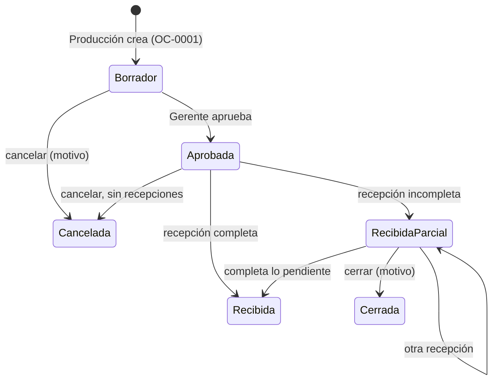
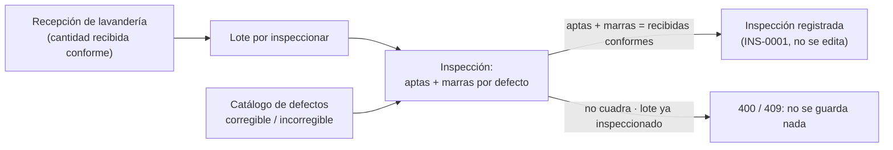
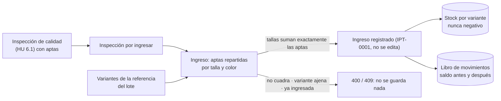
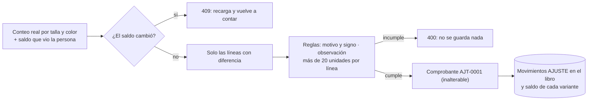
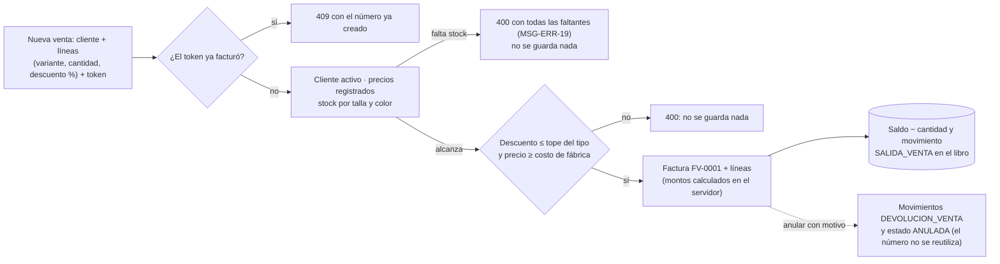

# Módulos y reglas de negocio

Resumen técnico de lo construido hasta ahora: por cada historia de usuario, qué hace, dónde vive en el
código, qué ruta la expone, qué permiso exige y qué reglas aplica. Los detalles de cada endpoint (parámetros,
cuerpos y respuestas) están en Swagger (`/api/docs/`); cómo se usa cada pantalla está en el
[manual de usuario](manual-de-usuario.md); los permisos por rol, en [roles y permisos](roles-y-permisos.md).

| Historia | Tema | App | Pantalla |
|---|---|---|---|
| HU 1.x | Seguridad, usuarios, roles y permisos | `users` | Seguridad y Usuarios |
| HU 2.1 a 2.4 | Inventario: proveedores, catálogo, movimientos, alertas | `inventory` | Inventario de Materias Primas |
| Compras | Órdenes de compra y recepción de mercancía | `purchasing` | Compras |
| HU 3.1 (TE-49) | Referencias de jean | `references` | Referencias de Jean |
| HU 3.2 (TE-50) | Ficha técnica de consumo por unidad | `references` | Botón *Ficha técnica* del catálogo de jeans |
| HU 4.1 (TE-51) | Validación de material y planificación | `production` | Órdenes de producción |
| HU 4.2 (TE-52) | Órdenes de producción y lotes | `production` | Órdenes de producción |
| HU 4.3 (TE-53) | Control de tiempos por etapa | `production` | Órdenes de producción → Seguimiento |
| HU 4.4 (TE-54) | Asignación de recursos | `production` | Recursos y Seguimiento |
| HU 4.5 (TE-55) | Monitor de estado | `production` | Monitor de estado |
| HU 4.6 (TE-56) | Costeo y liquidación de órdenes | `production`, `inventory` | Liquidación de Órdenes |
| HU 6.1 (TE-59) | Registro de marras y calidad | `quality` | Control de Calidad → Inspecciones y Defectos |
| HU 6.2 (TE-60) | Ingreso a inventario final (producto terminado) | `finished` | Producto Terminado → Ingreso, Existencias y Movimientos |
| HU 6.3 (TE-61) | Ajuste manual de inventario de producto terminado | `finished` | Producto Terminado → Ajuste manual |
| HU 7.1 (TE-62) | Facturación y descuento de inventario (factura POS interna) | `sales` | Ventas y Despachos → Panel de ventas, Nueva venta, Facturas, Clientes y Precios |

Cómo se conectan entre sí:

```mermaid
flowchart LR
    COMP["Compras<br/>orden → aprobación → recepción"] -- "ingreso con costo" --> INV[("Inventario<br/>stock · kardex · costo promedio")]
    REF["Referencias<br/>+ ficha técnica"] -- "consumo por prenda" --> PLAN["Simulación de material"]
    INV -- "stock disponible" --> PLAN
    PLAN --> ORD["Orden de producción<br/>y lotes"]
    ORD -- "descuenta el material<br/>(foto del costo)" --> INV
    ORD --> TIEMPOS["Etapas: corte → confección → terminación<br/>tiempos y asignación de recursos"]
    TIEMPOS --> MON["Monitor de estado"]
    TIEMPOS -- "minutos netos × tarifa" --> COSTEO["Liquidación y costo por prenda"]
    INV -- "costo unitario del material" --> COSTEO
    TIEMPOS -. "el lote sale a lavandería<br/>y vuelve recibido" .-> CAL["Control de calidad<br/>inspección del lote"]
    CAL -- "aptas · marras por defecto" --> RES["Resultado de la inspección<br/>(solo se agrega)"]
    RES -- "solo las aptas, repartidas<br/>por talla y color" --> TER[("Producto terminado<br/>stock por variante · libro de movimientos")]
    CONTEO["Conteo físico de la bodega"] -- "ajuste manual (HU 6.3)<br/>movimientos AJUSTE" --> TER
    TER -- "stock por talla y color" --> VEN["Ventas: factura POS interna<br/>(HU 7.1)"]
    VEN -- "SALIDA_VENTA al facturar<br/>DEVOLUCION_VENTA al anular" --> TER
    VEN -. "por cobrar · guía de la transportadora<br/>(HU 7.2 y 7.3, pendientes)" .-> COBRO["Despacho y cobro"]
```

## Seguridad y usuarios (HU 1.x)

- **Autenticación:** JWT (`/api/token/`); `access` de 15 min y `refresh` rotativo de 30 min.
- **Cuentas:** el registro público crea un usuario en rol `PENDING` con el área que pidió; un administrador lo aprueba
  asignándole rol. Las cuentas creadas por un administrador reciben una invitación (48 h) para definir su contraseña.
- **Recuperación de contraseña:** enlace de un solo uso que vence a los 15 minutos; solo se guarda su SHA-256.
- **Roles y permisos:** ver [roles y permisos](roles-y-permisos.md). Rutas en `apps/users/urls.py`.

## Inventario (HU 2.1 a 2.4)

App `apps/inventory`. Toda la lógica de stock está en `services.py` y todas las rutas cuelgan de `/api/inventario/`.

- **Catálogo:** nueve categorías que fijan tipo, unidades y datos obligatorios (ancho útil y composición para telas e hilos).
  Código automático por categoría (`TEL-0001`).
- **Kardex:** el stock solo cambia con movimientos (`Movimiento`), cada uno con saldo antes y después, usuario y fecha.
  Los saldos se bloquean por fila al escribir, así dos salidas simultáneas no dejan el stock en negativo.
- **Órdenes de salida:** `OP-0001` (producción) y `LV-0001` (lavandería), con varias líneas. Una salida con stock
  insuficiente se rechaza completa y devuelve `faltantes`. Anular una orden en proceso devuelve las cantidades.
- **Costo promedio ponderado:** cada compra puede traer `costo_unitario`; el costo del producto se recalcula como
  `(existencias × promedio + compra × costo) / (existencias + compra)`. Si lo que había no tenía costo, manda el de la
  compra; una compra sin costo no cambia el promedio. Al salir material por una orden, la línea guarda una **foto del
  costo** vigente (`OrdenLinea.costo_unitario`), que es la que usa el costeo.
- **Evidencias:** foto o PDF (5 MB, hasta 10 por movimiento u orden), validadas por su contenido.

## Compras: órdenes de compra y recepción de mercancía

App `apps/purchasing`, rutas bajo `/api/compras/`, tablas `compras_*`.

| Regla | Detalle |
|---|---|
| Quién hace qué | Producción crea, edita (solo en borrador), cancela y cierra (`compras.gestionar`); el Gerente aprueba (`compras.aprobar`); el Almacenista recibe (`inventario.gestionar`). |
| Contenido de la orden | Solo materia prima e insumos, sin repetir producto, hasta 100 líneas. El precio pactado por unidad es opcional. |
| Recepción | Varias filas en una sola transacción: si una falla, no se guarda ninguna. Cada fila lleva cantidad, lote y costo real (opcional). Código `RC-0001`. |
| Tolerancia | Se puede recibir hasta un **5 %** más de lo pendiente de cada línea (`OVERAGE_TOLERANCE`, fijo en el código). |
| Estados | Se guardan: borrador, aprobada, recibida parcial, recibida, cerrada y cancelada. La cantidad recibida de cada línea **no** se guarda: se suma de las recepciones. |
| Separación de funciones | Quien creó la orden no puede registrar su recepción. |
| Entrega sin orden | La recepción sin `orden` registra varios productos de un proveedor (remisión o factura, lote y costo). |
| Efecto en el inventario | Cada fila se registra con la misma regla del ingreso: suma al stock, recalcula el costo promedio y deja su fila en el kardex con el código de la orden y de la recepción. |

## Referencias de jean (HU 3.1, TE-49)

App `apps/references`, rutas bajo `/api/referencias/`, tablas `referencias_*`.

- Una **referencia** (`REF-0001`) tiene nombre, ajuste (skinny, slim, recto, bootcut, mom, wide leg, jogger u otro),
  descripción, **variantes** (talla × color, hasta 60) y hasta cinco imágenes del prototipo (2 MB cada una, una principal).
- **Estados:** `BORRADOR → ACTIVA → DESCONTINUADA` (y de vuelta a activa). Para activarla hacen falta al menos una variante
  y una imagen. Solo se archiva una referencia que no esté activa.
- Las imágenes se guardan en la base y se sirven con sesión y `ETag`.

## Ficha técnica de consumo por unidad (HU 3.2, TE-50)

- Una ficha por referencia: lista de materiales (materia prima o insumo del inventario, sin repetir, hasta 50) con
  **cantidad por prenda** (hasta 3 decimales; entera para botones, cierres y remaches) y **merma %** (0 a 50). Opcionalmente
  el tipo de lavado (`STONE_WASH`, `ENZIMATICO`, `LEJIA`, `OZONO`, `LASER` u `OTRO`) y notas.
- Guardar la ficha **reemplaza** la lista anterior. No se puede quitar mientras la referencia tenga órdenes en proceso.
- **Consumo contra el stock** (`/api/inventario/fichas-tecnicas/<id>/consumo/?cantidad=N`): la merma se aplica una sola vez
  y el resultado se redondea hacia arriba. Es una simulación; no reserva stock.
- **PDF de la ficha extensa** (geometral, secuencia de confección, tabla de medidas): hasta 5 MB, detectado por su contenido
  y guardado en la base. Se descarga con `ETag`.
- Permisos propios: `fichas_tecnicas.ver` y `fichas_tecnicas.gestionar`.

## Validación de material y planificación (HU 4.1, TE-51 / TE-110)

`POST /api/produccion/simulacion/` recibe referencia, cantidad y, opcionalmente, la lista de lotes. Devuelve:

- `viable`, y por material lo **requerido**, lo **disponible** y lo que **falta**;
- el **máximo producible** con el stock actual y su **cuello de botella** (el material que limita);
- si hay lotes, la **cobertura acumulada**: los lotes comparten el mismo stock, así que un lote se cubre si alcanza para
  él y los anteriores juntos.

Es de solo lectura (basta `produccion.ver`): la orden vuelve a verificar el stock bajo bloqueo al crearse. La pantalla
la llama sola, con una pequeña espera mientras se escribe.

## Órdenes de producción y lotes (HU 4.2, TE-52)

`POST /api/produccion/ordenes/` crea, en **una sola transacción**: la salida de inventario (que descuenta el material de
la ficha, con su merma), la orden de producción (`OP-0001`, el mismo código de la salida), sus lotes (`OP-0001-L01`…, hasta 50,
que deben sumar exactamente el total) y, opcionalmente, las tallas de cada lote. Si falta material no queda nada ni se gasta
el consecutivo. Anular la orden (`/anular/`, con motivo) devuelve el material y deja los lotes como historial.

## Control de tiempos por etapa (HU 4.3, TE-53)

- Cada lote recorre **Corte → Confección → Terminación**, en ese orden; una etapa empieza cuando la anterior terminó y un
  lote tiene una sola etapa en curso. La lavandería, la calidad y el empaque no son etapas de este seguimiento.
- Acciones: `iniciar`, `pausar`, `reanudar`, `completar` (`POST /api/produccion/lotes/<id>/<accion>/`). Cada una queda en el
  historial de la etapa (`EventoEtapa`), que solo recibe filas nuevas.
- **Tiempo neto** = suma de los intervalos en que la etapa estuvo corriendo; el tiempo en pausa no cuenta.
- El **estado** del lote y de la orden (*Planeada, En proceso, En pausa, Terminada, Cancelada*) **no se guarda**: se calcula
  desde sus etapas y desde la anulación. El bloqueo del lote evita que dos personas se pisen.

## Asignación de recursos (HU 4.4, TE-54)

- **Catálogo:** `Operario` (`OPE-0001`; etapas en que puede trabajar y forma de pago, solo informativa) y `Maquina`
  (`MAQ-0001`; tipo, serial, ubicación, etapas y estado físico: disponible, en mantenimiento o fuera de servicio).
  Un operario no necesita usuario del sistema. Nada se borra: se desactiva.
- **Asignación por etapa** (`AsignacionEtapa`): `asignar/` asigna, reasigna o quita; `desvincular/` quita el operario, la
  máquina o ambos; `asignaciones/` muestra el historial. Cada cambio cierra la asignación abierta y abre otra.
- **Se rechaza:** recurso inactivo o no habilitado para la etapa, máquina en mantenimiento o fuera de servicio, etapa terminada,
  orden anulada. **Solo se avisa** (campo `advertencias`): que el operario o la máquina ya estén en otra etapa en curso.
- Terminar la etapa o anular la orden libera los recursos. «Ocupado» se calcula con las asignaciones abiertas; no se guarda.

## Monitor de estado (HU 4.5, TE-55)

`GET /api/produccion/monitor/` devuelve los lotes en cuatro columnas (Planeada, En proceso, En pausa, Terminada) con su total.

| Parámetro | Efecto |
|---|---|
| `limite` | Tarjetas por columna (50 por defecto, máximo 200). Los totales siempre cuentan todo. |
| `orden`, `referencia` | Filtran por id; los totales respetan el filtro. |
| `terminadas_dias` | Ventana de la columna Terminada (7 por defecto, máximo 90). |
| `canceladas=1` | Agrega una columna Cancelada, de solo consulta. |

Cada tarjeta trae su `alerta` por tiempo detenido: `ATENCION` desde 2 horas y `CRITICA` desde 8 horas, para lotes en pausa o
entre una etapa y la siguiente. La respuesta resume las alertas de todos los lotes activos. Dentro de cada columna va primero lo
que más tiempo lleva esperando (en Terminada, lo más reciente). La pantalla se actualiza sola cada 20 s y permite mover un lote
arrastrando su tarjeta, lo que aplica la acción de la etapa en curso si es válida.

## Costeo y liquidación (HU 4.6, TE-56 / TE-129 / TE-130)

`GET /api/produccion/ordenes/<id>/costos/` calcula la liquidación de una orden (motor puro en `apps/production/costing.py`):

- **Materiales** = cantidad × costo unitario de la foto guardada en cada línea de la salida. Como el material se descuenta por
  orden completa, a cada lote se le asigna `total_materiales × prendas_del_lote / prendas_de_la_orden`.
- **Mano de obra** por lote y etapa = `(segundos netos / 60) × tarifa por minuto`, con la tarifa vigente a la fecha en que terminó
  la etapa (o a hoy si sigue en curso; entonces el costo es *provisional*).
- **Tarifas** (`/api/produccion/tarifas/`): historial por etapa; nunca se editan ni se borran. Para cambiar un precio se
  registra una nueva vigencia (`vigente_desde`).
- Se redondea a centavos solo al final (mitad hacia arriba). La respuesta incluye totales, **costo por prenda**, distribución
  porcentual y `completo: false` con `advertencias` si falta una tarifa o el costo de un material (*Sin tarifa*, *Sin costo*).
- Una orden anulada devuelve todos los costos en cero, porque el material regresó al almacén.

## Control de calidad: marras y defectos (HU 6.1, TE-59)

App `apps/quality`, rutas bajo `/api/calidad/`, tablas `calidad_defecto`, `calidad_inspeccion` y `calidad_marra_detalle`.
Cubre RF19 (criterios de calidad) y RF20 (registro de marras). La lógica está en `services.py`; las constantes (permisos,
prefijos `DEF` e `INS`, máximo de defectos por inspección) en `catalog.py`.

| Regla | Detalle |
|---|---|
| Catálogo de defectos (RF19) | Cada `TipoDefecto` (`DEF-0001`) tiene nombre (3 a 80 caracteres), descripción y tipo: **corregible** (se podría reprocesar) o **incorregible** (marra definitiva). El nombre no se repite, sin importar mayúsculas ni espacios de más, ni siquiera frente a uno desactivado. Nunca se borra: se **desactiva** (`PATCH` con `activo`), y un defecto inactivo no se puede elegir en una inspección nueva. |
| Qué se inspecciona | La base es lo **recibido conforme** (`RecepcionLote.cantidad_recibida_conforme`) en la recepción de lavandería más reciente del lote (HU 5.2, TE-58). Los faltantes y daños de lavandería ya los liquida esa recepción; aquí solo se clasifican las prendas que sí llegaron. No se modifica el modelo `Lote`. |
| Lote «por inspeccionar» | Está en planta, tiene una recepción con prendas conformes, su orden **no está anulada** y todavía **no tiene inspección**. Lo lista `GET /api/calidad/pendientes/`. |
| La suma debe cuadrar | `aptas + marras = cantidad recibida conforme`. Las marras son la suma de su desglose por defecto (hasta 30 defectos distintos, sin repetir, con cantidades enteras mayores que cero). Si no cuadra responde `400` indicando cuántas prendas faltan o sobran. Una restricción de la base (`ck_calidad_inspeccion_suma`) lo respalda. |
| Una inspección por lote | Si el lote ya fue inspeccionado responde `409` (también si otra persona la registró un instante antes: el lote se bloquea durante la transacción). Una restricción única lo respalda. |
| Solo se agrega | La inspección no tiene `PUT`, `PATCH` ni `DELETE`. Cada línea del desglose (`MarraDetalle`) guarda el **nombre y el tipo del defecto tal como estaban**, así que renombrar o desactivar un defecto después no cambia el historial. |
| Todo o nada | Se registra en una sola transacción: si algo falla no queda nada ni se gasta el consecutivo `INS-0001`. Se guardan el inspector (el usuario de la sesión), la fecha (hoy si no se envía) y observaciones de hasta 500 caracteres. |
| Se rechaza con `400` | Lote inexistente o sin recepción de lavandería lista, orden anulada, suma que no cuadra, defecto inactivo, inexistente o repetido, cantidades que no son enteras. |

Rutas y permisos (la referencia exacta está en Swagger, etiqueta `calidad`):

| Ruta | Operaciones | Permiso |
|---|---|---|
| `/api/calidad/defectos/` | `GET` (filtros `activo`, `q`, `limit`), `POST` | `calidad.ver` / `calidad.gestionar` |
| `/api/calidad/defectos/<id>/` | `GET`, `PATCH` | `calidad.ver` / `calidad.gestionar` |
| `/api/calidad/pendientes/` | `GET` | `calidad.ver` |
| `/api/calidad/inspecciones/` | `GET` (filtros `lote`, `orden`, `desde`, `hasta`, `q`, `limit`), `POST` | `calidad.ver` / `calidad.gestionar` |
| `/api/calidad/inspecciones/<id>/` | `GET` | `calidad.ver` |

Quién puede qué: el Personal de Terminación y el Jefe de Producción **gestionan** (definen defectos e inspeccionan; este último
por la migración `users/0010_permisos_calidad_produccion`), el Gerente solo **consulta** y el Administrador tiene todo. Ver
[roles y permisos](roles-y-permisos.md).

!!! warning "Limitaciones conocidas de la HU 6.1"
    - **Sin reproceso:** el tipo corregible/incorregible solo se registra; no hay flujo para reparar y volver a inspeccionar.
    - **Sin valoración de las marras:** no se calcula su costo ni su pérdida, y las aptas pasan al inventario de producto terminado
      (HU 6.2), pero las marras no tienen inventario.
    - **Sin muestreo AQL:** se clasifica el lote completo, no una muestra.
    - **Una inspección por lote y sin corrección:** si se digita mal una inspección no hay forma de corregirla desde el sistema
      (queda como pregunta pendiente para el responsable del producto).

## Producto terminado: ingreso al inventario final (HU 6.2, TE-60)

App `apps/finished`, rutas bajo `/api/terminado/`, tablas `terminado_stock`, `terminado_ingreso`, `terminado_ingreso_linea` y
`terminado_movimiento`. Cubre RF21 (ingreso de producto terminado). La lógica está en `services.py`; las constantes (permisos,
prefijo `IPT`, tipos de movimiento, máximo de líneas por ingreso) en `catalog.py`.

| Regla | Detalle |
|---|---|
| Qué se ingresa | Solo las **aptas** de una inspección de calidad (HU 6.1). Las **marras no entran** a este saldo: siguen sin inventario hasta la HU 6.4 (TE-169). |
| Inspección «por ingresar» | Tiene al menos una prenda apta, su orden **no está anulada** y todavía **no tiene ingreso**. La lista `GET /api/terminado/pendientes/` trae además las variantes (talla y color) de la referencia del lote y lo planificado por talla. |
| La suma debe cuadrar | Las líneas por talla y color deben sumar **exactamente** las aptas de la inspección. Si no cuadra responde `400` indicando cuántas prendas faltan o sobran. Hasta 100 variantes por ingreso, sin repetir, con cantidades enteras mayores que cero. |
| Variantes de la referencia | Cada talla y color debe ser una variante de la **referencia del lote**; una ajena se rechaza con `400`. |
| Lo planificado es un dato | Lo que el lote tenía planificado por talla (`LoteTalla`) se copia a cada línea (`planificada`, con su `diferencia`) para comparar; **no es una regla**: se puede ingresar distinto de lo planificado mientras la suma cuadre. |
| Un ingreso por inspección | Si la inspección ya fue ingresada responde `409` (también si otra persona la ingresó un instante antes). Una restricción única de la base lo respalda. |
| Todo o nada | Una sola transacción con la inspección bloqueada: el ingreso (`IPT-0001`), el saldo de cada variante y su movimiento en el libro. Los saldos se bloquean por fila en orden de id para que dos ingresos simultáneos no se bloqueen entre sí. Si algo falla no queda nada ni se gasta el consecutivo. |
| Saldo y libro | El saldo (`StockTerminado`) nunca es negativo y solo cambia con un movimiento. Cada movimiento (`MovimientoTerminado`) guarda cantidad con signo, saldo antes y saldo después, y una restricción de la base exige `saldo_después = saldo_antes + cantidad`. Tipos: `ENTRADA_PRODUCCION` (HU 6.2), `AJUSTE` (HU 6.3), `SALIDA_VENTA` y `DEVOLUCION_VENTA` (HU 7.1, sección «Ventas» más abajo). |
| Solo se agrega | No hay `PUT`, `PATCH` ni `DELETE`. Cada línea guarda la talla y el color tal como estaban al ingresar. |
| Ubicación en bodega | Solo un texto libre opcional por ingreso (hasta 80 caracteres), sin controles. |
| Código `IPT-0001` | No se usa `PT`, porque ese prefijo ya es el de los productos de la categoría Producto terminado del inventario de materias primas. |

Rutas y permisos (la referencia exacta está en Swagger, etiqueta `producto-terminado`):

| Ruta | Operaciones | Permiso |
|---|---|---|
| `/api/terminado/pendientes/` | `GET` | `producto_terminado.ver` |
| `/api/terminado/ingresos/` | `GET` (filtros `referencia`, `lote`, `desde`, `hasta`, `q`, `limit`), `POST` | `producto_terminado.ver` / `producto_terminado.gestionar` |
| `/api/terminado/ingresos/<id>/` | `GET` | `producto_terminado.ver` |
| `/api/terminado/existencias/` | `GET` (filtro `referencia`): matriz referencia × color × talla, con las celdas en cero | `producto_terminado.ver` |
| `/api/terminado/movimientos/` | `GET` (filtros `referencia`, `variante`, `tipo`, `desde`, `hasta`, `limit`) | `producto_terminado.ver` |

Quién puede qué: la Secretaria y el Administrador **gestionan** (ingresan); el Vendedor y el Gerente solo **consultan**. Los permisos
`producto_terminado.ver` y `producto_terminado.gestionar` ya existían desde la matriz inicial, así que **no hay migración de permisos
nueva**. Ver [roles y permisos](roles-y-permisos.md).

!!! warning "Limitaciones conocidas de la HU 6.2"
    - **Sin reversa de ingresos:** un ingreso equivocado no se anula; se corrige con un ajuste manual (HU 6.3, sección siguiente).
    - **Sin ubicaciones controladas:** la ubicación es solo texto libre; el aviso MSG-WRN-05 queda pendiente.
    - **Sin reservas ni valorización de costos:** el saldo es de cantidades; no se reserva para pedidos ni se calcula su valor.
    - **Sin recepción parcial:** se ingresan todas las aptas de la inspección de una vez.
    - **Sin notificación por correo** del nuevo stock (el aviso es una tarjeta en el inicio).
    - **Las marras siguen sin inventario** (HU 6.4, TE-169).

## Producto terminado: ajuste manual (HU 6.3, TE-61)

Misma app `apps/finished`. Cubre RF22 (ajuste manual del inventario). La lógica está en `adjustments.py`; las constantes (permiso,
prefijo `AJT`, motivos y signos, umbrales) en `catalog.py`. Tablas nuevas: `terminado_ajuste` (el comprobante: código, motivo,
observación, fecha, quién lo hizo, `token`, `unidades_faltantes` y `unidades_sobrantes`) y `terminado_ajuste_linea` (por variante: talla
y color tal como estaban, `stock_antes`, `stock_contado` y `diferencia`). Además `terminado_movimiento` gana la llave foránea
opcional `ajuste`, igual que ya tenía `ingreso`. El diagrama entidad-relación está en [modelo de datos](modelo-de-datos.md).

El ajuste **no cambia el saldo a mano**: escribe movimientos `AJUSTE` en el libro, uno por variante con diferencia, con el mismo saldo
antes y después de siempre. Por eso el saldo sigue siendo la suma del libro y la restricción `saldo_después = saldo_antes + cantidad`
sigue valiendo. El motivo del movimiento queda como `Ajuste AJT-0001: <motivo>`.

Reglas, en el orden en que el servicio las aplica (todo en una sola transacción: si algo falla no queda nada ni se gasta el consecutivo):

| Regla | Detalle |
|---|---|
| Datos básicos | El motivo debe ser uno del catálogo; la observación se recorta y debe tener entre **10** y 500 caracteres; llegan de 1 a **200** líneas, sin repetir variante, con `esperado` y `contado` enteros desde cero y variantes que existen. Un `token` que no es UUID responde `400`. |
| Conteo real y saldo esperado | Cada línea trae el saldo que vio la persona (`esperado`) y lo que contó (`contado`). Con los saldos ya **bloqueados por fila**, si alguno no coincide con el real (por ejemplo, entró un ingreso mientras contaba) responde `409` con la lista de variantes y no guarda nada. |
| Solo líneas con diferencia | Las líneas donde lo contado es igual al saldo se descartan. Si no queda ninguna responde `400` («No hay diferencias que ajustar»). |
| Faltantes y sobrantes por separado | El comprobante suma `unidades_faltantes` y `unidades_sobrantes` sin netearlos: faltar 5 en una talla y sobrar 5 en otra son 5 y 5, no cero. |
| Motivos cerrados con signo | `ERROR_CONTEO` (Error de conteo) admite ambos signos; `MUESTRA_COMERCIAL`, `PERDIDA` (Pérdida) y `PRENDA_DANADA` (Prenda dañada) solo restan; `SOBRANTE` (Sobrante o hallazgo) solo suma; `OTRO` (Otro) admite ambos. Un motivo que solo resta rechaza con `400` cualquier línea con sobrante, y al revés. |
| Más de 20 unidades por línea | Se mira **cada línea**, no el total del ajuste: si alguna cambia **más de 20** unidades (exactamente 20 no cuenta), el motivo «Otro» no se acepta y la observación debe tener al menos **30** caracteres. |
| Token contra el doble clic | El formulario genera un UUID (`token`) que la base exige único. Si ya existe un comprobante con ese token, el segundo envío responde `409` con el comprobante ya creado (`ajuste` y `codigo`); lo mismo si dos envíos con el mismo token compiten. |
| Inmutable | No hay `PUT`, `PATCH` ni `DELETE`. Restricciones de la base respaldan la observación obligatoria, que la diferencia no sea cero y que `diferencia = contado − stock_antes`. |
| Código `AJT-0001` | Consecutivo automático. |

Rutas y permisos (la referencia exacta está en Swagger, etiqueta `producto-terminado`):

| Ruta | Operaciones | Permiso |
|---|---|---|
| `/api/terminado/ajustes/` | `GET` (filtros `referencia`, `motivo`, `desde`, `hasta`, `q`, `limit`), `POST` | `producto_terminado.ver` / `producto_terminado.ajustar` |
| `/api/terminado/ajustes/<id>/` | `GET` | `producto_terminado.ver` |
| `/api/terminado/metadatos/` | `GET`: motivos con su signo, umbral de unidades y mínimos de la observación | `producto_terminado.ver` |

**Permiso nuevo:** `producto_terminado.ajustar`, creado por la migración `users/0011_permiso_ajustar_producto_terminado`. Se otorga a la
Secretaria y, de forma implícita, al Administrador; el Gerente y el Vendedor solo consultan (`producto_terminado.ver`). Como es un
permiso propio, se puede dar o quitar desde *Roles y permisos* sin tocar el de ingresar. Ver [roles y permisos](roles-y-permisos.md).

**Pantalla:** *Producto Terminado → Ajuste manual* (`/producto-terminado/ajuste`). Quien solo tiene `ver` puede entrar al historial
de ajustes pero no hace el conteo. En *Existencias*, cada referencia muestra el enlace **Ajustar** (solo con el permiso), que abre esta
pantalla con la referencia ya elegida.

**Pruebas:** `apps/finished/test_ajustes.py` cubre el cálculo de la diferencia desde el conteo, un movimiento `AJUSTE` por línea, que el
saldo siga siendo la suma del libro, el `409` por saldo cambiado, el ajuste sin diferencias, las reglas de signo por motivo, la
observación obligatoria, el umbral de 20 unidades (con «Otro» y la observación de 30), el token único, la inmutabilidad, los permisos
por rol, los filtros y que las consultas no crezcan con las filas.

!!! warning "Limitaciones conocidas de la HU 6.3"
    - **Sin aprobación de un segundo rol:** quien tiene `producto_terminado.ajustar` ajusta directamente; un ajuste grande solo
      exige más justificación, no otra firma.
    - **Sin conteo ciego ni cíclico:** la pantalla muestra el saldo del sistema junto a cada celda; no hay programación de conteos.
    - **Sin fotos ni evidencias** adjuntas al comprobante.
    - **Sin valorización:** el ajuste cuenta prendas, no calcula su valor.
    - **Un motivo por ajuste:** si hay faltantes y sobrantes de causas distintas hay que registrar un ajuste por cada motivo.
    - **Sin anular ni editar:** un ajuste equivocado se corrige con otro ajuste.

## Ventas: factura POS interna y descuento de inventario (HU 7.1, TE-62)

App nueva `apps/sales`, rutas bajo `/api/ventas/`. Cubre RF23 (facturación y descuento de inventario). La lógica está en `invoicing.py`
(emitir y anular), el PDF en `pdf.py` (con **reportlab**, dependencia nueva en `requirements.txt`) y las constantes (permisos, prefijos,
IVA, topes de descuento, transportadoras, leyenda) en `catalog.py`.

!!! warning "No es factura electrónica"
    El documento que emite TexCore es una **factura POS interna**: un comprobante propio de la empresa, **no una factura electrónica ante
    la DIAN**. La leyenda *«Factura POS interna. No es factura electrónica.»* aparece en pantalla (Panel de ventas, Facturas y su
    detalle), en el PDF y en el campo `aviso` de la API. El alcance del proyecto excluye la facturación electrónica, la contabilidad,
    la nómina, el comercio electrónico y la gestión tributaria.

Tablas nuevas (prefijo `ventas_`, borrado lógico como el resto):

| Tabla | Qué guarda |
|---|---|
| `ventas_cliente` | A quién se le vende: código `CLI-0001`, tipo y número de documento (único entre los activos), dígito de verificación (solo NIT), nombre, **tipo** (`DETAL`, `MAYORISTA` o `DISTRIBUIDOR`), ciudad, dirección, teléfono, correo opcional y `activo`. |
| `ventas_precio_referencia` | Costo de fábrica, precio mayorista y precio de detal de **una referencia** (uno por referencia), en pesos enteros y antes de IVA, y quién lo actualizó. |
| `ventas_factura` | La factura: número `FV-0001` (único), cliente y **copia** de su nombre, documento, tipo, ciudad, dirección y teléfono, vendedor, fecha, `estado` (`EMITIDA` o `ANULADA`), `modalidad_pago` (`CONTRAENTREGA`), `estado_cobro` (`POR_COBRAR`), `transportadora` y `numero_guia` (opcionales), observaciones, montos (`subtotal`, `descuento_total`, `base_gravable`, `iva_tarifa`, `iva_total`, `total`, `valor_a_recaudar`), el `token` único del formulario y los datos de la anulación (`motivo_anulacion`, `anulada_por`, `anulada_en`). |
| `ventas_factura_linea` | Una variante (talla y color) vendida: referencia, talla y color tal como estaban, cantidad, precio unitario, `descuento_pct`, copia del costo de fábrica y los montos de la línea (`subtotal`, `descuento`, `base`, `iva`, `total`). |

Además `terminado_movimiento` gana la llave foránea opcional `factura` (igual que ya tenía `ingreso` y `ajuste`) y un tipo nuevo,
`DEVOLUCION_VENTA` («Reingreso por anulación de venta»), junto al `SALIDA_VENTA` que el libro ya tenía reservado (migración
`finished/0003_ventas_facturacion`). Restricciones de la base respaldan las cuentas: `base = subtotal − descuento`, `total = base + IVA`
y `valor_a_recaudar = total` en la factura; `subtotal = precio × cantidad` en la línea; y costo ≤ mayorista ≤ detal en los precios. El
diagrama entidad-relación está en [modelo de datos](modelo-de-datos.md).

Reglas, en el orden en que el servicio las aplica (la emisión es una sola transacción: si algo falla no queda nada, ni siquiera el consecutivo):

| Regla | Detalle |
|---|---|
| Token contra el doble clic | El formulario genera un UUID (`token`) que la base exige único. Un `token` que no es UUID responde `400`. Si ya existe una factura con ese token, el segundo envío responde `409` con la factura ya creada (`factura` y `numero`); lo mismo si dos envíos con el mismo token compiten. |
| Cliente y despacho | El cliente debe existir y estar **activo**. La transportadora, si viene, es una de la lista (`INTERRAPIDISIMO`, `ENVIA` u `OTRA`); el número de guía (hasta 40 caracteres) es opcional y la factura solo lo guarda: lo consulta la HU 7.2. Las observaciones admiten hasta 500 caracteres. |
| Líneas | De 1 a **100** variantes distintas, cada una con cantidad entera mayor que cero, `descuento_pct` entero de 0 a 100 (por defecto 0) y una variante que exista. Una talla y color no puede repetirse. |
| Precio registrado | Toda referencia vendida debe tener su fila en `ventas_precio_referencia`; si falta, `400` con los códigos que no tienen precio. |
| Stock suficiente | Se bloquean los saldos por fila, en orden de id, y se compara cada línea con lo disponible. Si **alguna** talla y color no alcanza, responde `400` (MSG-ERR-19) con **todas** las faltantes en `faltantes` (variante, nombre, disponible y pedido) y **no guarda nada**. Si dos vendedores piden las últimas unidades, gana el primero y el otro recibe ese `400`. |
| Precio de lista por tipo de cliente | `DETAL` paga el precio de detal; `MAYORISTA` y `DISTRIBUIDOR` pagan el mayorista. Todo antes de IVA. |
| Descuento decidido por el vendedor, con tope | Lo digita el vendedor por línea; el máximo depende del tipo de cliente: **Detal 5 %, Mayorista 15 %, Distribuidor 20 %**. Pasarse responde `400` con el tope. |
| Nunca por debajo del costo de fábrica | Aun dentro del tope, si el precio con descuento queda por debajo del costo de fábrica de la referencia, `400` indicando el costo (el costo exacto sí se permite). Los problemas de descuento de todas las líneas se devuelven juntos. |
| Montos en pesos enteros | Los calcula siempre el servidor, con una sola regla de redondeo (**mitad hacia arriba**): cada línea redondea su descuento y su IVA, y la factura es la **suma de sus líneas**. Lo que muestra la pantalla es solo una vista previa. |
| IVA | General del **19 %**, guardado en cada factura (`iva_tarifa`): cambiarlo después no toca las ya emitidas. |
| Numeración sin huecos | `FV-0001`, `FV-0002`… dentro de la transacción: si algo falla antes no se gasta el número. |
| Descuento del inventario | Por cada línea, el saldo baja y se escribe un movimiento `SALIDA_VENTA` en el libro (cantidad negativa, saldo antes y después, la factura y el usuario), así que el saldo sigue siendo la suma del libro. |
| Contraentrega | Toda venta es `CONTRAENTREGA`: el `valor_a_recaudar` es el total y el `estado_cobro` queda en `POR_COBRAR` hasta que la HU 7.3 lo cobre. |
| Copia de lo vendido | La factura guarda el cliente, el precio, el descuento, el costo de fábrica y el IVA del momento; cambiar después los datos del cliente o los precios no la toca. |
| Sin edición ni borrado | No hay `PUT`, `PATCH` ni `DELETE` sobre facturas: se **anulan**. |
| Anulación con motivo | Exige un motivo de **10 a 255 caracteres** (sin contar espacios de los extremos). Reingresa cada línea con un movimiento `DEVOLUCION_VENTA` (motivo `Anulación de FV-0001: …`), marca la factura `ANULADA` con quién y cuándo, y **no reutiliza el número**. Una factura ya anulada responde `409`. Anular exige un permiso propio. |

Rutas y permisos (la referencia exacta está en Swagger, etiqueta `ventas`):

| Ruta | Operaciones | Permiso |
|---|---|---|
| `/api/ventas/metadatos/` | `GET`: tipos de cliente con su lista de precios y descuento máximo, tipos de documento, transportadoras, IVA, la leyenda y el mínimo del motivo | `ventas.ver` |
| `/api/ventas/clientes/` | `GET` (filtros `tipo`, `activo`, `q`, `limit`), `POST` | `ventas.ver` / `ventas.gestionar` |
| `/api/ventas/clientes/<id>/` | `GET`, `PATCH` (un cliente no se borra: se desactiva con `activo`) | `ventas.ver` / `ventas.gestionar` |
| `/api/ventas/precios/` | `GET` (filtro `q`): las referencias activas con su costo y precios (vacíos si todavía no se registran) | `ventas.ver` |
| `/api/ventas/precios/<referencia>/` | `PUT`: registra o actualiza el costo de fábrica y los precios de una referencia | `ventas.precios` |
| `/api/ventas/facturas/` | `GET` (filtros `cliente`, `estado`, `desde`, `hasta`, `q`, `limit`), `POST` (emite y descuenta) | `ventas.ver` / `ventas.gestionar` |
| `/api/ventas/facturas/<id>/` | `GET` con sus líneas | `ventas.ver` |
| `/api/ventas/facturas/<id>/pdf/` | `GET`: descarga `FV-0001.pdf` | `ventas.ver` |
| `/api/ventas/facturas/<id>/anular/` | `POST` con `motivo` | `ventas.anular` |

Validaciones de clientes y precios: el documento son de 5 a 15 dígitos, sin puntos ni guiones, y no puede repetirse entre clientes activos
del mismo tipo de documento; el dígito de verificación (un solo número) solo aplica al NIT; el nombre pide al menos 3 caracteres y el
teléfono 7 a 20 caracteres válidos. Los precios son enteros de 1 a 100.000.000 con **costo de fábrica ≤ mayorista ≤ detal**.

**Permisos:** `ventas.ver` y `ventas.gestionar` ya existían desde la matriz inicial (migración `users/0003`). La migración
`users/0012_permisos_ventas_precios_anular` crea `ventas.precios` (administrar precios y costo de fábrica) y `ventas.anular` (anular
facturas) y los otorga al **Gerente**; el Administrador los tiene de forma implícita. El Vendedor queda con `ventas.ver` y
`ventas.gestionar` (registra clientes y factura); el Gerente consulta, administra los precios y anula, pero no factura. Ver
[roles y permisos](roles-y-permisos.md).

**Pantallas** (menú *Ventas y Despachos*):

- *Panel de ventas* (`/ventas/panel`): la leyenda de que la factura es interna, el resumen del día y las últimas facturas.
- *Nueva venta* (`/ventas/nueva`, exige `ventas.gestionar`): elegir o crear el cliente, una **matriz de color × talla** con la disponibilidad de
  cada celda, el descuento por línea con su tope, los **totales en vivo** (subtotal, descuento, base gravable, IVA y total), el despacho
  (transportadora y guía) y el botón **Facturar**, que envía el `token` del formulario. Al terminar ofrece **Descargar PDF**.
- *Facturas* (`/ventas/facturas`): lista con búsqueda por número, cliente o documento y filtros básicos de estado y fechas; el detalle muestra
  las líneas con el precio, descuento e IVA del momento, el PDF y, con `ventas.anular`, la anulación con motivo.
- *Clientes* (`/ventas/clientes`) y *Precios* (`/ventas/precios`): mantenimiento de clientes (con permiso de gestionar) y del costo de
  fábrica y los precios por referencia (con `ventas.precios`).

**Datos de demostración:** `python manage.py seed_demo_ventas` (solo con `DJANGO_DEBUG=true`, idempotente) crea **4 clientes** (un
distribuidor, dos mayoristas y uno de detal) y los precios de demostración de cinco referencias (mayorista ≈ costo × 1,45 y detal ≈ costo × 1,90).
No crea facturas, para hacerlas en vivo, y no toca una referencia que ya tenga precio. Necesita antes `seed_demo_referencias`
(o `seed_demo_inventario`) y, para tener stock que vender, `seed_demo_terminado`.

**Pruebas:** `apps/sales/test_ventas.py` cubre el redondeo y los montos de una línea, la emisión con descuento del stock y un movimiento por
variante, el precio de detal y mayorista, que la factura sea la suma de sus líneas y el saldo la suma del libro, el `400` con todas las faltantes sin
guardar nada, las últimas unidades para el primero, la numeración sin huecos, el tope de descuento por tipo de cliente, el piso del costo
de fábrica (el costo exacto pasa y un peso menos no), el token único (y que la base impida repetirlo o totales que no cuadran), la anulación
(devuelve las unidades, conserva la factura, no se repite y exige motivo y permiso), que las facturas no se editen ni se borren, los permisos por
rol, los filtros, que las consultas no crezcan con las filas, el PDF, los metadatos, los clientes y los precios. Los permisos por rol de la
migración se prueban en `apps/users/tests.py`.

!!! warning "Limitaciones conocidas de la HU 7.1"
    - **Sin factura electrónica:** es un comprobante interno; no hay numeración autorizada, CUFE ni envío a la DIAN, ni contabilidad.
    - **Solo contraentrega:** no hay venta de contado, a crédito ni abonos (deuda técnica). La factura queda `POR_COBRAR` y la HU 7.3 la cobra.
    - **Sin pedidos ni reservas:** se factura contra el stock disponible en ese instante; no se reserva producto para un pedido.
    - **Sin devolución parcial ni flete:** solo se anula la factura completa. En una devolución el flete se descuenta al vendedor (política de
      la empresa) y lo resolverán las HU 7.2 y 7.3; la factura ya guarda el vendedor para ello.
    - **Precios y costo a mano:** el Gerente fija el costo de fábrica y los precios; a futuro el costo saldrá de la liquidación de la orden
      (deuda técnica, ítem 19).
    - **Despacho y cobro para después:** la transportadora y el número de guía se guardan, pero su seguimiento es de la HU 7.2.
    - **Filtros avanzados e impresión directa:** quedan fuera; la lista tiene búsqueda, estado y fechas (Sprint 4) y el comprobante se entrega solo en PDF.
    - **Un solo IVA:** tarifa general del 19 %, sin productos exentos ni retenciones.

## Datos de demostración

Comandos solo para desarrollo (exigen `DJANGO_DEBUG=true`), idempotentes y que pasan por las mismas reglas que la aplicación.
`seed_demo_calidad` crea 8 defectos típicos de denim y dos lotes devueltos de lavandería (uno inspeccionado y otro por inspeccionar); necesita antes `seed_demo_inventario` y `seed_demo_produccion`. `seed_demo_terminado` ingresa al inventario final las aptas de la inspección de demostración; necesita antes `seed_demo_calidad`. `seed_demo_ventas` crea 4 clientes y los precios de demostración; necesita antes `seed_demo_referencias` (o `seed_demo_inventario`). Orden recomendado: ver [manual del sistema](manual-del-sistema.md#datos-de-demostracion).
