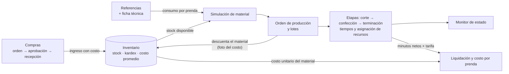
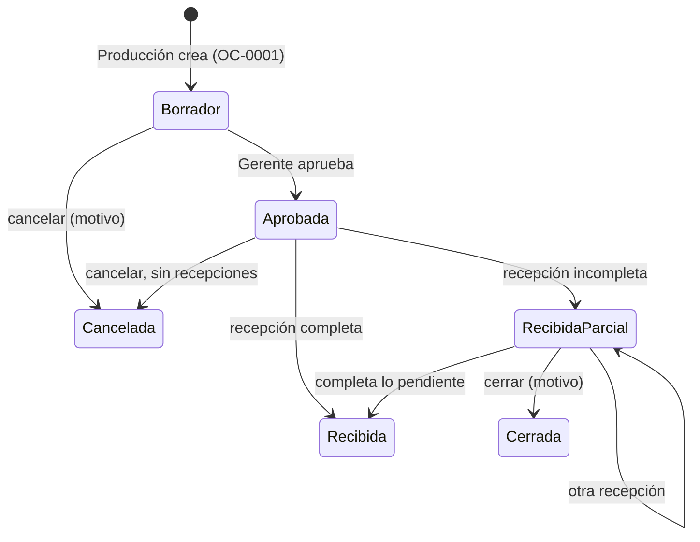

# Módulos y reglas de negocio

Resumen técnico de lo construido hasta el Sprint 2: por cada historia de usuario, qué hace, dónde vive en el
código, qué ruta la expone, qué permiso exige y qué reglas aplica. Los detalles de cada endpoint (parámetros,
cuerpos y respuestas) están en Swagger (`/api/docs/`); cómo se usa cada pantalla está en el
[manual de usuario](manual-de-usuario.md); los permisos por rol, en [roles y permisos](roles-y-permisos.md).

| Historia | Tema | App | Pantalla |
|---|---|---|---|
| HU 1.x | Seguridad, usuarios, roles y permisos | `users` | Seguridad y Usuarios |
| HU 2.1 a 2.4 | Inventario: proveedores, catálogo, movimientos, alertas | `inventory` | Inventario de Materias Primas |
| Compras | Órdenes de compra y recepción de mercancía | `purchasing` | Compras |
| HU 3.1 (TE-49) | Referencias de jean | `references` | Referencias de Jean |
| HU 3.2 (TE-50) | Ficha técnica de consumo por unidad | `references` | Botón *Ficha técnica* del catálogo de jeans |
| HU 4.1 (TE-51) | Validación de material y planificación | `production` | Órdenes de producción |
| HU 4.2 (TE-52) | Órdenes de producción y lotes | `production` | Órdenes de producción |
| HU 4.3 (TE-53) | Control de tiempos por etapa | `production` | Órdenes de producción → Seguimiento |
| HU 4.4 (TE-54) | Asignación de recursos | `production` | Recursos y Seguimiento |
| HU 4.5 (TE-55) | Monitor de estado | `production` | Monitor de estado |
| HU 4.6 (TE-56) | Costeo y liquidación de órdenes | `production`, `inventory` | Liquidación de Órdenes |

Cómo se conectan entre sí:

## Seguridad y usuarios (HU 1.x)

- **Autenticación:** JWT (`/api/token/`); `access` de 15 min y `refresh` rotativo de 30 min.
- **Cuentas:** el registro público crea un usuario en rol `PENDING` con el área que pidió; un administrador lo aprueba
  asignándole rol. Las cuentas creadas por un administrador reciben una invitación (48 h) para definir su contraseña.
- **Recuperación de contraseña:** enlace de un solo uso que vence a los 15 minutos; solo se guarda su SHA-256.
- **Roles y permisos:** ver [roles y permisos](roles-y-permisos.md). Rutas en `apps/users/urls.py`.

## Inventario (HU 2.1 a 2.4)

App `apps/inventory`. Toda la lógica de stock está en `services.py` y todas las rutas cuelgan de `/api/inventario/`.

- **Catálogo:** nueve categorías que fijan tipo, unidades y datos obligatorios (ancho útil y composición para telas e hilos).
  Código automático por categoría (`TEL-0001`).
- **Kardex:** el stock solo cambia con movimientos (`Movimiento`), cada uno con saldo antes y después, usuario y fecha.
  Los saldos se bloquean por fila al escribir, así dos salidas simultáneas no dejan el stock en negativo.
- **Órdenes de salida:** `OP-0001` (producción) y `LV-0001` (lavandería), con varias líneas. Una salida con stock
  insuficiente se rechaza completa y devuelve `faltantes`. Anular una orden en proceso devuelve las cantidades.
- **Costo promedio ponderado:** cada compra puede traer `costo_unitario`; el costo del producto se recalcula como
  `(existencias × promedio + compra × costo) / (existencias + compra)`. Si lo que había no tenía costo, manda el de la
  compra; una compra sin costo no cambia el promedio. Al salir material por una orden, la línea guarda una **foto del
  costo** vigente (`OrdenLinea.costo_unitario`), que es la que usa el costeo.
- **Evidencias:** foto o PDF (5 MB, hasta 10 por movimiento u orden), validadas por su contenido.

## Compras: órdenes de compra y recepción de mercancía

App `apps/purchasing`, rutas bajo `/api/compras/`, tablas `compras_*`.

| Regla | Detalle |
|---|---|
| Quién hace qué | Producción crea, edita (solo en borrador), cancela y cierra (`compras.gestionar`); el Gerente aprueba (`compras.aprobar`); el Almacenista recibe (`inventario.gestionar`). |
| Contenido de la orden | Solo materia prima e insumos, sin repetir producto, hasta 100 líneas. El precio pactado por unidad es opcional. |
| Recepción | Varias filas en una sola transacción: si una falla, no se guarda ninguna. Cada fila lleva cantidad, lote y costo real (opcional). Código `RC-0001`. |
| Tolerancia | Se puede recibir hasta un **5 %** más de lo pendiente de cada línea (`OVERAGE_TOLERANCE`, fijo en el código). |
| Estados | Se guardan: borrador, aprobada, recibida parcial, recibida, cerrada y cancelada. La cantidad recibida de cada línea **no** se guarda: se suma de las recepciones. |
| Separación de funciones | Quien creó la orden no puede registrar su recepción. |
| Entrega sin orden | La recepción sin `orden` registra varios productos de un proveedor (remisión o factura, lote y costo). |
| Efecto en el inventario | Cada fila se registra con la misma regla del ingreso: suma al stock, recalcula el costo promedio y deja su fila en el kardex con el código de la orden y de la recepción. |

## Referencias de jean (HU 3.1, TE-49)

App `apps/references`, rutas bajo `/api/referencias/`, tablas `referencias_*`.

- Una **referencia** (`REF-0001`) tiene nombre, ajuste (skinny, slim, recto, bootcut, mom, wide leg, jogger u otro),
  descripción, **variantes** (talla × color, hasta 60) y hasta cinco imágenes del prototipo (2 MB cada una, una principal).
- **Estados:** `BORRADOR → ACTIVA → DESCONTINUADA` (y de vuelta a activa). Para activarla hacen falta al menos una variante
  y una imagen. Solo se archiva una referencia que no esté activa.
- Las imágenes se guardan en la base y se sirven con sesión y `ETag`.

## Ficha técnica de consumo por unidad (HU 3.2, TE-50)

- Una ficha por referencia: lista de materiales (materia prima o insumo del inventario, sin repetir, hasta 50) con
  **cantidad por prenda** (hasta 3 decimales; entera para botones, cierres y remaches) y **merma %** (0 a 50). Opcionalmente
  el tipo de lavado (`STONE_WASH`, `ENZIMATICO`, `LEJIA`, `OZONO`, `LASER` u `OTRO`) y notas.
- Guardar la ficha **reemplaza** la lista anterior. No se puede quitar mientras la referencia tenga órdenes en proceso.
- **Consumo contra el stock** (`/api/inventario/fichas-tecnicas/<id>/consumo/?cantidad=N`): la merma se aplica una sola vez
  y el resultado se redondea hacia arriba. Es una simulación; no reserva stock.
- **PDF de la ficha extensa** (geometral, secuencia de confección, tabla de medidas): hasta 5 MB, detectado por su contenido
  y guardado en la base. Se descarga con `ETag`.
- Permisos propios: `fichas_tecnicas.ver` y `fichas_tecnicas.gestionar`.

## Validación de material y planificación (HU 4.1, TE-51 / TE-110)

`POST /api/produccion/simulacion/` recibe referencia, cantidad y, opcionalmente, la lista de lotes. Devuelve:

- `viable`, y por material lo **requerido**, lo **disponible** y lo que **falta**;
- el **máximo producible** con el stock actual y su **cuello de botella** (el material que limita);
- si hay lotes, la **cobertura acumulada**: los lotes comparten el mismo stock, así que un lote se cubre si alcanza para
  él y los anteriores juntos.

Es de solo lectura (basta `produccion.ver`): la orden vuelve a verificar el stock bajo bloqueo al crearse. La pantalla
la llama sola, con una pequeña espera mientras se escribe.

## Órdenes de producción y lotes (HU 4.2, TE-52)

`POST /api/produccion/ordenes/` crea, en **una sola transacción**: la salida de inventario (que descuenta el material de
la ficha, con su merma), la orden de producción (`OP-0001`, el mismo código de la salida), sus lotes (`OP-0001-L01`…, hasta 50,
que deben sumar exactamente el total) y, opcionalmente, las tallas de cada lote. Si falta material no queda nada ni se gasta
el consecutivo. Anular la orden (`/anular/`, con motivo) devuelve el material y deja los lotes como historial.

## Control de tiempos por etapa (HU 4.3, TE-53)

- Cada lote recorre **Corte → Confección → Terminación**, en ese orden; una etapa empieza cuando la anterior terminó y un
  lote tiene una sola etapa en curso. La lavandería, la calidad y el empaque no son etapas de este seguimiento.
- Acciones: `iniciar`, `pausar`, `reanudar`, `completar` (`POST /api/produccion/lotes/<id>/<accion>/`). Cada una queda en el
  historial de la etapa (`EventoEtapa`), que solo recibe filas nuevas.
- **Tiempo neto** = suma de los intervalos en que la etapa estuvo corriendo; el tiempo en pausa no cuenta.
- El **estado** del lote y de la orden (*Planeada, En proceso, En pausa, Terminada, Cancelada*) **no se guarda**: se calcula
  desde sus etapas y desde la anulación. El bloqueo del lote evita que dos personas se pisen.

## Asignación de recursos (HU 4.4, TE-54)

- **Catálogo:** `Operario` (`OPE-0001`; etapas en que puede trabajar y forma de pago, solo informativa) y `Maquina`
  (`MAQ-0001`; tipo, serial, ubicación, etapas y estado físico: disponible, en mantenimiento o fuera de servicio).
  Un operario no necesita usuario del sistema. Nada se borra: se desactiva.
- **Asignación por etapa** (`AsignacionEtapa`): `asignar/` asigna, reasigna o quita; `desvincular/` quita el operario, la
  máquina o ambos; `asignaciones/` muestra el historial. Cada cambio cierra la asignación abierta y abre otra.
- **Se rechaza:** recurso inactivo o no habilitado para la etapa, máquina en mantenimiento o fuera de servicio, etapa terminada,
  orden anulada. **Solo se avisa** (campo `advertencias`): que el operario o la máquina ya estén en otra etapa en curso.
- Terminar la etapa o anular la orden libera los recursos. «Ocupado» se calcula con las asignaciones abiertas; no se guarda.

## Monitor de estado (HU 4.5, TE-55)

`GET /api/produccion/monitor/` devuelve los lotes en cuatro columnas (Planeada, En proceso, En pausa, Terminada) con su total.

| Parámetro | Efecto |
|---|---|
| `limite` | Tarjetas por columna (50 por defecto, máximo 200). Los totales siempre cuentan todo. |
| `orden`, `referencia` | Filtran por id; los totales respetan el filtro. |
| `terminadas_dias` | Ventana de la columna Terminada (7 por defecto, máximo 90). |
| `canceladas=1` | Agrega una columna Cancelada, de solo consulta. |

Cada tarjeta trae su `alerta` por tiempo detenido: `ATENCION` desde 2 horas y `CRITICA` desde 8 horas, para lotes en pausa o
entre una etapa y la siguiente. La respuesta resume las alertas de todos los lotes activos. Dentro de cada columna va primero lo
que más tiempo lleva esperando (en Terminada, lo más reciente). La pantalla se actualiza sola cada 20 s y permite mover un lote
arrastrando su tarjeta, lo que aplica la acción de la etapa en curso si es válida.

## Costeo y liquidación (HU 4.6, TE-56 / TE-129 / TE-130)

`GET /api/produccion/ordenes/<id>/costos/` calcula la liquidación de una orden (motor puro en `apps/production/costing.py`):

- **Materiales** = cantidad × costo unitario de la foto guardada en cada línea de la salida. Como el material se descuenta por
  orden completa, a cada lote se le asigna `total_materiales × prendas_del_lote / prendas_de_la_orden`.
- **Mano de obra** por lote y etapa = `(segundos netos / 60) × tarifa por minuto`, con la tarifa vigente a la fecha en que terminó
  la etapa (o a hoy si sigue en curso; entonces el costo es *provisional*).
- **Tarifas** (`/api/produccion/tarifas/`): historial por etapa; nunca se editan ni se borran. Para cambiar un precio se
  registra una nueva vigencia (`vigente_desde`).
- Se redondea a centavos solo al final (mitad hacia arriba). La respuesta incluye totales, **costo por prenda**, distribución
  porcentual y `completo: false` con `advertencias` si falta una tarifa o el costo de un material (*Sin tarifa*, *Sin costo*).
- Una orden anulada devuelve todos los costos en cero, porque el material regresó al almacén.

## Datos de demostración

Comandos solo para desarrollo (exigen `DJANGO_DEBUG=true`), idempotentes y que pasan por las mismas reglas que la aplicación.
Orden recomendado: ver [manual del sistema](manual-del-sistema.md#datos-de-demostracion).
