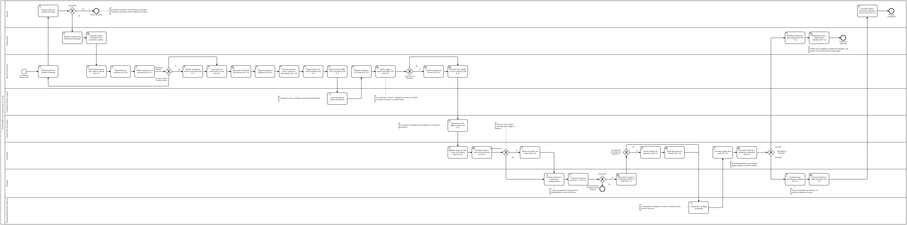
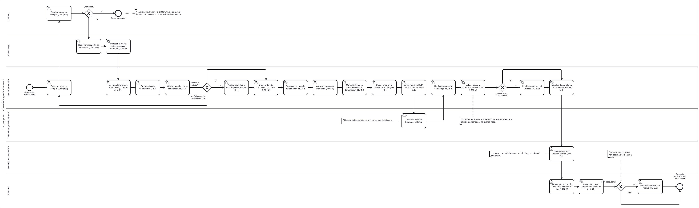
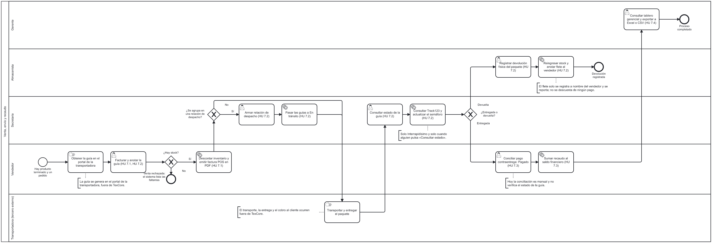

# Procesos de negocio (BPMN)

Esta página muestra el proceso de negocio que TexCore automatiza hoy (estado al Sprint 3, 12 de noviembre de 2026), desde la compra de la materia prima hasta el recaudo de la venta y los reportes del Gerente. Está modelado en **BPMN 2.0**, el estándar para dibujar procesos con piscinas y carriles: cada carril es un rol y cada flecha, el orden en que se hacen las cosas.

## Cómo leer el diagrama

| Símbolo | Significa |
|---|---|
| Círculo de borde fino | Evento de inicio: de dónde arranca el proceso. |
| Círculo de borde grueso | Evento de fin: cómo termina una rama. |
| Rectángulo redondeado con una persona | Tarea de usuario: alguien la hace en una pantalla de TexCore. |
| Rectángulo redondeado con un engranaje | Tarea de servicio: la hace el sistema solo, como consecuencia de la anterior. |
| Rectángulo redondeado con una mano | Tarea manual: ocurre fuera del sistema (el lavado, la guía en el portal de la transportadora, el transporte). |
| Rombo con una X | Compuerta exclusiva: se toma una sola rama, según la respuesta a la pregunta. Las ramas llevan su etiqueta. |
| Flecha continua | Flujo de secuencia: qué sigue después. |
| Línea de puntos con corchete | Nota de texto: aclara algo que hoy es manual, está fuera de la app o tiene una regla especial. |
| Piscina y carriles | La piscina es el proceso completo; cada carril es un rol (o un tercero externo). |

## Diagrama general

Visión de conjunto, de la materia prima a la venta. Abre el [SVG](img/bpmn-proceso.svg) (vectorial, se amplía sin perder nitidez) o el [PNG](img/bpmn-proceso.png); también puedes [descargar el archivo `.bpmn`](bpmn/texcore-proceso.bpmn) y abrirlo en [bpmn.io](https://demo.bpmn.io), Camunda Modeler o Bizagi para editarlo.

## Diagramas de detalle

Los mismos pasos, partidos en dos para leerlos sin desplazarse tanto.

**Compras, producción, lavandería y producto terminado** (pasos 1 a 4): [SVG](img/bpmn-proceso-produccion.svg) · [PNG](img/bpmn-proceso-produccion.png) · [`.bpmn`](bpmn/texcore-proceso-produccion.bpmn)

**Venta, envío y recaudo** (pasos 5 a 7): [SVG](img/bpmn-proceso-venta.svg) · [PNG](img/bpmn-proceso-venta.png) · [`.bpmn`](bpmn/texcore-proceso-venta.bpmn)

## De cada paso a su historia, requerimiento y pantalla

Las historias (HU) y sus claves de Jira (TE) están en [módulos y reglas de negocio](modulos.md). Donde la documentación no consigna un requerimiento, la celda dice «—». Las compras son un módulo adicional, sin historia ni RF propios.

| Paso | Rol | Historia (Jira) | Requerimiento | Pantalla del menú |
|---|---|---|---|---|
| 1. Solicitar la orden de compra | Jefe de Producción | Compras (sin clave) | — | Compras → Órdenes de compra |
| 1. Aprobar la orden de compra | Gerente | Compras (sin clave) | — | Compras → Órdenes de compra |
| 1. Registrar la recepción de mercancía (ingresa al stock, costo promedio y kardex) | Almacenista | Compras (sin clave) | — | Compras → Recepción de mercancía; Inventario de Materias Primas → Movimientos |
| 2. Definir la referencia de jean (tallas y colores) | Jefe de Producción | HU 3.1 (TE-49) | — | Referencias de Jean → Catálogo de jeans |
| 2. Definir la ficha de consumo | Jefe de Producción | HU 3.2 (TE-50) | — | Catálogo de jeans → botón Ficha técnica |
| 2. Validar el material con la simulación | Jefe de Producción | HU 4.1 (TE-51) | — | Producción y Trazabilidad → Órdenes de producción |
| 2. Crear la orden de producción en lotes (el sistema descuenta el material) | Jefe de Producción | HU 4.2 (TE-52) | RF11, RF12 | Producción y Trazabilidad → Órdenes de producción |
| 2. Asignar operarios y máquinas | Jefe de Producción | HU 4.4 (TE-54) | RF14 | Producción y Trazabilidad → Recursos |
| 2. Controlar los tiempos por etapa | Jefe de Producción | HU 4.3 (TE-53) | RF13 | Producción y Trazabilidad → Órdenes de producción → Seguimiento |
| 2. Seguir los lotes en el monitor Kanban | Jefe de Producción | HU 4.5 (TE-55) | RF15 | Producción y Trazabilidad → Monitor de estado |
| 3. Emitir la remisión REM-LAV | Jefe de Producción | HU 5.1 (TE-57) | RF17 | Procesos Externos (Lavandería) → Remisión a Lavado |
| 3. Lavar las prendas | Lavandería (tercero) | Fuera del sistema | — | — |
| 3. Registrar la recepción con cotejo y liquidar pérdidas | Jefe de Producción | HU 5.2 (TE-58) | RF18 | Procesos Externos (Lavandería) → Recepción de Lavandería |
| 4. Inspeccionar el lote (aptas y marras) | Personal de Terminación | HU 6.1 (TE-59) | RF19, RF20 | Control de Calidad → Inspecciones y Defectos |
| 4. Ingresar las aptas al inventario final | Secretaria | HU 6.2 (TE-60) | RF21 | Producto Terminado → Ingreso, Existencias y Movimientos |
| 4. Ajustar el inventario con motivo (opcional) | Secretaria | HU 6.3 (TE-61) | RF22 | Producto Terminado → Ajuste manual |
| 5. Obtener la guía en el portal de la transportadora | Vendedor | Fuera del sistema | — | — |
| 5. Facturar y anotar la guía (descuenta el inventario, factura POS en PDF) | Vendedor | HU 7.1 (TE-62) y HU 7.2 (TE-63) | RF23, RF24 | Ventas y Despachos → Nueva venta y Facturas |
| 5. Armar la relación de despacho (opcional) | Secretaria (o Almacenista) | HU 7.2 (TE-63) | RF24 | Envíos → Por despachar y Relaciones de despacho |
| 5. Transportar y entregar | Transportadora (tercero) | Fuera del sistema | — | — |
| 5. Consultar el estado de la guía (Track123) y actualizar el semáforo | Secretaria (o Almacenista) | HU 7.2 (TE-63) | RF24 | Envíos → Guías y Panel de envíos |
| 6. Conciliar el pago contraentrega | Vendedor | HU 7.3 (TE-64) | RF25 | Ventas y Despachos → Gestión de cartera |
| 6. Registrar la devolución física (reingresa el stock, anota el flete) | Almacenista (o Gerente) | HU 7.2 (TE-63) y HU 7.3 (TE-64) | RF24, RF25 | Envíos → Guías (detalle de la guía devuelta) |
| 7. Consultar el tablero gerencial y exportar | Gerente | HU 7.4 (TE-65) | RF26 | Reportes → Tablero gerencial |

## Dónde el diagrama se aparta del encargo original

El diagrama sigue lo que el código hace hoy, y en seis puntos es más preciso que el relato de partida:

- **Orden rechazada:** el Gerente no «rechaza»; si no aprueba, Producción **cancela** la orden con un motivo. El fin se llama «Orden cancelada».
- **Cotejo de la lavandería:** si conformes + merma + dañadas no suman lo enviado, el sistema **rechaza y no guarda nada**. Las pérdidas se liquidan cuando **hay merma o dañadas** (que sí cuadran con lo enviado), no cuando no coincide.
- **Guía:** se anota en el mismo formulario de la venta; si falta, se anota después desde Envíos. No es un paso separado.
- **Estado en Track123:** lo consulta quien gestiona envíos (Secretaria o Almacenista), no el Vendedor, solo para Interrapidísimo y solo cuando se pulsa «Consultar estado».
- **Flete de la devolución:** TexCore lo **anota a nombre del vendedor y lo reporta**; no lo descuenta de ningún pago.
- **Conciliación:** hoy no revisa el estado de la guía; el Vendedor puede confirmar el recaudo sin que la guía figure como entregada (pendiente en TE-173).

## Regenerar los diagramas

Los `.bpmn` y las imágenes son estáticos; salen de una definición en `tools/bpmn/` (ver su `README.md`). Para cambiar el proceso se edita esa definición y se vuelve a generar, o se edita el `.bpmn` directamente en bpmn.io.
