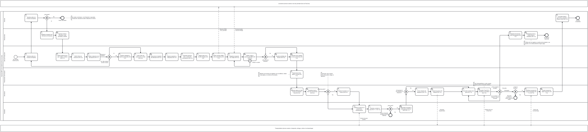
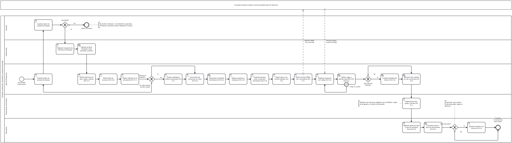
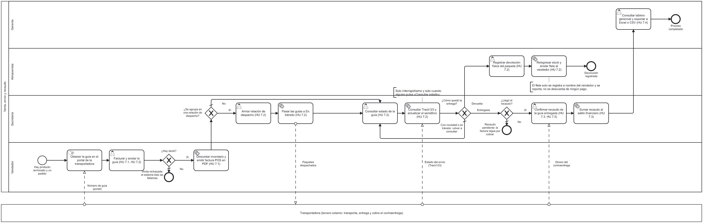

# Procesos de negocio (BPMN)

Esta página muestra el proceso de negocio que TexCore automatiza hoy (estado al Sprint 4, 28 de noviembre de 2026), desde la compra de la materia prima hasta el recaudo de la venta y los reportes del Gerente. Está modelado en **BPMN 2.0**, el estándar para dibujar procesos con piscinas y carriles: cada carril es un rol y cada flecha, el orden en que se hacen las cosas.

## Cómo leer el diagrama

| Símbolo | Significa |
|---|---|
| Círculo de borde fino | Evento de inicio: de dónde arranca el proceso. |
| Círculo de borde grueso | Evento de fin: cómo termina una rama. |
| Rectángulo redondeado con una persona | Tarea de usuario: alguien la hace en una pantalla de TexCore. |
| Rectángulo redondeado con un engranaje | Tarea de servicio: la hace el sistema solo, como consecuencia de la anterior. |
| Rectángulo redondeado con una mano | Tarea manual: la hace una persona fuera del sistema (obtener la guía en el portal de la transportadora). |
| Rombo con una X | Compuerta exclusiva: se toma una sola rama, según la respuesta a la pregunta. Cada rama lleva su etiqueta y su condición (en el `.bpmn`); la rama marcada con una raya es la **salida por defecto**, la que se toma si no se cumple ninguna condición. |
| Círculo doble con un rayo, sobre el borde de una tarea | Evento de error adjunto: la tarea falla y el proceso sigue por esa salida (el cotejo de la lavandería que no cuadra). |
| Flecha continua | Flujo de secuencia: qué sigue después. |
| Línea de puntos con corchete | Nota de texto: aclara algo que hoy es manual, está fuera de la app o tiene una regla especial. |
| Piscina y carriles | La piscina de TexCore es el proceso completo; cada carril es un rol de la empresa. |
| Piscina vacía arriba o abajo | Participante externo («piscina negra»): la **lavandería** y la **transportadora**. Lo que hacen ocurre fuera de TexCore, así que no se dibujan sus tareas, solo sus intercambios con la empresa. |
| Flecha discontinua con un círculo al inicio | Flujo de mensaje: lo que se intercambia con un tercero (las prendas y la remisión, la guía, el estado del envío, el dinero del contraentrega). Los flujos de secuencia nunca salen de la piscina de TexCore. |

## Diagrama general

Visión de conjunto, de la materia prima a la venta. Abre el [SVG](img/bpmn-proceso.svg) (vectorial, se amplía sin perder nitidez) o el [PNG](img/bpmn-proceso.png); también puedes [descargar el archivo `.bpmn`](bpmn/texcore-proceso.bpmn) y abrirlo en [bpmn.io](https://demo.bpmn.io), Camunda Modeler o Bizagi para editarlo.

## Diagramas de detalle

Los mismos pasos, partidos en dos para leerlos sin desplazarse tanto.

**Compras, producción, lavandería y producto terminado** (pasos 1 a 4): [SVG](img/bpmn-proceso-produccion.svg) · [PNG](img/bpmn-proceso-produccion.png) · [`.bpmn`](bpmn/texcore-proceso-produccion.bpmn)

**Venta, envío y recaudo** (pasos 5 a 7): [SVG](img/bpmn-proceso-venta.svg) · [PNG](img/bpmn-proceso-venta.png) · [`.bpmn`](bpmn/texcore-proceso-venta.bpmn)

## De cada paso a su historia, requerimiento y pantalla

Las historias (HU) y sus claves de Jira (TE) están en [módulos y reglas de negocio](modulos.md). Donde la documentación no consigna un requerimiento, la celda dice «—». Las compras son un módulo adicional, sin historia ni RF propios.

| Paso | Rol | Historia (Jira) | Requerimiento | Pantalla del menú |
|---|---|---|---|---|
| 1. Solicitar la orden de compra | Jefe de Producción | Compras (sin clave) | — | Compras → Órdenes de compra |
| 1. Aprobar la orden de compra | Gerente | Compras (sin clave) | — | Compras → Órdenes de compra |
| 1. Registrar la recepción de mercancía (ingresa al stock, costo promedio y kardex) | Almacenista | Compras (sin clave) | — | Compras → Recepción de mercancía; Inventario de Materias Primas → Movimientos |
| 2. Definir la referencia de jean (tallas y colores) | Jefe de Producción | HU 3.1 (TE-49) | — | Referencias de Jean → Catálogo de jeans |
| 2. Definir la ficha de consumo | Jefe de Producción | HU 3.2 (TE-50) | — | Catálogo de jeans → botón Ficha técnica |
| 2. Validar el material con la simulación | Jefe de Producción | HU 4.1 (TE-51) | — | Producción y Trazabilidad → Órdenes de producción |
| 2. Crear la orden de producción en lotes (el sistema descuenta el material) | Jefe de Producción | HU 4.2 (TE-52) | RF11, RF12 | Producción y Trazabilidad → Órdenes de producción |
| 2. Asignar operarios y máquinas | Jefe de Producción | HU 4.4 (TE-54) | RF14 | Producción y Trazabilidad → Recursos |
| 2. Controlar los tiempos por etapa | Jefe de Producción | HU 4.3 (TE-53) | RF13 | Producción y Trazabilidad → Órdenes de producción → Seguimiento |
| 2. Seguir los lotes en el monitor Kanban | Jefe de Producción | HU 4.5 (TE-55) | RF15 | Producción y Trazabilidad → Monitor de estado |
| 3. Emitir la remisión REM-LAV | Jefe de Producción | HU 5.1 (TE-57) | RF17 | Procesos Externos (Lavandería) → Remisión a Lavado |
| 3. Registrar la recepción con cotejo y liquidar pérdidas | Jefe de Producción | HU 5.2 (TE-58) | RF18 | Procesos Externos (Lavandería) → Recepción de Lavandería |
| 4. Inspeccionar el lote (aptas y marras) | Personal de Terminación | HU 6.1 (TE-59) | RF19, RF20 | Control de Calidad → Inspecciones y Defectos |
| 4. Ingresar las aptas al inventario final | Secretaria | HU 6.2 (TE-60) | RF21 | Producto Terminado → Ingreso, Existencias y Movimientos |
| 4. Ajustar el inventario con motivo (opcional) | Secretaria | HU 6.3 (TE-61) | RF22 | Producto Terminado → Ajuste manual |
| 5. Obtener la guía en el portal de la transportadora | Vendedor | Fuera del sistema | — | — |
| 5. Facturar y anotar la guía (descuenta el inventario, factura POS en PDF) | Vendedor | HU 7.1 (TE-62) y HU 7.2 (TE-63) | RF23, RF24 | Ventas y Despachos → Nueva venta y Facturas |
| 5. Armar la relación de despacho (opcional) | Secretaria (o Almacenista) | HU 7.2 (TE-63) | RF24 | Envíos → Por despachar y Relaciones de despacho |
| 5. Consultar el estado de la guía (Track123) y actualizar el semáforo | Secretaria (o Almacenista) | HU 7.2 (TE-63) | RF24 | Envíos → Guías y Panel de envíos |
| 6. Confirmar el recaudo de una guía entregada | Secretaria (o Gerente) | HU 7.3 (TE-64) y HU 7.5 (TE-173) | RF25 | Ventas y Despachos → Gestión de cartera |
| 6. Registrar la devolución física (reingresa el stock, anota el flete) | Almacenista (o Gerente) | HU 7.2 (TE-63) y HU 7.3 (TE-64) | RF24, RF25 | Envíos → Guías (detalle de la guía devuelta) |
| 7. Consultar el tablero gerencial y exportar | Gerente | HU 7.4 (TE-65) | RF26 | Reportes → Tablero gerencial |

## Excepciones modeladas

| Excepción | Dónde | Cómo termina |
|---|---|---|
| Falta material para la orden | Compuerta «¿Alcanza el material?» | Se ajusta la cantidad al máximo producible o, por defecto, se solicita una orden de compra. |
| El cotejo de la lavandería no cuadra | Evento de error «Cotejo no cuadra» sobre *Validar cotejo* | No se guarda nada y se vuelve a registrar la recepción con el conteo corregido. |
| Faltantes de la lavandería (merma o dañadas) | Compuerta «¿Hay merma o dañadas?» | Se liquidan las pérdidas al tercero y el lote vuelve a planta con las conformes. |
| Defectos en calidad | Tarea *Inspeccionar lote* (nota) | Las marras se registran con su defecto, restan de las aptas y no entran al inventario. |
| Descuadre del inventario final | Compuerta «¿Hay descuadre?» | Ajuste manual con motivo. |
| Venta sin stock | Compuerta «¿Hay stock?» | Fin «Venta rechazada»: el sistema lista las faltantes. |
| Entrega fallida o con novedad | Compuerta «¿Cómo quedó la entrega?», salida por defecto | Se vuelve a consultar el estado de la guía hasta que quede entregada o devuelta. |
| Devolución | Misma compuerta, salida «Devuelta» | Se registra la devolución física: reingresa el stock y el flete queda a nombre del vendedor (fin «Devolución registrada»). |
| Recaudo no confirmado | Compuerta «¿Llegó el recaudo?», salida por defecto | Fin «Recaudo pendiente»: la factura sigue por cobrar en la cartera. |

Ningún camino termina en un estado inconsistente: cada salida de una compuerta tiene condición o es la salida por defecto, y
`tools/bpmn/generar_bpmn.py` falla si a una compuerta le falta su salida por defecto o una condición, o si un nodo queda sin entrada o sin
salida. Los `.bpmn` pasan además `bpmnlint` con las reglas recomendadas (`tools/bpmn/.bpmnlintrc`) en la integración continua.

## Verificación: actividad → caso de uso → endpoint → prueba

Cada tarea automatizada del diagrama general (de usuario o de servicio) tiene su caso de uso, la ruta de la API que la ejecuta y la prueba
que la ejercita. La tabla sale de `apps/core/test_bpmn_trazabilidad.py`, que comprueba en cada corrida de la suite que el diagrama no tiene
tareas automatizadas sin fila, que cada ruta existe y que cada prueba existe y usa esa ruta. La tarea manual (obtener la guía en el portal)
no está en la tabla: ocurre fuera de TexCore.

| Tarea | Actividad | Caso de uso | Endpoint | Prueba |
|---|---|---|---|---|
| T1 | Solicitar orden de compra (Compras) | CU-05b | `/api/compras/ordenes/` | `apps/purchasing/test_ordenes_compra.py` |
| T2 | Aprobar orden de compra (Compras) | CU-05b | `/api/compras/ordenes/<int:pk>/aprobar/` | `apps/purchasing/test_ordenes_compra.py` |
| T3 | Registrar recepción de mercancía (Compras) | CU-05b | `/api/compras/recepciones/` | `apps/purchasing/test_recepciones.py` |
| S1 | Ingresar al stock, actualizar costo promedio y kardex | CU-05 | `/api/compras/recepciones/` | `apps/purchasing/test_recepciones.py` |
| T4 | Definir referencia de jean: tallas y colores (HU 3.1) | CU-06 | `/api/referencias/` | `apps/references/tests.py` |
| T5 | Definir ficha de consumo (HU 3.2) | CU-06 | `/api/referencias/<int:pk>/ficha/` | `apps/references/test_ficha.py` |
| T6 | Validar material con la simulación (HU 4.1) | CU-07 | `/api/produccion/simulacion/` | `apps/production/tests.py` |
| T7 | Ajustar cantidad al máximo producible (HU 4.1) | CU-07 | `/api/produccion/simulacion/` | `apps/production/tests.py` |
| T8 | Crear orden de producción en lotes (HU 4.2) | CU-08 | `/api/produccion/ordenes/` | `apps/production/test_ordenes.py` |
| S2 | Descontar el material del almacén (HU 4.2) | CU-08 | `/api/produccion/ordenes/` | `apps/production/test_ordenes.py` |
| T9 | Asignar operarios y máquinas (HU 4.4) | CU-10 | `/api/produccion/lotes/<int:pk>/asignar/` | `apps/production/test_recursos.py` |
| T10 | Controlar tiempos: corte, confección, terminación (HU 4.3) | CU-09 | `/api/produccion/lotes/<int:pk>/<str:accion>/` | `apps/production/test_tiempos.py` |
| T11 | Seguir lotes en el monitor Kanban (HU 4.5) | CU-11 | `/api/produccion/monitor/` | `apps/production/test_monitor.py` |
| T12 | Emitir remisión REM-LAV a lavandería (HU 5.1) | CU-13 | `/api/lavanderia/remisiones/` | `apps/core/test_e2e_sustentacion.py` |
| T14 | Registrar recepción con cotejo (HU 5.2) | CU-14 | `/api/lavanderia/recepciones/` | `apps/core/test_e2e_sustentacion.py` |
| S4 | Validar cotejo y asentar acta REC-LAV (HU 5.2) | CU-14 | `/api/lavanderia/recepciones/` | `apps/core/test_e2e_sustentacion.py` |
| S5 | Liquidar pérdidas del tercero (HU 5.2) | CU-14 | `/api/lavanderia/recepciones/` | `apps/core/test_e2e_sustentacion.py` |
| S6 | Devolver lote a planta con las conformes (HU 5.2) | CU-14 | `/api/lavanderia/recepciones/` | `apps/core/test_e2e_sustentacion.py` |
| T15 | Inspeccionar lote: aptas y marras (HU 6.1) | CU-15 | `/api/calidad/inspecciones/` | `apps/quality/test_calidad.py` |
| T16 | Ingresar aptas por talla y color al inventario final (HU 6.2) | CU-16 | `/api/terminado/ingresos/` | `apps/finished/test_terminado.py` |
| S8 | Actualizar stock y libro de movimientos (HU 6.2) | CU-16 | `/api/terminado/ingresos/` | `apps/finished/test_terminado.py` |
| T17 | Ajustar inventario con motivo (HU 6.3) | CU-16 | `/api/terminado/ajustes/` | `apps/finished/test_ajustes.py` |
| T19 | Facturar y anotar la guía (HU 7.1, HU 7.2) | CU-17 | `/api/ventas/facturas/` | `apps/sales/test_ventas.py` |
| S10 | Descontar inventario y emitir factura POS en PDF (HU 7.1) | CU-17 | `/api/ventas/facturas/<int:pk>/pdf/` | `apps/sales/test_ventas.py` |
| T21 | Armar relación de despacho (HU 7.2) | CU-18 | `/api/envios/relaciones/` | `apps/shipping/test_envios.py` |
| S11 | Pasar las guías a En tránsito (HU 7.2) | CU-18 | `/api/envios/relaciones/` | `apps/shipping/test_envios.py` |
| T23 | Consultar estado de la guía (HU 7.2) | CU-18 | `/api/envios/guias/<int:pk>/rastrear/` | `apps/shipping/test_rastreo.py` |
| S12 | Consultar Track123 y actualizar el semáforo (HU 7.2) | CU-18 | `/api/envios/guias/<int:pk>/rastrear/` | `apps/shipping/test_rastreo.py` |
| T24 | Confirmar recaudo de la guía entregada (HU 7.3, HU 7.5) | CU-19 | `/api/ventas/facturas/<int:pk>/conciliar/` | `apps/shipping/test_cartera_guias.py` |
| S13 | Sumar recaudo al saldo financiero (HU 7.3) | CU-19 | `/api/ventas/facturas/<int:pk>/conciliar/` | `apps/shipping/test_cartera_guias.py` |
| T27 | Registrar devolución física del paquete (HU 7.2) | CU-19 | `/api/envios/guias/<int:pk>/devolucion/` | `apps/shipping/test_cartera_guias.py` |
| S14 | Reingresar stock y anotar flete al vendedor (HU 7.2) | CU-19 | `/api/envios/guias/<int:pk>/devolucion/` | `apps/shipping/test_cartera_guias.py` |
| T25 | Consultar tablero gerencial y exportar a Excel o CSV (HU 7.4) | CU-20 | `/api/reportes/gerencial/` | `apps/reports/test_reportes.py` |

## Dónde el diagrama se aparta del encargo original

El diagrama sigue lo que el código hace hoy, y en seis puntos es más preciso que el relato de partida:

- **Orden rechazada:** el Gerente no «rechaza»; si no aprueba, Producción **cancela** la orden con un motivo. El fin se llama «Orden cancelada».
- **Cotejo de la lavandería:** si conformes + merma + dañadas no suman lo enviado, el sistema **rechaza y no guarda nada**. Las pérdidas se liquidan cuando **hay merma o dañadas** (que sí cuadran con lo enviado), no cuando no coincide.
- **Guía:** se anota en el mismo formulario de la venta; si falta, se anota después desde Envíos. No es un paso separado.
- **Estado en Track123:** lo consulta quien gestiona envíos (Secretaria o Almacenista), no el Vendedor, solo para Interrapidísimo y solo cuando se pulsa «Consultar estado».
- **Flete de la devolución:** TexCore lo **anota a nombre del vendedor y lo reporta**; no lo descuenta de ningún pago.
- **Conciliación:** desde la HU 7.5 (TE-173) la confirma quien tiene `ventas.conciliar` (Secretaria o Gerente, nunca el Vendedor de su propia venta) y solo si la guía vigente está **entregada**.

## Regenerar los diagramas

Los `.bpmn` y las imágenes son estáticos; salen de una definición en `tools/bpmn/` (ver su `README.md`). Para cambiar el proceso se edita esa definición y se vuelve a generar, o se edita el `.bpmn` directamente en bpmn.io.
